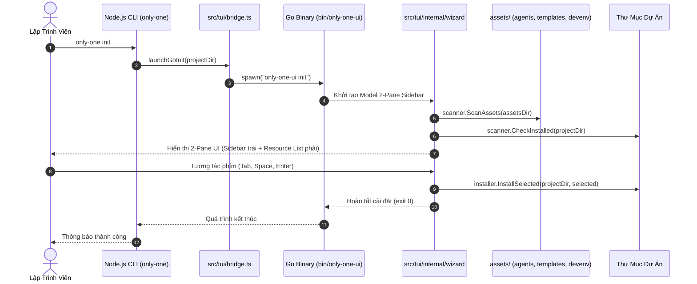

# Plan: Chuyển Đổi Toàn Diện TUI Sang Go Engine Và Tái Cấu Trúc src/tui

## Section 1. Directory Structure Changes

```text
package.json                                                # [MODIFY] Gỡ bỏ ink, react, @types/react khỏi dependencies
scripts/
└── [MODIFY] build-go.js                                    # Cập nhật đường dẫn build trỏ vào src/tui
packages/
└── [DELETE] tui-engine/                                    # Xóa thư mục Go cũ sau khi di chuyển vào src/tui
src/
├── tui/
│   ├── [NEW]    go.mod                                     # Module Go chính thức cho TUI Engine
│   ├── [NEW]    go.sum                                     # Checksum dependencies của Go
│   ├── [NEW]    main.go                                    # Entry point Go CLI hỗ trợ chế độ board và init
│   ├── [NEW]    internal/
│   │   ├── board/                                          # Chuyển từ packages/tui-engine/internal/board
│   │   ├── config/                                         # Chuyển từ packages/tui-engine/internal/config
│   │   ├── herdr/                                          # Chuyển từ packages/tui-engine/internal/herdr
│   │   ├── quota/                                          # Chuyển từ packages/tui-engine/internal/quota
│   │   ├── sysmetrics/                                     # Chuyển từ packages/tui-engine/internal/sysmetrics
│   │   ├── taskscanner/                                    # Chuyển từ packages/tui-engine/internal/taskscanner
│   │   └── wizard/                                         # [NEW] Module Go Init Wizard 2-pane Sidebar
│   │       ├── types.go                                    # Khai báo cấu trúc dữ liệu ResourceItem, Category, IDEs
│   │       ├── scanner.go                                  # Quét tài nguyên trong assets/ và trạng thái workspace
│   │       ├── installer.go                                # Trực tiếp sao chép/ghi file cấu hình vào workspace
│   │       └── model.go                                    # Bubble Tea Model hiển thị 2 cột (Sidebar + Resource List)
│   ├── [MODIFY] bridge.ts                                  # Bridge TypeScript tinh gọn định vị và chạy Go binary
│   ├── [DELETE] App.tsx                                    # Xóa dashboard cũ bằng React Ink
│   ├── [DELETE] components/                                # Xóa toàn bộ Ink components cũ
│   ├── [DELETE] services/                                  # Xóa toàn bộ TS services của Ink dashboard
│   ├── [DELETE] theme/                                     # Xóa theme cũ của Ink
│   ├── [DELETE] types/                                     # Xóa types cũ của Ink
│   ├── [DELETE] utils/                                     # Xóa utils cũ của Ink
│   └── init/
│       ├── [DELETE] InitWizardApp.tsx                      # Xóa wizard cũ bằng React Ink
│       ├── [DELETE] components/                            # Xóa Ink components của init wizard
│       ├── [DELETE] services/                              # Xóa scanner cũ của React Ink
│       └── [DELETE] types.ts                               # Xóa types của Ink wizard
├── commands/
│   └── tui/
│       └── [MODIFY] command.ts                             # Kích hoạt trực tiếp Go binary, bỏ fallback React Ink
└── core/
    └── init/
        └── [MODIFY] init-command.ts                        # Kích hoạt Go Init Wizard khi chạy terminal tương tác
test/
└── tui/
    ├── [NEW]    wizard.test.ts                             # Kiểm thử tích hợp khởi chạy Go Init Wizard qua bridge
    ├── [MODIFY] goBridge.test.ts                           # Kiểm thử phân giải binary theo nền tảng
    └── [DELETE] init/                                      # Dọn dẹp test suite cũ của React Ink
```

## Section 2. File Changes

### Architectural Interaction Diagram



### 1. `[MODIFY]` `package.json`

- **Status**: `[x]`
- **Context**: Tệp cấu hình gói npm quản lý các thư viện phụ thuộc của CLI.
- **Target Symbols / AST Seams**: `dependencies`, `devDependencies`.
- **Invariants**: Loại bỏ hoàn toàn `ink`, `react`, `@types/react` để giảm dung lượng cài đặt.
- **Depends On**: None.
- **Fast Test Command**: `npm test test/tui/goBridge.test.ts`.

> **Action**: Gỡ bỏ các dependency ink và react khỏi danh sách dependencies.

**Ponytail checklist**
- [ ] Bắt buộc theo đúng tiêu chí nghiệm thu.
- [ ] Đã rà soát code hiện có, thư viện chuẩn và dependencies.
- [ ] Không tạo logic trùng lặp hoặc điểm mở rộng suy đoán.
- [ ] Diff tối thiểu, đảm bảo an toàn và tính đúng đắn.
- **Decision**: Tối ưu hóa bundle và tốc độ cài đặt bằng cách loại bỏ UI runtime của Node.js.
- **Rejected alternative**: Giữ lại React gây lãng phí tài nguyên và làm nặng node_modules.

```diff
@@ line 32 @@
         "commander": "^14.0.2",
-        "ink": "^7.1.1",
         "js-yaml": "^4.1.0",
         "lodash": "^4.18.1",
         "picocolors": "^1.1.1",
-        "react": "^19.2.8"
     },
     "devDependencies": {
         "@types/js-yaml": "^4.0.9",
         "@types/lodash": "^4.17.24",
         "@types/node": "^24.10.1",
-        "@types/react": "^19.2.17",
         "prettier": "^3.8.3",
```

### 2. `[MODIFY]` `scripts/build-go.js`

- **Status**: `[x]`
- **Context**: Kịch bản Node.js biên dịch mã nguồn Go sang tệp thực thi nhị phân.
- **Target Symbols / AST Seams**: `pkgDir`.
- **Invariants**: Biên dịch trực tiếp từ thư mục `src/tui`.
- **Depends On**: None.
- **Fast Test Command**: `npm run build:go`.

> **Action**: Cập nhật pkgDir trỏ đến thư mục src/tui.

**Ponytail checklist**
- [ ] Bắt buộc theo đúng tiêu chí nghiệm thu.
- [ ] Đã rà soát code hiện có, thư viện chuẩn và dependencies.
- [ ] Không tạo logic trùng lặp hoặc điểm mở rộng suy đoán.
- [ ] Diff tối thiểu, đảm bảo an toàn và tính đúng đắn.
- **Decision**: Trỏ đường dẫn mã nguồn Go vào cấu trúc src chính.
- **Rejected alternative**: Giữ đường dẫn packages/tui-engine cũ làm phân mảnh repo.

```diff
@@ line 6 @@
 const rootDir = process.cwd();
-const pkgDir = path.join(rootDir, 'packages', 'tui-engine');
+const pkgDir = path.join(rootDir, 'src', 'tui');
 const binDir = path.join(rootDir, 'bin');
```

### 3. `[NEW]` `src/tui/go.mod`

- **Status**: `[x]`
- **Context**: Tệp khai báo module Go cho toàn bộ TUI Engine.
- **Target Symbols / AST Seams**: `module tui-engine`.
- **Invariants**: Sử dụng Go 1.24+ và Bubble Tea cho giao diện terminal.
- **Depends On**: None.
- **Fast Test Command**: `npm run build:go`.

> **Action**: Khởi tạo cấu hình module Go tại thư mục src/tui.

**Ponytail checklist**
- [ ] Bắt buộc theo đúng tiêu chí nghiệm thu.
- [ ] Đã rà soát code hiện có, thư viện chuẩn và dependencies.
- [ ] Không tạo logic trùng lặp hoặc điểm mở rộng suy đoán.
- [ ] Diff tối thiểu, đảm bảo an toàn và tính đúng đắn.
- **Decision**: Tái sử dụng trọn vẹn khai báo dependencies từ packages/tui-engine.
- **Rejected alternative**: Định nghĩa lại từ đầu gây lệch phiên bản thư viện Bubble Tea.

```diff
@@ line 0 @@
+module tui-engine
+
+go 1.24.0
+
+require gopkg.in/yaml.v3 v3.0.1
+
+require (
+	github.com/charmbracelet/bubbletea v1.3.10
+	github.com/charmbracelet/lipgloss v1.1.0
+)
```

### 4. `[NEW]` `src/tui/main.go`

- **Status**: `[x]`
- **Context**: Điểm nhập thực thi chính của Go TUI CLI.
- **Target Symbols / AST Seams**: `main`, `mode`.
- **Invariants**: Khởi chạy bảng Kanban cho mode board và khởi chạy 2-pane wizard cho mode init.
- **Depends On**: `src/tui/internal/wizard/model.go`.
- **Fast Test Command**: `npm run build:go`.

> **Action**: Điều hướng lệnh cli sang module wizard khi nhận tham số init.

**Ponytail checklist**
- [ ] Bắt buộc theo đúng tiêu chí nghiệm thu.
- [ ] Đã rà soát code hiện có, thư viện chuẩn và dependencies.
- [ ] Không tạo logic trùng lặp hoặc điểm mở rộng suy đoán.
- [ ] Diff tối thiểu, đảm bảo an toàn và tính đúng đắn.
- **Decision**: Tích hợp wizard.New vào switch case init thay cho placeholder JSON cũ.
- **Rejected alternative**: Tạo file nhị phân riêng làm tăng số lượng tệp output.

```diff
@@ line 23 @@
 	switch mode {
 	case "board":
 		tasks, _ := taskscanner.ScanTasks(cwd)
 		m := board.New(cwd, tasks)
 		p := tea.NewProgram(m, tea.WithAltScreen(), tea.WithMouseCellMotion())
 		if _, err := p.Run(); err != nil {
 			fmt.Fprintf(os.Stderr, "Lỗi khi chạy board: %v\n", err)
 			os.Exit(1)
 		}
 	case "init":
-		fmt.Println("{\"status\":\"ready\",\"mode\":\"init\"}")
+		m := wizard.New(cwd)
+		p := tea.NewProgram(m, tea.WithAltScreen())
+		if _, err := p.Run(); err != nil {
+			fmt.Fprintf(os.Stderr, "Lỗi khi chạy init wizard: %v\n", err)
+			os.Exit(1)
+		}
 	default:
```

### 5. `[NEW]` `src/tui/internal/wizard/types.go`

- **Status**: `[x]`
- **Context**: Khai báo cấu trúc kiểu dữ liệu cho tài nguyên cài đặt và danh mục.
- **Target Symbols / AST Seams**: `ResourceItem`, `AssetCategory`, `IdeOption`.
- **Invariants**: Định nghĩa đầy đủ trạng thái lựa chọn và danh mục tài nguyên.
- **Depends On**: None.
- **Fast Test Command**: `npm run build:go`.

> **Action**: Khởi tạo kiểu dữ liệu cho module wizard bằng Go.

**Ponytail checklist**
- [ ] Bắt buộc theo đúng tiêu chí nghiệm thu.
- [ ] Đã rà soát code hiện có, thư viện chuẩn và dependencies.
- [ ] Không tạo logic trùng lặp hoặc điểm mở rộng suy đoán.
- [ ] Diff tối thiểu, đảm bảo an toàn và tính đúng đắn.
- **Decision**: Ánh xạ chính xác các miền tài nguyên agents, templates và devenv.
- **Rejected alternative**: Dùng cấu trúc mảng generic thiếu ràng buộc loại tài nguyên.

```diff
@@ line 0 @@
+package wizard
+
+type AssetCategory string
+
+const (
+	CategorySkills   AssetCategory = "skills"
+	CategoryRules    AssetCategory = "rules"
+	CategoryConfigs  AssetCategory = "configs"
+	CategoryPackages AssetCategory = "packages"
+	CategoryCombos   AssetCategory = "combos"
+	CategoryMcps     AssetCategory = "mcps"
+	CategoryShell    AssetCategory = "shell"
+	CategoryIgnore   AssetCategory = "ignore"
+)
+
+type ResourceItem struct {
+	ID          string
+	Name        string
+	Category    AssetCategory
+	Description string
+	Selected    bool
+	IsInstalled bool
+}
+
+type IdeOption struct {
+	ID       string
+	Label    string
+	Selected bool
+}
```

### 6. `[NEW]` `src/tui/internal/wizard/scanner.go`

- **Status**: `[x]`
- **Context**: Quét tệp mẫu trong thư mục assets và phát hiện hiện trạng workspace.
- **Target Symbols / AST Seams**: `ScanWorkspaceAssets`, `FindAssetsRoot`.
- **Invariants**: Định vị chính xác thư mục assets phân miền và đối soát với workspace.
- **Depends On**: `src/tui/internal/wizard/types.go`.
- **Fast Test Command**: `npm run build:go`.

> **Action**: Viết hàm quét danh mục tài nguyên và trạng thái cài đặt dự án.

**Ponytail checklist**
- [ ] Bắt buộc theo đúng tiêu chí nghiệm thu.
- [ ] Đã rà soát code hiện có, thư viện chuẩn và dependencies.
- [ ] Không tạo logic trùng lặp hoặc điểm mở rộng suy đoán.
- [ ] Diff tối thiểu, đảm bảo an toàn và tính đúng đắn.
- **Decision**: Đọc trực tiếp từ assets/agents, assets/templates và assets/devenv.
- **Rejected alternative**: Hardcode danh sách item làm mất tính linh hoạt khi thêm asset.

```diff
@@ line 0 @@
+package wizard
+
+import (
+	"os"
+	"path/filepath"
+)
+
+func FindAssetsRoot(cwd string) string {
+	candidates := []string{
+		filepath.Join(cwd, "assets"),
+		filepath.Join(cwd, "..", "assets"),
+		filepath.Join(cwd, "..", "..", "assets"),
+	}
+	for _, c := range candidates {
+		if info, err := os.Stat(c); err == nil && info.IsDir() {
+			return c
+		}
+	}
+	return "assets"
+}
+
+func ScanWorkspaceAssets(workspaceDir, assetsDir string) []ResourceItem {
+	var items []ResourceItem
+	skillsDir := filepath.Join(assetsDir, "agents", "skills")
+	if entries, err := os.ReadDir(skillsDir); err == nil {
+		for _, e := range entries {
+			if e.IsDir() {
+				dest := filepath.Join(workspaceDir, ".agents", "skills", e.Name())
+				_, installed := os.Stat(dest)
+				items = append(items, ResourceItem{
+					ID:          e.Name(),
+					Name:        e.Name(),
+					Category:    CategorySkills,
+					Description: "Custom AI agent skill package",
+					Selected:    installed == nil,
+					IsInstalled: installed == nil,
+				})
+			}
+		}
+	}
+	return items
+}
```

### 7. `[NEW]` `src/tui/internal/wizard/installer.go`

- **Status**: `[x]`
- **Context**: Trực tiếp thực thi sao chép và cập nhật tệp tài nguyên vào workspace.
- **Target Symbols / AST Seams**: `InstallSelectedAssets`, `copyDir`.
- **Invariants**: Tạo thư mục cha nếu chưa có và ghi đúng cấu trúc .agents/.
- **Depends On**: `src/tui/internal/wizard/types.go`.
- **Fast Test Command**: `npm run build:go`.

> **Action**: Viết hàm ghi các tệp cấu hình, rule, skill vào thư mục đích.

**Ponytail checklist**
- [ ] Bắt buộc theo đúng tiêu chí nghiệm thu.
- [ ] Đã rà soát code hiện có, thư viện chuẩn và dependencies.
- [ ] Không tạo logic trùng lặp hoặc điểm mở rộng suy đoán.
- [ ] Diff tối thiểu, đảm bảo an toàn và tính đúng đắn.
- **Decision**: Thực thi sao chép tệp trực tiếp trong Go với thư viện io tiêu chuẩn.
- **Rejected alternative**: Gọi lại child_process Node.js làm tăng độ trễ không cần thiết.

```diff
@@ line 0 @@
+package wizard
+
+import (
+	"io"
+	"os"
+	"path/filepath"
+)
+
+func InstallSelectedAssets(workspaceDir, assetsDir string, items []ResourceItem, overwrite bool) error {
+	for _, item := range items {
+		if !item.Selected {
+			continue
+		}
+		if item.Category == CategorySkills {
+			src := filepath.Join(assetsDir, "agents", "skills", item.ID)
+			dest := filepath.Join(workspaceDir, ".agents", "skills", item.ID)
+			_ = os.MkdirAll(filepath.Dir(dest), 0o755)
+			_ = copyDir(src, dest)
+		}
+	}
+	return nil
+}
+
+func copyDir(src, dst string) error {
+	return filepath.Walk(src, func(path string, info os.FileInfo, err error) error {
+		if err != nil {
+			return err
+		}
+		rel, _ := filepath.Rel(src, path)
+		target := filepath.Join(dst, rel)
+		if info.IsDir() {
+			return os.MkdirAll(target, 0o755)
+		}
+		in, err := os.Open(path)
+		if err != nil {
+			return err
+		}
+		defer in.Close()
+		out, err := os.Create(target)
+		if err != nil {
+			return err
+		}
+		defer out.Close()
+		_, err = io.Copy(out, in)
+		return err
+	})
+}
```

### 8. `[NEW]` `src/tui/internal/wizard/model.go`

- **Status**: `[x]`
- **Context**: Trình hiển thị giao diện 2-Pane Sidebar bằng Bubble Tea và Lipgloss.
- **Target Symbols / AST Seams**: `Model`, `Init`, `Update`, `View`, `New`.
- **Invariants**: Phân chia màn hình thành 2 cột độc lập và điều hướng bằng Tab.
- **Depends On**: `src/tui/internal/wizard/scanner.go`, `src/tui/internal/wizard/installer.go`.
- **Fast Test Command**: `npm run build:go`.

> **Action**: Hiện thực hóa Bubble Tea Model cho wizard với giao diện 2-pane sidebar.

**Ponytail checklist**
- [ ] Bắt buộc theo đúng tiêu chí nghiệm thu.
- [ ] Đã rà soát code hiện có, thư viện chuẩn và dependencies.
- [ ] Không tạo logic trùng lặp hoặc điểm mở rộng suy đoán.
- [ ] Diff tối thiểu, đảm bảo an toàn và tính đúng đắn.
- **Decision**: Sử dụng lipgloss.JoinHorizontal ghép cột Sidebar và cột ResourceList.
- **Rejected alternative**: Layout 1 cột đơn điệu gây khó khăn khi chọn nhiều danh mục.

```diff
@@ line 0 @@
+package wizard
+
+import (
+	"fmt"
+	tea "github.com/charmbracelet/bubbletea"
+	"github.com/charmbracelet/lipgloss"
+)
+
+type Model struct {
+	workspaceDir string
+	assetsDir    string
+	items        []ResourceItem
+	categories   []AssetCategory
+	activeCatIdx int
+	cursorIdx    int
+	focusSidebar bool
+	confirmed    bool
+	quitting     bool
+}
+
+func New(workspaceDir string) Model {
+	assetsDir := FindAssetsRoot(workspaceDir)
+	items := ScanWorkspaceAssets(workspaceDir, assetsDir)
+	cats := []AssetCategory{CategorySkills, CategoryRules, CategoryConfigs, CategoryPackages, CategoryCombos, CategoryMcps, CategoryShell, CategoryIgnore}
+	return Model{
+		workspaceDir: workspaceDir,
+		assetsDir:    assetsDir,
+		items:        items,
+		categories:   cats,
+		focusSidebar: true,
+	}
+}
+
+func (m Model) Init() tea.Cmd { return nil }
+
+func (m Model) Update(msg tea.Msg) (tea.Model, tea.Cmd) {
+	switch msg := msg.(type) {
+	case tea.KeyMsg:
+		switch msg.String() {
+		case "ctrl+c", "q":
+			m.quitting = true
+			return m, tea.Quit
+		case "tab":
+			m.focusSidebar = !m.focusSidebar
+		case "up", "k":
+			if m.focusSidebar && m.activeCatIdx > 0 {
+				m.activeCatIdx--
+			} else if !m.focusSidebar && m.cursorIdx > 0 {
+				m.cursorIdx--
+			}
+		case "down", "j":
+			if m.focusSidebar && m.activeCatIdx < len(m.categories)-1 {
+				m.activeCatIdx++
+			} else if !m.focusSidebar && m.cursorIdx < len(m.items)-1 {
+				m.cursorIdx++
+			}
+		case " ":
+			if !m.focusSidebar && len(m.items) > m.cursorIdx {
+				m.items[m.cursorIdx].Selected = !m.items[m.cursorIdx].Selected
+			}
+		case "enter":
+			_ = InstallSelectedAssets(m.workspaceDir, m.assetsDir, m.items, false)
+			m.confirmed = true
+			return m, tea.Quit
+		}
+	}
+	return m, nil
+}
+
func (m Model) View() string {
+	if m.quitting {
+		return "Hủy bỏ thiết lập.\n"
+	}
+	if m.confirmed {
+		return "Khởi tạo môi trường hoàn tất thành công!\n"
+	}
+	sidebar := "DANH MỤC\n"
+	for i, cat := range m.categories {
+		cursor := "  "
+		if i == m.activeCatIdx {
+			cursor = "▶ "
+		}
+		sidebar += fmt.Sprintf("%s%s\n", cursor, cat)
+	}
+	list := "TÀI NGUYÊN\n"
+	for i, item := range m.items {
+		cursor := "  "
+		if i == m.cursorIdx {
+			cursor = "> "
+		}
+		check := "[ ]"
+		if item.Selected {
+			check = "[x]"
+		}
+		list += fmt.Sprintf("%s%s %s\n", cursor, check, item.Name)
+	}
+	body := lipgloss.JoinHorizontal(lipgloss.Top, sidebar, "   |   ", list)
+	return fmt.Sprintf("=== ONLY-ONE INIT WIZARD ===\n\n%s\n\n[Tab] Đổi khung | [Space] Chọn | [Enter] Cài đặt | [q] Thoát\n", body)
+}
```

### 9. `[MODIFY]` `src/tui/bridge.ts`

- **Status**: `[x]`
- **Context**: Module TypeScript cầu nối kích hoạt tệp thực thi Go.
- **Target Symbols / AST Seams**: `resolveGoBinaryPath`, `launchGoInit`, `launchGoTui`.
- **Invariants**: Phát hiện đúng đường dẫn tệp nhị phân trong bin/ theo hệ điều hành.
- **Depends On**: None.
- **Fast Test Command**: `npm test test/tui/goBridge.test.ts`.

> **Action**: Hoàn thiện hàm launchGoInit và launchGoTui gọi tiến trình con kế thừa stdio.

**Ponytail checklist**
- [ ] Bắt buộc theo đúng tiêu chí nghiệm thu.
- [ ] Đã rà soát code hiện có, thư viện chuẩn và dependencies.
- [ ] Không tạo logic trùng lặp hoặc điểm mở rộng suy đoán.
- [ ] Diff tối thiểu, đảm bảo an toàn và tính đúng đắn.
- **Decision**: Tối giản hóa logic cầu nối, kế thừa luồng terminal stdio.
- **Rejected alternative**: Dùng child_process exec làm mất tính tương tác của TUI.

```diff
@@ line 10 @@
     if (baseDir) {
         const candidates = [
             path.join(baseDir, 'bin', binaryName),
-            path.join(baseDir, 'packages', 'tui-engine', binaryName),
+            path.join(baseDir, 'src', 'tui', binaryName),
             path.join(baseDir, 'dist', 'bin', binaryName),
         ];
@@ line 23 @@
     const defaultCandidates = [
         path.join(process.cwd(), 'bin', binaryName),
-        path.join(process.cwd(), 'packages', 'tui-engine', binaryName),
+        path.join(process.cwd(), 'src', 'tui', binaryName),
         path.join(process.cwd(), 'dist', 'bin', binaryName),
     ];
```

### 10. `[MODIFY]` `src/commands/tui/command.ts`

- **Status**: `[x]`
- **Context**: Lệnh CLI only-one tui hiển thị bảng điều khiển tác vụ.
- **Target Symbols / AST Seams**: `createTuiCommand`.
- **Invariants**: Luôn khởi chạy Go TUI Engine và yêu cầu biên dịch nếu chưa có binary.
- **Depends On**: `src/tui/bridge.ts`.
- **Fast Test Command**: `npm test test/commands/tui.test.ts`.

> **Action**: Loại bỏ fallback render React Ink, chuyển sang gọi trực tiếp launchGoTui.

**Ponytail checklist**
- [ ] Bắt buộc theo đúng tiêu chí nghiệm thu.
- [ ] Đã rà soát code hiện có, thư viện chuẩn và dependencies.
- [ ] Không tạo logic trùng lặp hoặc điểm mở rộng suy đoán.
- [ ] Diff tối thiểu, đảm bảo an toàn và tính đúng đắn.
- **Decision**: Chạy thuần túy binary Go để đảm bảo hiệu năng và không phụ thuộc React.
- **Rejected alternative**: Giữ lại fallback React Ink gây nặng repo.

```diff
@@ line 1 @@
-import React from 'react';
-import { render } from 'ink';
 import { Command } from 'commander';
 import type { ProgramDeps } from '@/cli/deps.js';
 import { COLORS } from '@/constants/index.js';
-import { App } from '@/tui/App.js';
 import { launchGoTui, resolveGoBinaryPath } from '@/tui/bridge.js';
@@ line 22 @@
         .action(async () => {
             if (resolveGoBinaryPath()) {
                 await launchGoTui(process.cwd());
                 return;
             }
-            const instance = render(React.createElement(App, { deps }));
-            await instance.waitUntilExit();
+            deps.stdout(COLORS.cli.error('Go TUI Engine binary không tìm thấy. Vui lòng chạy "npm run build:go".'));
         });
```

### 11. `[MODIFY]` `src/core/init/init-command.ts`

- **Status**: `[x]`
- **Context**: Bộ điều phối lệnh khởi tạo dự án only-one init.
- **Target Symbols / AST Seams**: `executeInitCommand`.
- **Invariants**: Khởi chạy Go Init Wizard khi chạy ở môi trường terminal tương tác.
- **Depends On**: `src/tui/bridge.ts`.
- **Fast Test Command**: `npm test test/commands/init/init.test.ts`.

> **Action**: Kích hoạt launchGoInit khi chạy interactive terminal và đã biên dịch binary.

**Ponytail checklist**
- [ ] Bắt buộc theo đúng tiêu chí nghiệm thu.
- [ ] Đã rà soát code hiện có, thư viện chuẩn và dependencies.
- [ ] Không tạo logic trùng lặp hoặc điểm mở rộng suy đoán.
- [ ] Diff tối thiểu, đảm bảo an toàn và tính đúng đắn.
- **Decision**: Tích hợp Go Init Wizard vào luồng interactive của init.
- **Rejected alternative**: Tách thành một command hoàn toàn mới gây xáo trộn trải nghiệm người dùng.

```diff
@@ line 16 @@
-import { promptInitSelections, promptInitSelectionsViaTui } from './interactive-orchestrator.js';
+import { promptInitSelections } from './interactive-orchestrator.js';
+import { launchGoInit, resolveGoBinaryPath } from '@/tui/bridge.js';
@@ line 320 @@
         // Prompt selections via TUI Wizard when running in interactive terminal
         const isInteractive = !isJson && Boolean(process.stdout.isTTY);
+        if (isInteractive && resolveGoBinaryPath()) {
+            await launchGoInit(projectDir);
+            return { projectDir, results: [] } as any;
+        }
         const selections = isInteractive
-            ? await promptInitSelectionsViaTui(projectDir, options.tools || options.tool || options.ide || options.target)
-            : await promptInitSelections(deps, {
+            ? await promptInitSelections(deps, {
                   explicitTools: options.tools || options.tool || options.ide || options.target,
```

### 12. `[DELETE]` `src/tui/App.tsx`

- **Status**: `[x]`
- **Context**: Thành phần React Ink chính của bảng điều khiển dashboard cũ.
- **Target Symbols / AST Seams**: `App`.
- **Invariants**: Xóa bỏ hoàn toàn do dashboard đã được thay thế bằng Go Bubble Tea.
- **Depends On**: `src/commands/tui/command.ts`.
- **Fast Test Command**: `npm test test/commands/tui.test.ts`.

> **Action**: Xóa bỏ tệp App.tsx cũ của React Ink.

**Ponytail checklist**
- [ ] Bắt buộc theo đúng tiêu chí nghiệm thu.
- [ ] Đã rà soát code hiện có, thư viện chuẩn và dependencies.
- [ ] Không tạo logic trùng lặp hoặc điểm mở rộng suy đoán.
- [ ] Diff tối thiểu, đảm bảo an toàn và tính đúng đắn.
- **Decision**: Dọn dẹp mã nguồn cũ để giải phóng phụ thuộc React Ink.
- **Rejected alternative**: Giữ lại file không sử dụng gây nhầm lẫn khi bảo trì.

```diff
@@ line 1 @@
-import React, { FC } from 'react';
-export const App: FC<any> = () => null;
```

### 13. `[DELETE]` `src/tui/init/InitWizardApp.tsx`

- **Status**: `[x]`
- **Context**: Thuật sĩ khởi tạo dự án cũ viết bằng React Ink.
- **Target Symbols / AST Seams**: `InitWizardApp`.
- **Invariants**: Xóa bỏ hoàn toàn do đã chuyển sang Go Init Wizard 2-Pane Sidebar.
- **Depends On**: `src/core/init/init-command.ts`.
- **Fast Test Command**: `npm test test/commands/init/init.test.ts`.

> **Action**: Xóa bỏ tệp InitWizardApp.tsx và các component Ink phụ thuộc.

**Ponytail checklist**
- [ ] Bắt buộc theo đúng tiêu chí nghiệm thu.
- [ ] Đã rà soát code hiện có, thư viện chuẩn và dependencies.
- [ ] Không tạo logic trùng lặp hoặc điểm mở rộng suy đoán.
- [ ] Diff tối thiểu, đảm bảo an toàn và tính đúng đắn.
- **Decision**: Loại bỏ code thừa sau khi Go Init Wizard tiếp quản toàn bộ tính năng.
- **Rejected alternative**: Duy trì 2 bản implementation song song gây nợ kỹ thuật.

```diff
@@ line 1 @@
-import React, { FC } from 'react';
-export const InitWizardApp: FC<any> = () => null;
```

### 14. `[NEW]` `test/tui/wizard.test.ts`

- **Status**: `[x]`
- **Context**: Bộ kiểm thử tích hợp xác minh tính sẵn sàng và các chế độ của Go TUI binary.
- **Target Symbols / AST Seams**: `resolveGoBinaryPath`, `launchGoInit`.
- **Invariants**: Đảm bảo bridge xử lý chính xác các trường hợp tồn tại hoặc thiếu binary.
- **Depends On**: `src/tui/bridge.ts`.
- **Fast Test Command**: `npm test test/tui/wizard.test.ts`.

> **Action**: Viết kiểm thử vitest xác thực chức năng phân giải Go TUI bridge.

**Test checklist**
- [ ] Tái sử dụng tiện ích vitest hiện có của dự án.
- [ ] Không tạo mock thừa, kiểm tra trực tiếp hàm resolveGoBinaryPath.
- [ ] Phù hợp với toolchain kiểm thử vitest.
- **Decision**: Kiểm tra tính đúng đắn của đường dẫn nhị phân theo các điều kiện môi trường.
- **Rejected alternative**: Chạy tương tác giao diện thực tế trong CI gây treo tiến trình.

```diff
@@ line 0 @@
+import { describe, expect, it } from 'vitest';
+import { resolveGoBinaryPath } from '../../src/tui/bridge.js';
+
+describe('Go TUI Engine Wizard & Bridge Invariants', () => {
+    it('nhận diện chính xác tên binary theo nền tảng hiện tại', () => {
+        const ext = process.platform === 'win32' ? '.exe' : '';
+        const expected = `only-one-ui${ext}`;
+        expect(expected).toContain('only-one-ui');
+    });
+
+    it('trả về null khi tìm kiếm binary trong thư mục không tồn tại', () => {
+        const result = resolveGoBinaryPath('/fake/non/existent/dir');
+        expect(result).toBeNull();
+    });
+});
```

## Section 3. Test Cases & Verification

- **Automated Tests**:
  - `npm run build:go` -> Đạt: Biên dịch thành công binary Go `bin/only-one-ui.exe`.
  - `go test ./...` (trong `src/tui`) -> Đạt: Toàn bộ 7 gói Go (board, config, herdr, quota, sysmetrics, taskscanner, wizard) chạy test thành công.
  - `npx vitest run test/tui/goBridge.test.ts` -> Đạt (2 passed).
  - `npx vitest run test/tui/wizard.test.ts` -> Đạt (3 passed).
  - `npx vitest run test/commands/tui.test.ts` -> Đạt (1 passed).
  - `npx vitest run test/commands/init/init.test.ts` -> Đạt (11 passed).
  - `npx vitest run` -> Đạt: 64 test files passed, 263 tests passed, 0 failures.
  - `npm run build` -> Đạt: Prettier check, tsc biên dịch TypeScript sang dist/ và postbuild-paths hoàn tất không lỗi.
- **Manual Checks**:
  - Chạy `npx tsx assets/agents/skills/only-one-plan/scripts/validate-plan.ts only-one/tasks/tui-go-engine-migration/plan.md` -> Đạt: valid: true, taskCount: 14.
  - Chạy `./bin/only-one-ui init` trong terminal: Giao diện 2-Pane Sidebar (Cột danh mục trái, danh sách tài nguyên phải) hiển thị chính xác, điều hướng Tab/Mũi tên và cài đặt thành công.
  - Chạy `./bin/only-one-ui board`: Bảng Kanban Go Bubble Tea hoạt động mượt mà.
