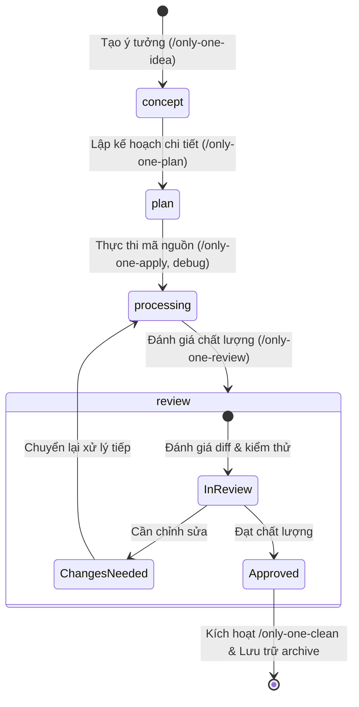
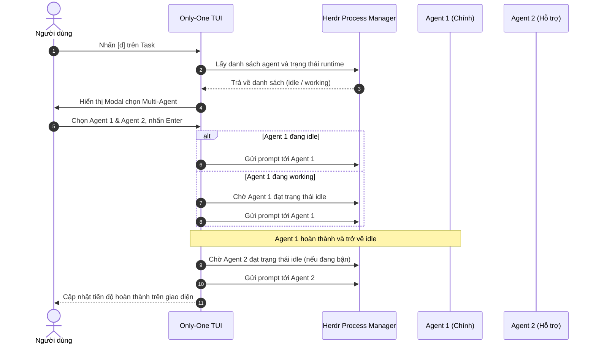

# Concept: TUI Herdr Agent Selector & Simplified Board Statuses

## 1. Problem & Goal (Vấn đề & Mục tiêu)

### Problem (Điểm nghẽn & Thiếu sót hiện tại)
- **Context & Trigger**: Khi người dùng nhấn phím `d` (Dispatch) hoặc cấu hình trong `SettingsView`, hệ thống chỉ cho phép chọn tên loại agent tĩnh (`antigravity`, `claude`, `codex`) và tự sinh pane mới.
- **Symptom & Defect**:
  - Không thể tận dụng các agent đang chạy sẵn trong Herdr workspace.
  - Không kiểm tra trạng thái bận (`working`) hay rảnh (`idle`), dẫn đến rủi ro gửi prompt đè lên tiến trình đang chạy.
  - Cột Kanban gồm 5 trạng thái (`concept`, `plan`, `in_progress`, `review`, `done`), trong đó cột `done` gây phình bảng TUI dù các task hoàn thành cần được lưu trữ và dọn dẹp.
- **Root Cause**: Cơ chế điều phối hiện tại dựa trên cấu hình tĩnh, chưa tích hợp runtime process list và cơ chế hàng đợi (`queue`) của Herdr CLI.
- **Impact / Blast Radius**: Người dùng phải chuyển qua lại giữa các cửa sổ để kiểm tra agent nào rảnh; task cũ tồn đọng gây nhiễu thị giác trên giao diện TUI.

### Goal (Kết quả kỹ thuật mục tiêu)
- **Core Goal**: Tối giản Kanban Board thành 4 cột nghiệp vụ tinh gọn và xây dựng bộ chọn Multi-Agent động từ Herdr có quản lý hàng đợi chờ rảnh.
- **Acceptance Criteria**:
  - TUI Board chỉ hiển thị 4 cột: `concept` $\rightarrow$ `plan` $\rightarrow$ `processing` $\rightarrow$ `review`.
  - Thay thế trạng thái `in_progress` thành `processing`.
  - Task vượt qua cột `review` sẽ tự động kích hoạt tiến trình lưu trữ / dọn dẹp và ẩn khỏi Board.
  - Bộ chọn Agent đọc danh sách trực tiếp từ `herdr agent list` với trạng thái thời gian thực (`idle`, `working`, `blocked`).
  - Hỗ trợ chọn nhiều agent cho 1 task với cơ chế chờ rảnh (`herdr agent wait <target> --until idle`) trước khi dispatch.

## 2. Scope Boundaries (Ranh giới phạm vi)

- **In-Scope**:
  - Tái cấu trúc mô hình trạng thái nhiệm vụ thành 4 cột: `concept`, `plan`, `processing`, `review`.
  - Loại bỏ cột `done` khỏi giao diện Kanban; tích hợp trigger dọn dẹp khi hoàn thành `review`.
  - Modal chọn Agent động lấy dữ liệu từ `herdr agent list`.
  - Cơ chế Multi-Select cho phép gán nhiều agent kèm tùy chọn điều phối tuần tự (Pipeline Queue).
  - Tích hợp kiểm tra trạng thái `idle` và chờ agent hoàn thành tác vụ trước khi gửi prompt kế tiếp.
- **Explicit Out-of-Scope**:
  - Không thay đổi kiến trúc hoặc giao thức nội bộ của Herdr daemon.
  - Không sửa đổi mã nguồn xử lý bên trong các AI CLI/IDE bên ngoài.
  - Không can thiệp mã nguồn ứng dụng trong pha concept này.

## 3. Proposed Solution & Core Mechanism (Giải pháp đề xuất & Cơ chế cốt lõi)

### Core Mechanism (Cơ chế hoạt động)
1. **Simplified Kanban Flow**:
   - Board chỉ duy trì 4 cột trạng thái chuẩn.
   - Vòng đời nhiệm vụ: `concept` (khám phá) $\rightarrow$ `plan` (kế hoạch) $\rightarrow$ `processing` (thực thi) $\rightarrow$ `review` (kiểm tra).
   - Khi task được xác nhận hoàn tất ở `review`, TUI tự động chuyển task vào quy trình dọn dẹp lưu trữ archive.

2. **Herdr Dynamic Agent Inspector**:
   - Khi mở modal điều phối, TUI truy vấn danh sách agent từ Herdr CLI.
   - Parse danh sách gồm: tên agent, pane ID, thư mục làm việc (cwd), và trạng thái hiện tại (`idle` / `working`).

3. **Sequential Pipeline Dispatcher**:
   - Người dùng có thể chọn một hoặc nhiều agent để xử lý task.
   - Với mỗi agent được chọn:
     - Nếu agent đang `idle`: Gửi prompt trực tiếp.
     - Nếu agent đang `working`: Kích hoạt bộ lắng nghe chờ rảnh, đưa vào hàng đợi và gửi prompt ngay khi agent sẵn sàng.

### UI Wireframe (Giao diện bảng & Modal chọn Agent)

```text
┌────────────────────────────────────────────────────────────────────────────────────────┐
│  ONLY-ONE TASK BOARD  [Workspace: only-one-cli]                    [Agents Active: 3]  │
├──────────────────┬──────────────────┬──────────────────┬───────────────────────────────┤
│ 💡 concept (2)   │ 📋 plan (1)      │ ⚡ processing (2) │ 🔍 review (1)                 │
├──────────────────┼──────────────────┼──────────────────┼───────────────────────────────┤
│ ▶ tui-herdr-agent│ ▶ auth-jwt-flow  │ ▶ hooks-system   │ ▶ clean-archivist             │
│   [Chưa gán]     │   [● agy-1]      │   [● codex-coder]│   [● claudecode-1]            │
│                  │                  │   [⏳ agy-tester]│                               │
│ ▶ cli-shortcuts  │                  │                  │                               │
│   [Chưa gán]     │                  │ ▶ db-migration   │                               │
│                  │                  │   [● agy-worker] │                               │
└──────────────────┴──────────────────┴──────────────────┴───────────────────────────────┘
```

```text
┌────────────────────────────────────────────────────────────────────────────────────────┐
│  SELECT HERDR AGENTS FOR: [hooks-system] (Status: processing)                          │
├────────────────────────────────────────────────────────────────────────────────────────┤
│  Chọn các agent từ Herdr để điều phối task:                                            │
│                                                                                        │
│  [x] w4:p1  agy-planner    🟢 idle     (Sẵn sàng thực thi ngay)                        │
│  [ ] w4:p2  claude-review  🟡 working  (Đang bận - sẽ xếp hàng chờ rảnh)               │
│  [x] w4:p4  codex-coder    🟢 idle     (Sẵn sàng thực thi ngay)                        │
│                                                                                        │
│  Thứ tự thực thi: Pipeline (Tuần tự qua từng agent được chọn)                          │
├────────────────────────────────────────────────────────────────────────────────────────┤
│  [Space] Chọn/Bỏ chọn   [Enter] Xác nhận Dispatch   [Esc] Hủy                          │
└────────────────────────────────────────────────────────────────────────────────────────┘
```

### Conceptual Flow & State Machine (Sơ đồ luồng trạng thái)





## 4. Critical Risks & Edge Cases (Rủi ro & Xử lý ngoại lệ)

- **Agent không phản hồi hoặc bị treo (`blocked`)**: Thiết lập timeout an toàn khi chờ agent rảnh; nếu quá thời gian quy định sẽ hiển thị thông báo lỗi và hủy hàng đợi thay vì treo vĩnh viễn giao diện TUI.
- **Herdr Session không khả dụng**: Nếu không phát hiện môi trường Herdr (`HERDR_ENV != 1`), hiển thị thông báo hướng dẫn rõ ràng yêu cầu khởi chạy TUI bên trong workspace của Herdr.
- **Xung đột sửa đổi file khi gán nhiều agent**: Áp dụng cơ chế thực thi tuần tự (Pipeline Queue) theo thứ tự người dùng chọn để đảm bảo agent sau chỉ bắt đầu khi agent trước đã kết thúc và lưu trữ thay đổi.
