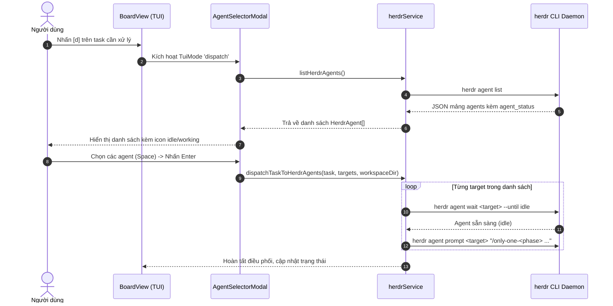

# Plan: TUI Herdr Agent Selector & Simplified Board Statuses

## Section 1. Directory Structure Changes

```text
src/tui/
├── [MODIFY] types/task.ts                  # TaskStatus 4 cột, HerdrAgent type, TuiMode dispatch
├── [MODIFY] services/herdrService.ts       # listHerdrAgents, waitHerdrAgent, dispatchTaskToHerdrAgents
├── [MODIFY] services/taskScanner.ts        # 4 LIFECYCLE_COLUMNS, mapper status processing
├── [MODIFY] components/Header.tsx          # Cập nhật iconMap cho processing, bỏ done
├── [MODIFY] components/BoardView.tsx       # Cập nhật COLUMN_ICONS, cardIndices cho 4 cột
├── [NEW]    components/AgentSelectorModal.tsx # Modal chọn Multi-Agent từ Herdr với trạng thái idle/working
├── [MODIFY] components/Footer.tsx          # Bổ sung phím tắt điều hướng cho mode dispatch
└── [MODIFY] App.tsx                        # Tích hợp AgentSelectorModal và luồng multi-dispatch
test/tui/
├── [MODIFY] taskScanner.test.ts            # Kiểm thử gom nhóm 4 cột Kanban chính quy
└── [MODIFY] herdrService.test.ts          # Kiểm thử phân tích agent list và wait agent idle
```

## Section 2. File Changes

### Architectural Interaction Diagram



---

### 1. `[MODIFY]` `src/tui/types/task.ts`

- **Status**: `[ ]`
- **Context**: Định nghĩa kiểu trạng thái nhiệm vụ cũ đang chứa 5 cột và chưa hỗ trợ HerdrAgent.
- **Target Symbols / AST Seams**: `TaskStatus`, `HerdrAgent`, `TuiMode`.
- **Invariants**: Chỉ giữ đúng 4 trạng thái Kanban: concept, plan, processing, review.
- **Depends On**: None.
- **Fast Test Command**: `npx vitest run test/tui/taskScanner.test.ts`.

> **Action**: Cập nhật TaskStatus thành 4 cột, khai báo HerdrAgent và mở rộng TuiMode cho dispatch.

**Ponytail checklist**
- [ ] Bắt buộc theo đúng tiêu chí nghiệm thu.
- [ ] Đã rà soát code hiện có, thư viện chuẩn và dependencies.
- [ ] Không tạo logic trùng lặp hoặc điểm mở rộng suy đoán.
- [ ] Diff tối thiểu, đảm bảo an toàn và tính đúng đắn.
- **Decision**: Tái sử dụng các kiểu dữ liệu hiện hữu và bổ sung interface HerdrAgent chính xác theo schema Herdr.
- **Rejected alternative**: Giữ nguyên in_progress và thêm cờ boolean phụ gây lệch chuẩn với concept.

```diff
@@ -1,3 +1,12 @@
-export type TaskStatus = 'concept' | 'plan' | 'in_progress' | 'review' | 'done';
+export type TaskStatus = 'concept' | 'plan' | 'processing' | 'review';
+
+export interface HerdrAgent {
+    agent: string;
+    agent_status: 'idle' | 'working' | 'blocked' | 'done' | 'unknown' | string;
+    pane_id: string;
+    workspace_id?: string;
+    cwd?: string;
+    focused?: boolean;
+}
 
 export interface TaskDoc {
@@ -24,3 +33,3 @@
 
-export type TuiMode = 'board' | 'viewer' | 'confirm' | 'settings';
+export type TuiMode = 'board' | 'viewer' | 'confirm' | 'settings' | 'dispatch';
 
```

---

### 2. `[MODIFY]` `src/tui/services/herdrService.ts`

- **Status**: `[ ]`
- **Context**: Dịch vụ Herdr hiện chỉ điều phối tĩnh dựa trên cấu hình mở pane mới.
- **Target Symbols / AST Seams**: `listHerdrAgents`, `waitHerdrAgent`, `dispatchTaskToHerdrAgents`.
- **Invariants**: Đảm bảo gọi wait agent idle trước khi gửi prompt; không làm treo tiến trình.
- **Depends On**: `1`.
- **Fast Test Command**: `npx vitest run test/tui/herdrService.test.ts`.

> **Action**: Bổ sung hàm lấy danh sách agent, chờ agent rảnh và gửi prompt tuần tự.

**Ponytail checklist**
- [ ] Bắt buộc theo đúng tiêu chí nghiệm thu.
- [ ] Đã rà soát code hiện có, thư viện chuẩn và dependencies.
- [ ] Không tạo logic trùng lặp hoặc điểm mở rộng suy đoán.
- [ ] Diff tối thiểu, đảm bảo an toàn và tính đúng đắn.
- **Decision**: Tận dụng lệnh herdr agent list và herdr agent wait chuẩn của Herdr CLI.
- **Rejected alternative**: Tự viết vòng lặp kiểm tra terminal output thủ công gây tốn tài nguyên.

```diff
@@ -3,2 +3,3 @@
 import type { OnlyOneGlobalConfig } from '../types/config.js';
-import type { TaskModel, TaskStatus } from '../types/task.js';
+import type { HerdrAgent, TaskModel, TaskStatus } from '../types/task.js';
 
@@ -27,3 +28,4 @@
 ): HerdrDispatchPlan {
-    const routingKey = (phase === 'in_progress' ? 'debug' : phase) as keyof OnlyOneGlobalConfig['agentRouting'];
+    const routingKey = (phase === 'processing' ? 'apply' : phase) as keyof OnlyOneGlobalConfig['agentRouting'];
     const targetAgent = config.agentRouting[routingKey] || 'antigravity';
@@ -39,3 +41,3 @@
         agentStartCommand: `herdr agent start ${agentName} --kind ${targetAgent}`,
-        agentPromptCommand: `herdr agent prompt ${agentName} "/only-one-${phase === 'concept' ? 'idea' : phase} only-one/tasks/${task.slug}"`,
+        agentPromptCommand: `herdr agent prompt ${agentName} "/only-one-${phase === 'concept' ? 'idea' : phase === 'processing' ? 'apply' : phase} only-one/tasks/${task.slug}"`,
         targetAgent,
@@ -157,1 +159,71 @@
 }
+
+export async function listHerdrAgents(): Promise<HerdrAgent[]> {
+    if (!isHerdrSessionActive()) return [];
+    return new Promise((resolve) => {
+        exec('herdr agent list', (err, stdout) => {
+            if (err) {
+                resolve([]);
+                return;
+            }
+            try {
+                const data = JSON.parse(stdout);
+                const agents: HerdrAgent[] = data?.result?.agents || [];
+                resolve(agents);
+            } catch {
+                resolve([]);
+            }
+        });
+    });
+}
+
+export async function waitHerdrAgent(target: string, timeoutMs: number = 60000): Promise<boolean> {
+    if (!isHerdrSessionActive()) return false;
+    return new Promise((resolve) => {
+        exec(`herdr agent wait ${target} --until idle --timeout ${timeoutMs}`, (err) => {
+            resolve(!err);
+        });
+    });
+}
+
+export async function dispatchTaskToHerdrAgents(
+    task: TaskModel,
+    targets: string[],
+    workspaceDir: string,
+    onProgress?: (msg: string) => void,
+): Promise<HerdrDispatchResult> {
+    if (!isHerdrSessionActive()) {
+        return { success: false, message: 'Herdr session không hoạt động (HERDR_ENV != 1).' };
+    }
+    if (targets.length === 0) {
+        return { success: false, message: 'Chưa chọn agent nào để điều phối.' };
+    }
+
+    const phaseCmd = task.status === 'concept' ? 'idea' : task.status === 'processing' ? 'apply' : task.status;
+    const promptText = `/only-one-${phaseCmd} only-one/tasks/${task.slug}`;
+
+    for (let i = 0; i < targets.length; i++) {
+        const target = targets[i];
+        onProgress?.(`[${i + 1}/${targets.length}] Đang kiểm tra trạng thái agent ${target}...`);
+        const ready = await waitHerdrAgent(target, 45000);
+        if (!ready) {
+            return {
+                success: false,
+                message: `Agent ${target} không thể chuyển sang trạng thái rảnh (timeout).`,
+            };
+        }
+        onProgress?.(`[${i + 1}/${targets.length}] Gửi lệnh tới agent ${target}...`);
+        const promptSuccess = await new Promise<boolean>((resolve) => {
+            exec(`herdr agent prompt ${target} "${promptText}"`, (err) => {
+                resolve(!err);
+            });
+        });
+        if (!promptSuccess) {
+            return { success: false, message: `Lỗi khi gửi prompt tới agent ${target}.` };
+        }
+    }
+
+    return {
+        success: true,
+        message: `Đã điều phối thành công task ${task.slug} tới ${targets.length} agent.`,
+    };
+}
```

---

### 3. `[MODIFY]` `src/tui/services/taskScanner.ts`

- **Status**: `[ ]`
- **Context**: Bảng cột hiện quét 5 trạng thái với in_progress và done.
- **Target Symbols / AST Seams**: `LIFECYCLE_COLUMNS`, `scanTasks`.
- **Invariants**: Chỉ tạo 4 cột Kanban; gom các trạng thái đang thực thi vào processing.
- **Depends On**: `1`.
- **Fast Test Command**: `npx vitest run test/tui/taskScanner.test.ts`.

> **Action**: Điều chỉnh LIFECYCLE_COLUMNS thành 4 cột và chuẩn hóa ánh xạ trạng thái sang processing.

**Ponytail checklist**
- [ ] Bắt buộc theo đúng tiêu chí nghiệm thu.
- [ ] Đã rà soát code hiện có, thư viện chuẩn và dependencies.
- [ ] Không tạo logic trùng lặp hoặc điểm mở rộng suy đoán.
- [ ] Diff tối thiểu, đảm bảo an toàn và tính đúng đắn.
- **Decision**: Giữ nguyên logic đọc frontmatter và điều chỉnh danh sách cột gọn gàng.
- **Rejected alternative**: Thêm cột ẩn gây phức tạp cho việc tính toán card index.

```diff
@@ -8,4 +8,3 @@
     { id: 'concept', title: 'CONCEPT', color: 'cyan' },
     { id: 'plan', title: 'PLAN', color: 'blue' },
-    { id: 'in_progress', title: 'IN-PROGRESS', color: 'yellow' },
+    { id: 'processing', title: 'PROCESSING', color: 'yellow' },
     { id: 'review', title: 'REVIEW', color: 'magenta' },
-    { id: 'done', title: 'DONE', color: 'green' },
 ];
@@ -60,4 +59,3 @@
                     if (s === 'plan' || s === 'planned') status = 'plan';
-                    else if (s === 'in_progress' || s === 'in-progress' || s === 'debug') status = 'in_progress';
+                    else if (s === 'processing' || s === 'in_progress' || s === 'in-progress' || s === 'debug' || s === 'apply') status = 'processing';
                     else if (s === 'review') status = 'review';
-                    else if (s === 'done' || s === 'completed' || s === 'fixed' || s === 'resolved') status = 'done';
                     else status = 'concept';
@@ -66,2 +64,2 @@
                     if (docs.some((d) => d.name === 'review.md')) status = 'review';
-                    else if (docs.some((d) => d.name === 'debug.md')) status = 'in_progress';
+                    else if (docs.some((d) => d.name === 'debug.md')) status = 'processing';
```

---

### 4. `[MODIFY]` `src/tui/components/Header.tsx`

- **Status**: `[ ]`
- **Context**: Header hiển thị icon cho 5 cột cũ gồm in_progress và done.
- **Target Symbols / AST Seams**: `iconMap`.
- **Invariants**: Chỉ hiển thị đúng 4 biểu tượng tương ứng với 4 cột trạng thái mới.
- **Depends On**: `1`.
- **Fast Test Command**: `npm run build`.

> **Action**: Cập nhật iconMap thay in_progress bằng processing và loại bỏ done.

**Ponytail checklist**
- [ ] Bắt buộc theo đúng tiêu chí nghiệm thu.
- [ ] Đã rà soát code hiện có, thư viện chuẩn và dependencies.
- [ ] Không tạo logic trùng lặp hoặc điểm mở rộng suy đoán.
- [ ] Diff tối thiểu, đảm bảo an toàn và tính đúng đắn.
- **Decision**: Sửa trực tiếp mapping biểu tượng trong Header.
- **Rejected alternative**: Tạo hàm helper ngoài chỉ để trả về 4 icon.

```diff
@@ -16,3 +16,2 @@
         plan: '📋',
-        in_progress: '⚡',
+        processing: '⚡',
         review: '🔍',
-        done: '✅',
     };
```

---

### 5. `[MODIFY]` `src/tui/components/BoardView.tsx`

- **Status**: `[ ]`
- **Context**: BoardView cấu hình COLUMN_ICONS và cardIndices cho 5 cột.
- **Target Symbols / AST Seams**: `COLUMN_ICONS`, `cardIndices`.
- **Invariants**: cardIndices chỉ khởi tạo cho 4 cột (0 đến 3).
- **Depends On**: `1`, `4`.
- **Fast Test Command**: `npm run build`.

> **Action**: Cập nhật COLUMN_ICONS và rút gọn cardIndices còn 4 cột.

**Ponytail checklist**
- [ ] Bắt buộc theo đúng tiêu chí nghiệm thu.
- [ ] Đã rà soát code hiện có, thư viện chuẩn và dependencies.
- [ ] Không tạo logic trùng lặp hoặc điểm mở rộng suy đoán.
- [ ] Diff tối thiểu, đảm bảo an toàn và tính đúng đắn.
- **Decision**: Đồng bộ cấu trúc cột và index theo đúng 4 trạng thái nghiệp vụ.
- **Rejected alternative**: Giữ nguyên index 4 gây lỗi truy cập mảng rỗng.

```diff
@@ -20,3 +20,2 @@
     plan: '📋',
-    in_progress: '⚡',
+    processing: '⚡',
     review: '🔍',
-    done: '✅',
 };
@@ -37,3 +36,3 @@
     const [colIndex, setColIndex] = useState(0);
-    const [cardIndices, setCardIndices] = useState<Record<number, number>>({ 0: 0, 1: 0, 2: 0, 3: 0, 4: 0 });
+    const [cardIndices, setCardIndices] = useState<Record<number, number>>({ 0: 0, 1: 0, 2: 0, 3: 0 });
     const [grabbedTask, setGrabbedTask] = useState<TaskModel | null>(null);
```

---

### 6. `[NEW]` `src/tui/components/AgentSelectorModal.tsx`

- **Status**: `[ ]`
- **Context**: Chưa có modal cho phép chọn và gán nhiều agent từ Herdr runtime.
- **Target Symbols / AST Seams**: `AgentSelectorModal`.
- **Invariants**: Cho phép multi-select bằng Space, xác nhận bằng Enter và hủy bằng Escape.
- **Depends On**: `1`, `2`.
- **Fast Test Command**: `npm run build`.

> **Action**: Tạo mới component AgentSelectorModal để hiển thị và chọn các Herdr agent đang chạy.

**Ponytail checklist**
- [ ] Bắt buộc theo đúng tiêu chí nghiệm thu.
- [ ] Đã rà soát code hiện có, thư viện chuẩn và dependencies.
- [ ] Không tạo logic trùng lặp hoặc điểm mở rộng suy đoán.
- [ ] Diff tối thiểu, đảm bảo an toàn và tính đúng đắn.
- **Decision**: Sử dụng Ink hooks tiêu chuẩn để quản lý trạng thái chọn đa nhiệm.
- **Rejected alternative**: Đưa bộ chọn vào SettingsView gây mất ngữ cảnh nhiệm vụ đang chọn.

```diff
@@ -0,0 +1,95 @@
+import { Box, Text, useInput } from 'ink';
+import React, { FC, useEffect, useState } from 'react';
+import { listHerdrAgents } from '../services/herdrService.js';
+import type { HerdrAgent, TaskModel } from '../types/task.js';
+
+interface AgentSelectorModalProps {
+    task: TaskModel;
+    onConfirm: (selectedTargets: string[]) => void;
+    onCancel: () => void;
+}
+
+export const AgentSelectorModal: FC<AgentSelectorModalProps> = ({ task, onConfirm, onCancel }) => {
+    const [agents, setAgents] = useState<HerdrAgent[]>([]);
+    const [loading, setLoading] = useState<boolean>(true);
+    const [focusIndex, setFocusIndex] = useState<number>(0);
+    const [selectedTargets, setSelectedTargets] = useState<Set<string>>(new Set());
+
+    useEffect(() => {
+        listHerdrAgents().then((list) => {
+            setAgents(list);
+            setLoading(false);
+        });
+    }, []);
+
+    useInput((input, key) => {
+        if (key.escape) {
+            onCancel();
+            return;
+        }
+
+        if (key.upArrow && agents.length > 0) {
+            setFocusIndex((prev) => Math.max(0, prev - 1));
+            return;
+        }
+
+        if (key.downArrow && agents.length > 0) {
+            setFocusIndex((prev) => Math.min(agents.length - 1, prev + 1));
+            return;
+        }
+
+        if (input === ' ' && agents[focusIndex]) {
+            const target = agents[focusIndex].pane_id || agents[focusIndex].agent;
+            setSelectedTargets((prev) => {
+                const next = new Set(prev);
+                if (next.has(target)) next.delete(target);
+                else next.add(target);
+                return next;
+            });
+            return;
+        }
+
+        if (key.return) {
+            if (selectedTargets.size > 0) {
+                onConfirm(Array.from(selectedTargets));
+            } else if (agents[focusIndex]) {
+                const target = agents[focusIndex].pane_id || agents[focusIndex].agent;
+                onConfirm([target]);
+            }
+        }
+    });
+
+    return (
+        <Box flexDirection="column" borderStyle="double" borderColor="cyan" padding={1} marginY={1}>
+            <Box marginBottom={1} justifyContent="space-between">
+                <Text bold color="cyan">
+                    🤖 CHỌN AGENT TỪ HERDR CHO: <Text color="yellow">{task.slug}</Text> ({task.status})
+                </Text>
+                <Text dimColor>Đã chọn: {selectedTargets.size} agent(s)</Text>
+            </Box>
+
+            {loading ? (
+                <Text color="yellow">Đang tải danh sách agent từ Herdr...</Text>
+            ) : agents.length === 0 ? (
+                <Text color="red">Không tìm thấy agent nào đang chạy trong Herdr. Hãy khởi động agent qua herdr pane split.</Text>
+            ) : (
+                agents.map((agent, idx) => {
+                    const target = agent.pane_id || agent.agent;
+                    const isChecked = selectedTargets.has(target);
+                    const isFocused = idx === focusIndex;
+                    const isIdle = agent.agent_status === 'idle';
+                    const statusBadge = isIdle ? '🟢 idle (rảnh)' : '🟡 working (đang bận - sẽ xếp hàng)';
+
+                    return (
+                        <Box key={target} paddingLeft={1} backgroundColor={isFocused ? 'gray' : undefined}>
+                            <Text color={isFocused ? 'black' : isChecked ? 'green' : 'white'} bold={isChecked}>
+                                [{isChecked ? 'x' : ' '}] {agent.pane_id} ({agent.agent}) - {statusBadge}
+                            </Text>
+                        </Box>
+                    );
+                })
+            )}
+        </Box>
+    );
+};
```

---

### 7. `[MODIFY]` `src/tui/components/Footer.tsx`

- **Status**: `[ ]`
- **Context**: Footer chưa có hướng dẫn phím tắt cho chế độ dispatch modal.
- **Target Symbols / AST Seams**: `getHints`.
- **Invariants**: Hiển thị hướng dẫn phím Space và Enter khi mode là dispatch.
- **Depends On**: `1`.
- **Fast Test Command**: `npm run build`.

> **Action**: Bổ sung nhánh hiển thị phím tắt cho TuiMode dispatch trong Footer.

**Ponytail checklist**
- [ ] Bắt buộc theo đúng tiêu chí nghiệm thu.
- [ ] Đã rà soát code hiện có, thư viện chuẩn và dependencies.
- [ ] Không tạo logic trùng lặp hoặc điểm mở rộng suy đoán.
- [ ] Diff tối thiểu, đảm bảo an toàn và tính đúng đắn.
- **Decision**: Tận dụng hàm getHints hiện có để hiển thị phím điều hướng phù hợp.
- **Rejected alternative**: Tạo component Footer riêng biệt cho modal.

```diff
@@ -17,2 +17,5 @@
         }
+        if (mode === 'dispatch') {
+            return ['[↑/↓] Di chuyển', '[Space] Chọn/Bỏ chọn', '[Enter] Dispatch', '[Esc] Hủy'];
+        }
         if (isMoving) {
```

---

### 8. `[MODIFY]` `src/tui/App.tsx`

- **Status**: `[ ]`
- **Context**: App hiện tại gọi dispatch ngay khi bấm d thay vì mở modal chọn agent.
- **Target Symbols / AST Seams**: `handleDispatch`, `handleConfirmAgentDispatch`.
- **Invariants**: Mở AgentSelectorModal khi bấm d; dispatch tuần tự các agent đã chọn.
- **Depends On**: `1`, `2`, `5`, `6`, `7`.
- **Fast Test Command**: `npm run build`.

> **Action**: Tích hợp AgentSelectorModal và luồng xác nhận dispatch đa agent vào App.

**Ponytail checklist**
- [ ] Bắt buộc theo đúng tiêu chí nghiệm thu.
- [ ] Đã rà soát code hiện có, thư viện chuẩn và dependencies.
- [ ] Không tạo logic trùng lặp hoặc điểm mở rộng suy đoán.
- [ ] Diff tối thiểu, đảm bảo an toàn và tính đúng đắn.
- **Decision**: Quản lý dispatchTask ở state của App và chuyển đổi chế độ giao diện mượt mà.
- **Rejected alternative**: Bật popup tiến trình bên ngoài TUI.

```diff
@@ -5,2 +5,3 @@
 import { BoardView } from './components/BoardView.js';
+import { AgentSelectorModal } from './components/AgentSelectorModal.js';
 import { Footer } from './components/Footer.js';
@@ -9,3 +10,3 @@
 import { loadGlobalConfig, saveGlobalConfig } from './services/configService.js';
-import { dispatchCleanViaHerdr, dispatchTaskViaHerdr } from './services/herdrService.js';
+import { dispatchCleanViaHerdr, dispatchTaskToHerdrAgents } from './services/herdrService.js';
 import { groupTasksByColumn, scanTasks, updateTaskStatus } from './services/taskScanner.js';
@@ -21,2 +22,3 @@
     const [selectedTask, setSelectedTask] = useState<TaskModel | null>(null);
+    const [dispatchingTask, setDispatchingTask] = useState<TaskModel | null>(null);
     const [confirmAction, setConfirmAction] = useState<ConfirmActionState | null>(null);
@@ -74,4 +76,17 @@
 
-    const handleDispatch = async (task: TaskModel) => {
-        setStatusMessage(`Đang điều phối ${task.slug} qua Herdr...`);
-        const res = await dispatchTaskViaHerdr(task, task.status, globalConfig, workspaceDir);
+    const handleOpenDispatch = (task: TaskModel) => {
+        setDispatchingTask(task);
+        setMode('dispatch');
+    };
+
+    const handleConfirmAgentDispatch = async (selectedTargets: string[]) => {
+        if (!dispatchingTask) return;
+        const targetTask = dispatchingTask;
+        setMode('board');
+        setDispatchingTask(null);
+        setStatusMessage(`Bắt đầu điều phối ${targetTask.slug} tới ${selectedTargets.length} agent...`);
+        const res = await dispatchTaskToHerdrAgents(targetTask, selectedTargets, workspaceDir, (progressMsg) => {
+            setStatusMessage(progressMsg);
+        });
         setStatusMessage(res.message);
     };
@@ -103,2 +118,8 @@
                 <SettingsView
+                    initialConfig={globalConfig}
+                    onSave={(newCfg) => {
+                        setGlobalConfig(newCfg);
+                        saveGlobalConfig(newCfg);
+                    }}
+                    onClose={() => setMode('board')}
+                />
+            ) : mode === 'dispatch' && dispatchingTask ? (
+                <AgentSelectorModal
+                    task={dispatchingTask}
+                    onConfirm={handleConfirmAgentDispatch}
+                    onCancel={() => {
+                        setDispatchingTask(null);
+                        setMode('board');
+                    }}
+                />
             ) : mode === 'viewer' && selectedTask ? (
@@ -118,3 +139,3 @@
                     onCleanNow={handleCleanNow}
-                    onDispatchTask={handleDispatch}
+                    onDispatchTask={handleOpenDispatch}
                     onQuit={exit}
```

---

### 9. `[MODIFY]` `test/tui/taskScanner.test.ts`

- **Status**: `[ ]`
- **Context**: Bộ kiểm thử cũ đang kiểm tra gom nhóm vào đúng 5 cột.
- **Target Symbols / AST Seams**: `groupTasksByColumn test`.
- **Invariants**: Khẳng định đúng 4 cột chính quy và kiểm tra ánh xạ processing.
- **Depends On**: `3`.
- **Fast Test Command**: `npx vitest run test/tui/taskScanner.test.ts`.

> **Action**: Cập nhật bài kiểm thử gom nhóm cột cho 4 trạng thái nhiệm vụ mới.

**Test checklist**
- [ ] Bắt buộc theo đúng tiêu chí nghiệm thu.
- [ ] Đã rà soát code hiện có, fixture và dependencies.
- [ ] Không tạo test trùng lặp hoặc phụ thuộc thời gian thực.
- [ ] Kiểm thử tối thiểu, rõ ràng và chạy nhanh.
- **Decision**: Thay đổi assertion từ 5 cột về 4 cột và bổ sung kiểm tra cột processing.
- **Rejected alternative**: Bỏ qua test cột Kanban.

```diff
@@ -20,13 +20,13 @@
 
-    it('groups task array into exactly 5 canonical columns', () => {
+    it('groups task array into exactly 4 canonical columns', () => {
         const mockTasks: TaskModel[] = [
             { slug: 't1', folderPath: '/t1', status: 'concept', title: 'T1', docs: [], activeDocIndex: 0 },
             { slug: 't2', folderPath: '/t2', status: 'plan', title: 'T2', docs: [], activeDocIndex: 0 },
-            { slug: 't3', folderPath: '/t3', status: 'done', title: 'T3', docs: [], activeDocIndex: 0 },
-            { slug: 't4', folderPath: '/t4', status: 'done', title: 'T4', docs: [], activeDocIndex: 0 },
+            { slug: 't3', folderPath: '/t3', status: 'processing', title: 'T3', docs: [], activeDocIndex: 0 },
+            { slug: 't4', folderPath: '/t4', status: 'review', title: 'T4', docs: [], activeDocIndex: 0 },
         ];
         const columns = groupTasksByColumn(mockTasks);
-        expect(columns.length).toBe(5);
+        expect(columns.length).toBe(4);
         expect(columns.find((c) => c.id === 'concept')?.tasks.length).toBe(1);
         expect(columns.find((c) => c.id === 'plan')?.tasks.length).toBe(1);
-        expect(columns.find((c) => c.id === 'done')?.tasks.length).toBe(2);
-        expect(columns.find((c) => c.id === 'in_progress')?.tasks.length).toBe(0);
+        expect(columns.find((c) => c.id === 'processing')?.tasks.length).toBe(1);
+        expect(columns.find((c) => c.id === 'review')?.tasks.length).toBe(1);
     });
```

---

### 10. `[MODIFY]` `test/tui/herdrService.test.ts`

- **Status**: `[ ]`
- **Context**: Bộ kiểm thử HerdrService chưa có ca kiểm thử cho listHerdrAgents và waitHerdrAgent.
- **Target Symbols / AST Seams**: `listHerdrAgents`, `waitHerdrAgent`.
- **Invariants**: Kiểm tra fallback an toàn khi môi trường không có HERDR_ENV.
- **Depends On**: `2`.
- **Fast Test Command**: `npx vitest run test/tui/herdrService.test.ts`.

> **Action**: Bổ sung các ca kiểm thử cho danh sách Herdr agent và điều phối tuần tự.

**Test checklist**
- [ ] Bắt buộc theo đúng tiêu chí nghiệm thu.
- [ ] Đã rà soát code hiện có, fixture và dependencies.
- [ ] Không tạo test trùng lặp hoặc phụ thuộc thời gian thực.
- [ ] Kiểm thử tối thiểu, rõ ràng và chạy nhanh.
- **Decision**: Kiểm tra hành vi fallback an toàn khi không ở trong Herdr session.
- **Rejected alternative**: Gọi trực tiếp CLI Herdr thật trong unit test.

```diff
@@ -2,3 +2,3 @@
 import { describe, expect, it } from 'vitest';
-import { buildHerdrCleanDispatchPlan, buildHerdrDispatchPlan, isHerdrSessionActive } from '@/tui/services/herdrService.js';
+import { buildHerdrCleanDispatchPlan, buildHerdrDispatchPlan, isHerdrSessionActive, listHerdrAgents, waitHerdrAgent } from '@/tui/services/herdrService.js';
 import { DEFAULT_GLOBAL_CONFIG } from '@/tui/types/config.js';
@@ -40,3 +40,11 @@
     });
+
+    it('trả về mảng rỗng cho listHerdrAgents khi không trong Herdr session', async () => {
+        const agents = await listHerdrAgents();
+        expect(Array.isArray(agents)).toBe(true);
+    });
+
+    it('trả về false cho waitHerdrAgent khi không trong Herdr session', async () => {
+        const res = await waitHerdrAgent('mock-target', 100);
+        expect(typeof res).toBe('boolean');
+    });
 });
```

## Section 3. Test Cases & Verification

- **Automated Tests**:
  - `npx vitest run test/tui/taskScanner.test.ts`
  - `npx vitest run test/tui/herdrService.test.ts`
  - `npm run build`
  - `npm test`
- **Manual Checks**:
  - Khởi chạy `only-one tui` trong Herdr workspace có các pane agent đang chạy.
  - Kiểm tra giao diện Kanban chỉ hiển thị 4 cột: `💡 concept`, `📋 plan`, `⚡ processing`, `🔍 review`.
  - Chọn một task và nhấn phím `d` $\rightarrow$ Xác nhận modal chọn agent mở ra với danh sách các agent đang có.
  - Dùng phím `Space` để toggle chọn 2 agent, nhấn `Enter` $\rightarrow$ Xác nhận hệ thống kiểm tra trạng thái idle và điều phối tuần tự qua từng agent.
  - Nhấn `Esc` để hủy modal và quay lại Board an toàn.
