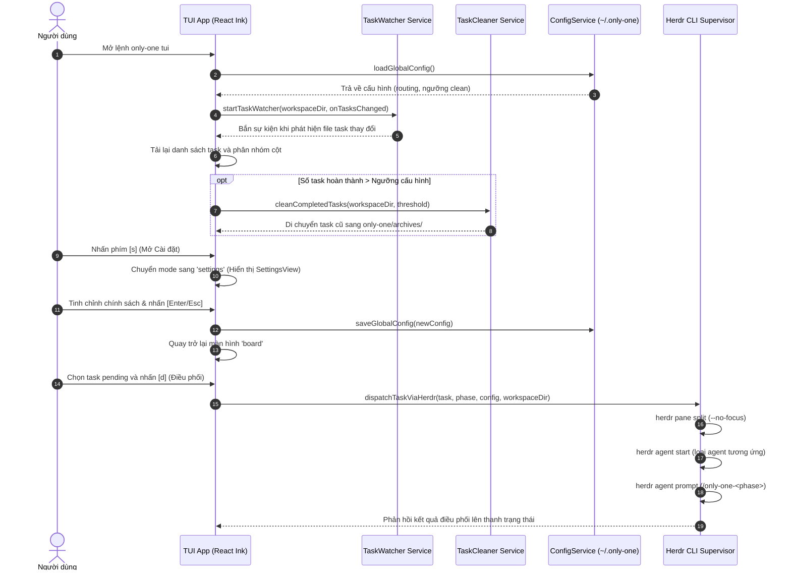

# Kế hoạch Triển khai: TUI Realtime Task Watcher & Bộ Điều Phối Herdr Agent

## Section 1. Directory Structure Changes

```text
src/tui/
├── types/
│   ├── [NEW]    config.ts              # Định nghĩa schema và kiểu dữ liệu cấu hình global
│   └── [MODIFY] task.ts                # Bổ sung chế độ 'settings' và trạng thái kết nối Herdr
├── services/
│   ├── [NEW]    configService.ts       # Dịch vụ đọc/ghi file cấu hình global (~/.only-one/config.json)
│   ├── [NEW]    taskWatcher.ts         # Theo dõi realtime thư mục only-one/tasks/ với cơ chế debounce
│   ├── [NEW]    herdrService.ts        # Kiểm tra session Herdr, chia pane và khởi chạy agent prompt
│   └── [NEW]    taskCleaner.ts         # Dịch vụ tự động lưu trữ task đã xong sang only-one/archives/ khi vượt ngưỡng
├── components/
│   ├── [NEW]    SettingsView.tsx       # Màn hình cấu hình tương tác trực tiếp trên TUI
│   ├── [MODIFY] Header.tsx             # Thêm badge hiển thị trạng thái kết nối Herdr
│   ├── [MODIFY] Footer.tsx             # Bổ sung phím tắt Cài đặt [s], Điều phối [d], Dọn dẹp [c]
│   └── [MODIFY] BoardView.tsx          # Xử lý sự kiện bàn phím cho dispatch [d], settings [s], clean [c]
└── [MODIFY] App.tsx                    # Kết nối task watcher, điều hướng settings và kích hoạt auto-clean

test/tui/
├── [NEW] configService.test.ts         # Kiểm thử khởi tạo mặc định, đọc và lưu file cấu hình global
├── [NEW] taskCleaner.test.ts           # Kiểm thử kiểm tra ngưỡng số lượng task và di chuyển thư mục archive
└── [NEW] herdrService.test.ts          # Kiểm thử nhận diện session Herdr và sinh tham số lệnh CLI
```

---

## Section 2. File Changes

### Architectural Interaction Diagram (Biểu đồ tương tác kiến trúc)



---

### 1. `[NEW]` `src/tui/types/config.ts`

- **Status**: `[x]`
- **Context**: Hệ thống cần hợp đồng kiểu dữ liệu cho cấu hình global và định tuyến agent.
- **Target Symbols / AST Seams**: `OnlyOneGlobalConfig`, `CleanPolicy`, `AgentRoutingConfig`, `HerdrConfig`.
- **Invariants**: Phải đảm bảo tính hợp lệ của cấu trúc và cung cấp giá trị mặc định an toàn.
- **Depends On**: None.
- **Fast Test Command**: `npx vitest run test/tui/configService.test.ts`.

> **Action**: Định nghĩa các interface TypeScript và giá trị mặc định cho cấu hình TUI toàn cục.

**Ponytail checklist**
- [x] Bắt buộc theo đúng tiêu chí nghiệm thu.
- [x] Đã rà soát code hiện có, thư viện chuẩn và các dependency đã cài đặt.
- [x] Không tạo logic trùng lặp hoặc điểm mở rộng suy đoán.
- [x] Diff tối thiểu, đảm bảo an toàn và tính đúng đắn.
- **Decision**: Định nghĩa kiểu dữ liệu thuần và đối tượng cấu hình mặc định trong file types riêng biệt.
- **Rejected alternative**: Lưu trữ cấu hình tự do không qua định kiểu bên trong state của React.

```diff
@@ line 1 @@
+export interface CleanPolicy {
+    enabled: boolean;
+    trigger: 'threshold' | 'immediate';
+    thresholdCount: number;
+}
+
+export interface AgentRoutingConfig {
+    concept: string;
+    plan: string;
+    apply: string;
+    debug: string;
+    review: string;
+}
+
+export interface HerdrConfig {
+    splitDirection: 'right' | 'down';
+    focusOnSpawn: boolean;
+}
+
+export interface OnlyOneGlobalConfig {
+    schemaVersion: number;
+    cleanPolicy: CleanPolicy;
+    agentRouting: AgentRoutingConfig;
+    herdr: HerdrConfig;
+}
+
+export const DEFAULT_GLOBAL_CONFIG: OnlyOneGlobalConfig = {
+    schemaVersion: 1,
+    cleanPolicy: {
+        enabled: true,
+        trigger: 'threshold',
+        thresholdCount: 5,
+    },
+    agentRouting: {
+        concept: 'antigravity',
+        plan: 'antigravity',
+        apply: 'codex',
+        debug: 'claudecode',
+        review: 'claudecode',
+    },
+    herdr: {
+        splitDirection: 'right',
+        focusOnSpawn: false,
+    },
+};
```

---

### 2. `[MODIFY]` `src/tui/types/task.ts`

- **Status**: `[x]`
- **Context**: Kiểu enum `TuiMode` hiện chỉ hỗ trợ các trạng thái board, viewer và confirm.
- **Target Symbols / AST Seams**: `TuiMode`.
- **Invariants**: Giữ nguyên các mode hiện có, không làm ảnh hưởng luồng điều hướng cũ.
- **Depends On**: `src/tui/types/config.ts`.
- **Fast Test Command**: `npx vitest run test/tui/taskScanner.test.ts`.

> **Action**: Bổ sung mode `settings` vào union type `TuiMode`.

**Ponytail checklist**
- [x] Bắt buộc theo đúng tiêu chí nghiệm thu.
- [x] Đã rà soát code hiện có, thư viện chuẩn và các dependency đã cài đặt.
- [x] Không tạo logic trùng lặp hoặc điểm mở rộng suy đoán.
- [x] Diff tối thiểu, đảm bảo an toàn và tính đúng đắn.
- **Decision**: Mở rộng union `TuiMode` để hỗ trợ hiển thị màn hình Cài đặt.
- **Rejected alternative**: Sử dụng biến cờ boolean modal riêng trong state component App.

```diff
@@ line 26 @@
-export type TuiMode = 'board' | 'viewer' | 'confirm';
+export type TuiMode = 'board' | 'viewer' | 'confirm' | 'settings';
```

---

### 3. `[NEW]` `src/tui/services/configService.ts`

- **Status**: `[x]`
- **Context**: Cấu hình người dùng cần được lưu trữ bền vững tại file `~/.only-one/config.json`.
- **Target Symbols / AST Seams**: `loadGlobalConfig`, `saveGlobalConfig`, `getGlobalConfigPath`.
- **Invariants**: Phải tự động khởi tạo file với giá trị mặc định nếu file chưa tồn tại trên ổ cứng.
- **Depends On**: `src/tui/types/config.ts`.
- **Fast Test Command**: `npx vitest run test/tui/configService.test.ts`.

> **Action**: Triển khai các hàm đọc và ghi file JSON cấu hình toàn cục.

**Ponytail checklist**
- [x] Bắt buộc theo đúng tiêu chí nghiệm thu.
- [x] Đã rà soát code hiện có, thư viện chuẩn và các dependency đã cài đặt.
- [x] Không tạo logic trùng lặp hoặc điểm mở rộng suy đoán.
- [x] Diff tối thiểu, đảm bảo an toàn và tính đúng đắn.
- **Decision**: Sử dụng `node:fs/promises` và thư mục `homedir()` chuẩn cho mọi hệ điều hành.
- **Rejected alternative**: Lưu trữ cấu hình trong thư mục cục bộ của từng dự án.

```diff
@@ line 1 @@
+import fs from 'node:fs/promises';
+import { homedir } from 'node:os';
+import path from 'node:path';
+import { DEFAULT_GLOBAL_CONFIG, type OnlyOneGlobalConfig } from '../types/config.js';
+
+export function getGlobalConfigPath(customHome?: string): string {
+    const baseHome = customHome || homedir();
+    return path.join(baseHome, '.only-one', 'config.json');
+}
+
+export async function loadGlobalConfig(customHome?: string): Promise<OnlyOneGlobalConfig> {
+    const configPath = getGlobalConfigPath(customHome);
+    try {
+        const raw = await fs.readFile(configPath, 'utf-8');
+        const parsed = JSON.parse(raw) as Partial<OnlyOneGlobalConfig>;
+        return {
+            ...DEFAULT_GLOBAL_CONFIG,
+            ...parsed,
+            cleanPolicy: {
+                ...DEFAULT_GLOBAL_CONFIG.cleanPolicy,
+                ...(parsed.cleanPolicy || {}),
+            },
+            agentRouting: {
+                ...DEFAULT_GLOBAL_CONFIG.agentRouting,
+                ...(parsed.agentRouting || {}),
+            },
+            herdr: {
+                ...DEFAULT_GLOBAL_CONFIG.herdr,
+                ...(parsed.herdr || {}),
+            },
+        };
+    } catch {
+        await saveGlobalConfig(DEFAULT_GLOBAL_CONFIG, customHome);
+        return DEFAULT_GLOBAL_CONFIG;
+    }
+}
+
+export async function saveGlobalConfig(config: OnlyOneGlobalConfig, customHome?: string): Promise<void> {
+    const configPath = getGlobalConfigPath(customHome);
+    const dir = path.dirname(configPath);
+    await fs.mkdir(dir, { recursive: true });
+    await fs.writeFile(configPath, JSON.stringify(config, null, 2), 'utf-8');
+}
```

---

### 4. `[NEW]` `src/tui/services/taskWatcher.ts`

- **Status**: `[x]`
- **Context**: TUI cần cập nhật tức thời khi các file trong thư mục `only-one/tasks` bị thay đổi.
- **Target Symbols / AST Seams**: `startTaskWatcher`.
- **Invariants**: Phải áp dụng debounce để tránh đọc file khi agent đang trong quá trình ghi dở.
- **Depends On**: None.
- **Fast Test Command**: `npx vitest run test/tui/taskScanner.test.ts`.

> **Action**: Triển khai watcher theo dõi thư mục bằng API `node:fs` có debounce an toàn.

**Ponytail checklist**
- [x] Bắt buộc theo đúng tiêu chí nghiệm thu.
- [x] Đã rà soát code hiện có, thư viện chuẩn và các dependency đã cài đặt.
- [x] Không tạo logic trùng lặp hoặc điểm mở rộng suy đoán.
- [x] Diff tối thiểu, đảm bảo an toàn và tính đúng đắn.
- **Decision**: Tận dụng `fs.watch` gốc của Node.js kết hợp bộ đếm debounce để không cần cài thư viện ngoài.
- **Rejected alternative**: Thêm thư viện nặng như `chokidar` vào danh sách dependencies.

```diff
@@ line 1 @@
+import fs from 'node:fs';
+import path from 'node:path';
+
+export interface TaskWatcherHandle {
+    close: () => void;
+}
+
+export function startTaskWatcher(
+    workspaceDir: string,
+    onChange: () => void,
+    debounceMs: number = 300,
+): TaskWatcherHandle {
+    const tasksDir = path.join(workspaceDir, 'only-one', 'tasks');
+
+    let timer: NodeJS.Timeout | null = null;
+    let watcher: fs.FSWatcher | null = null;
+
+    try {
+        if (!fs.existsSync(tasksDir)) {
+            fs.mkdirSync(tasksDir, { recursive: true });
+        }
+
+        watcher = fs.watch(tasksDir, { recursive: true }, () => {
+            if (timer) clearTimeout(timer);
+            timer = setTimeout(() => {
+                onChange();
+            }, debounceMs);
+        });
+    } catch {
+        // Bỏ qua lỗi nhẹ nếu filesystem watch không được hỗ trợ
+    }
+
     return {
         close: () => {
             if (timer) clearTimeout(timer);
             if (watcher) watcher.close();
         },
     };
 }
```

---

### 5. `[NEW]` `src/tui/services/herdrService.ts`

- **Status**: `[x]`
- **Context**: Task cần được điều phối sang AI Agent thông qua supervisor CLI của Herdr.
- **Target Symbols / AST Seams**: `isHerdrSessionActive`, `buildHerdrDispatchPlan`, `dispatchTaskViaHerdr`.
- **Invariants**: Phải kiểm tra biến `HERDR_ENV` và báo lỗi rõ ràng nếu chạy ngoài Herdr session.
- **Depends On**: `src/tui/types/config.ts`, `src/tui/types/task.ts`.
- **Fast Test Command**: `npx vitest run test/tui/herdrService.test.ts`.

> **Action**: Cung cấp hàm kiểm tra Herdr session và thực thi chuỗi lệnh CLI điều phối agent.

**Ponytail checklist**
- [x] Bắt buộc theo đúng tiêu chí nghiệm thu.
- [x] Đã rà soát code hiện có, thư viện chuẩn và các dependency đã cài đặt.
- [x] Không tạo logic trùng lặp hoặc điểm mở rộng suy đoán.
- [x] Diff tối thiểu, đảm bảo an toàn và tính đúng đắn.
- **Decision**: Sử dụng `child_process.exec` để gọi CLI `herdr` mà không làm block giao diện TUI.
- **Rejected alternative**: Tự viết lại cơ chế multiplexer terminal trong code TypeScript.

```diff
@@ line 1 @@
+import { exec } from 'node:child_process';
+import type { OnlyOneGlobalConfig } from '../types/config.js';
+import type { TaskModel, TaskStatus } from '../types/task.js';
+
+export function isHerdrSessionActive(env: NodeJS.ProcessEnv = process.env): boolean {
+    return env.HERDR_ENV === '1';
+}
+
+export interface HerdrDispatchPlan {
+    splitCommand: string;
+    agentStartCommand: string;
+    agentPromptCommand: string;
+    targetAgent: string;
+}
+
+export function buildHerdrDispatchPlan(
+    task: TaskModel,
+    phase: TaskStatus,
+    config: OnlyOneGlobalConfig,
+    workspaceDir: string,
+): HerdrDispatchPlan {
+    const routingKey = (phase === 'in_progress' ? 'debug' : phase) as keyof OnlyOneGlobalConfig['agentRouting'];
+    const targetAgent = config.agentRouting[routingKey] || 'antigravity';
+    const agentName = `agy-${task.slug.replace(/[^a-z0-9_-]/gi, '').slice(0, 15).toLowerCase()}`;
+    const direction = config.herdr.splitDirection;
+    const focusFlag = config.herdr.focusOnSpawn ? '' : '--no-focus';
+
+    return {
+        splitCommand: `herdr pane split --current --direction ${direction} --cwd "${workspaceDir}" ${focusFlag}`.trim(),
+        agentStartCommand: `herdr agent start ${agentName} --kind ${targetAgent}`,
+        agentPromptCommand: `herdr agent prompt ${agentName} "/only-one-${phase === 'concept' ? 'idea' : phase} only-one/tasks/${task.slug}"`,
+        targetAgent,
+    };
+}
+
+export async function dispatchTaskViaHerdr(
+    task: TaskModel,
+    phase: TaskStatus,
+    config: OnlyOneGlobalConfig,
+    workspaceDir: string,
+): Promise<{ success: boolean; message: string }> {
+    if (!isHerdrSessionActive()) {
+        return {
+            success: false,
+            message: 'Herdr session không hoạt động (HERDR_ENV != 1). Vui lòng mở trong Herdr workspace.',
+        };
+    }
+
+    const plan = buildHerdrDispatchPlan(task, phase, config, workspaceDir);
+
+    return new Promise((resolve) => {
+        exec(plan.splitCommand, (splitErr, splitStdout) => {
+            if (splitErr) {
+                resolve({ success: false, message: `Lỗi khi split pane: ${splitErr.message}` });
+                return;
+            }
+
+            let paneId = '';
+            try {
+                const parsed = JSON.parse(splitStdout);
+                paneId = parsed?.result?.pane?.pane_id || '';
+            } catch {
+                // Bỏ qua lỗi parse
+            }
+
+            const startCmd = paneId ? `${plan.agentStartCommand} --pane ${paneId}` : plan.agentStartCommand;
+
+            exec(startCmd, (startErr) => {
+                if (startErr) {
+                    resolve({ success: false, message: `Lỗi khi start agent: ${startErr.message}` });
+                    return;
+                }
+
+                exec(plan.agentPromptCommand, (promptErr) => {
+                    if (promptErr) {
+                        resolve({ success: false, message: `Lỗi khi prompt agent: ${promptErr.message}` });
+                        return;
+                    }
+                    resolve({
+                        success: true,
+                        message: `Đã điều phối task tới ${plan.targetAgent} trong pane kế bên.`,
+                    });
+                });
+            });
+        });
+    });
+}
```

---

### 6. `[NEW]` `src/tui/services/taskCleaner.ts`

- **Status**: `[x]`
- **Context**: Các task đã hoàn thành cần được tự động chuyển sang thư mục archive khi vượt ngưỡng.
- **Target Symbols / AST Seams**: `cleanCompletedTasks`.
- **Invariants**: Chỉ được di chuyển các task có trạng thái `done`. Tuyệt đối không chạm vào task đang xử lý.
- **Depends On**: `src/tui/services/taskScanner.ts`.
- **Fast Test Command**: `npx vitest run test/tui/taskCleaner.test.ts`.

> **Action**: Triển khai logic phát hiện task hoàn thành và di chuyển thư mục sang archives.

**Ponytail checklist**
- [x] Bắt buộc theo đúng tiêu chí nghiệm thu.
- [x] Đã rà soát code hiện có, thư viện chuẩn và các dependency đã cài đặt.
- [x] Không tạo logic trùng lặp hoặc điểm mở rộng suy đoán.
- [x] Diff tối thiểu, đảm bảo an toàn và tính đúng đắn.
- **Decision**: Sử dụng `fs.rename` chuyển thư mục từ `tasks` sang `archives` an toàn.
- **Rejected alternative**: Xóa vĩnh viễn task khỏi ổ đĩa.

```diff
@@ line 1 @@
+import fs from 'node:fs/promises';
+import path from 'node:path';
+import { scanTasks } from './taskScanner.js';
+
+export interface CleanResult {
+    archivedSlugs: string[];
+    remainingDoneCount: number;
+}
+
+export async function cleanCompletedTasks(
+    workspaceDir: string,
+    thresholdCount: number,
+): Promise<CleanResult> {
+    const tasks = await scanTasks(workspaceDir);
+    const doneTasks = tasks.filter((t) => t.status === 'done');
+
+    if (doneTasks.length <= thresholdCount) {
+        return { archivedSlugs: [], remainingDoneCount: doneTasks.length };
+    }
+
     const excessCount = doneTasks.length - thresholdCount;
     const tasksToArchive = doneTasks.slice(0, excessCount);

     const archivesRoot = path.join(workspaceDir, 'only-one', 'archives');
     await fs.mkdir(archivesRoot, { recursive: true });

     const archivedSlugs: string[] = [];

     for (const task of tasksToArchive) {
         const destPath = path.join(archivesRoot, task.slug);
         try {
             await fs.rename(task.folderPath, destPath);
             archivedSlugs.push(task.slug);
         } catch {
             // Bỏ qua lỗi rename từng file riêng lẻ
         }
     }

     return {
         archivedSlugs,
         remainingDoneCount: doneTasks.length - archivedSlugs.length,
     };
 }
```

---

### 7. `[NEW]` `src/tui/components/SettingsView.tsx`

- **Status**: `[x]`
- **Context**: Người dùng cần giao diện trực quan để sửa chính sách clean và định tuyến agent.
- **Target Symbols / AST Seams**: `SettingsView`.
- **Invariants**: Phải cô lập `useInput` tránh xung đột phím tắt với màn hình cha (Quy tắc TUI-001).
- **Depends On**: `src/tui/types/config.ts`, `src/tui/services/configService.ts`.
- **Fast Test Command**: `npm run build`.

> **Action**: Xây dựng component form cài đặt tương tác bằng bàn phím.

**Ponytail checklist**
- [x] Bắt buộc theo đúng tiêu chí nghiệm thu.
- [x] Đã rà soát code hiện có, thư viện chuẩn và các dependency đã cài đặt.
- [x] Không tạo logic trùng lặp hoặc điểm mở rộng suy đoán.
- [x] Diff tối thiểu, đảm bảo an toàn và tính đúng đắn.
- **Decision**: Thiết kế giao diện Ink Box với con trỏ dọc và phím tắt chuyển đổi giá trị trực tiếp.
- **Rejected alternative**: Mở trình soạn thảo nano bên ngoài terminal.

```diff
@@ line 1 @@
+import { Box, Text, useInput } from 'ink';
+import React, { FC, useState } from 'react';
+import type { OnlyOneGlobalConfig } from '../types/config.js';
+
+interface SettingsViewProps {
+    initialConfig: OnlyOneGlobalConfig;
+    onSave: (config: OnlyOneGlobalConfig) => void;
+    onClose: () => void;
+}
+
+const AGENT_OPTIONS = ['antigravity', 'claude', 'codex', 'claudecode'];
+
+export const SettingsView: FC<SettingsViewProps> = ({ initialConfig, onSave, onClose }) => {
+    const [config, setConfig] = useState<OnlyOneGlobalConfig>(initialConfig);
+    const [focusIndex, setFocusIndex] = useState(0);
+
+    const settingItems = [
+        { id: 'clean_enabled', label: 'Bật tự động dọn dẹp (Auto-Clean)' },
+        { id: 'clean_threshold', label: 'Ngưỡng task hoàn thành (Threshold)' },
+        { id: 'agent_concept', label: "Agent cho Phase 'concept'" },
+        { id: 'agent_plan', label: "Agent cho Phase 'plan'" },
+        { id: 'agent_apply', label: "Agent cho Phase 'apply'" },
+        { id: 'agent_debug', label: "Agent cho Phase 'debug'" },
+        { id: 'herdr_direction', label: 'Hướng chia màn hình Herdr (Split)' },
+    ];
+
+    useInput((input, key) => {
+        if (key.escape || input === 's' || input === 'q') {
+            onSave(config);
+            onClose();
+            return;
+        }
+
+        if (key.upArrow) {
+            setFocusIndex((prev) => Math.max(0, prev - 1));
+            return;
+        }
+
+        if (key.downArrow) {
+            setFocusIndex((prev) => Math.min(settingItems.length - 1, prev + 1));
+            return;
+        }
+
+        const currentItem = settingItems[focusIndex]?.id;
+
+        if (currentItem === 'clean_enabled' && (input === ' ' || key.return)) {
+            setConfig((prev) => ({
+                ...prev,
+                cleanPolicy: { ...prev.cleanPolicy, enabled: !prev.cleanPolicy.enabled },
+            }));
+        } else if (currentItem === 'clean_threshold') {
+            if (key.leftArrow) {
+                setConfig((prev) => ({
+                    ...prev,
+                    cleanPolicy: {
+                        ...prev.cleanPolicy,
+                        thresholdCount: Math.max(1, prev.cleanPolicy.thresholdCount - 1),
+                    },
+                }));
+            } else if (key.rightArrow) {
+                setConfig((prev) => ({
+                    ...prev,
+                    cleanPolicy: {
+                        ...prev.cleanPolicy,
+                        thresholdCount: prev.cleanPolicy.thresholdCount + 1,
+                    },
+                }));
+            }
+        } else if (currentItem?.startsWith('agent_')) {
+            const phase = currentItem.replace('agent_', '') as keyof OnlyOneGlobalConfig['agentRouting'];
+            const currentAgent = config.agentRouting[phase] || 'antigravity';
+            const idx = AGENT_OPTIONS.indexOf(currentAgent);
+            const nextIdx = (idx + 1) % AGENT_OPTIONS.length;
+            setConfig((prev) => ({
+                ...prev,
+                agentRouting: { ...prev.agentRouting, [phase]: AGENT_OPTIONS[nextIdx] },
+            }));
+        } else if (currentItem === 'herdr_direction' && (input === ' ' || key.return)) {
+            setConfig((prev) => ({
+                ...prev,
+                herdr: {
+                    ...prev.herdr,
+                    splitDirection: prev.herdr.splitDirection === 'right' ? 'down' : 'right',
+                },
+            }));
+        }
+    });
+
+    return (
+        <Box flexDirection="column" borderStyle="round" borderColor="cyan" padding={1} flexGrow={1}>
+            <Box marginBottom={1} justifyContent="space-between">
+                <Text bold color="cyan">
+                    ⚙️ ONLY-ONE GLOBAL SETTINGS (~/.only-one/config.json)
+                </Text>
+                <Text dimColor>[Esc / s] Lưu & Quay lại</Text>
+            </Box>
+
+            <Box flexDirection="column" gap={1}>
+                {settingItems.map((item, idx) => {
+                    const isFocused = idx === focusIndex;
+                    let valueDisplay = '';
+
+                    if (item.id === 'clean_enabled') {
+                        valueDisplay = config.cleanPolicy.enabled ? '[✓] Đang bật' : '[ ] Đang tắt';
+                    } else if (item.id === 'clean_threshold') {
+                        valueDisplay = `< ${config.cleanPolicy.thresholdCount} tasks > (dùng phím ←/→ để chỉnh)`;
+                    } else if (item.id.startsWith('agent_')) {
+                        const phase = item.id.replace('agent_', '') as keyof OnlyOneGlobalConfig['agentRouting'];
+                        valueDisplay = `[ ${config.agentRouting[phase]} ] (Space/Enter để đổi)`;
+                    } else if (item.id === 'herdr_direction') {
+                        valueDisplay = `[ ${config.herdr.splitDirection.toUpperCase()} ] (Space để đổi)`;
+                    }
+
+                    return (
+                        <Box key={item.id} gap={2}>
+                            <Text bold={isFocused} color={isFocused ? 'cyan' : 'white'}>
+                                {isFocused ? '►' : ' '} {item.label}:
+                            </Text>
+                            <Text color={isFocused ? 'yellow' : 'gray'}>{valueDisplay}</Text>
                         </Box>
                     );
                 })}
             </Box>
         </Box>
     );
 };
```

---

### 8. `[MODIFY]` `src/tui/components/Header.tsx`

- **Status**: `[x]`
- **Context**: Header hiển thị thông tin workspace nhưng thiếu chỉ báo kết nối Herdr.
- **Target Symbols / AST Seams**: `Header`, `HeaderProps`.
- **Invariants**: Bảo toàn thông tin đếm cột và nhãn phiên bản hiện tại.
- **Depends On**: `src/tui/services/herdrService.ts`.
- **Fast Test Command**: `npm run build`.

> **Action**: Bổ sung badge hiển thị trạng thái kết nối Herdr ở góc trên bên phải header.

**Ponytail checklist**
- [x] Bắt buộc theo đúng tiêu chí nghiệm thu.
- [x] Đã rà soát code hiện có, thư viện chuẩn và các dependency đã cài đặt.
- [x] Không tạo logic trùng lặp hoặc điểm mở rộng suy đoán.
- [x] Diff tối thiểu, đảm bảo an toàn và tính đúng đắn.
- **Decision**: Gọi `isHerdrSessionActive()` để hiển thị badge màu xanh lá hoặc xám.
- **Rejected alternative**: Tạo thêm một component status bar tách biệt.

```diff
@@ line 1 @@
 import React from 'react';
 import { Box, Text } from 'ink';
 import { VERSION } from '@/constants/index.js';
+import { isHerdrSessionActive } from '../services/herdrService.js';
 import type { ColumnModel } from '../types/task.js';
@@ line 26 @@
                 <Text bold color="cyan">
                     🚀 ONLY-ONE ⚡ WORKFLOW BOARD <Text color="gray">v{VERSION}</Text>
                 </Text>
-                <Text dimColor>Workspace: {workspacePath}</Text>
+                <Box gap={2}>
+                    <Text dimColor>Workspace: {workspacePath}</Text>
+                    {isHerdrSessionActive() ? (
+                        <Text bold color="green">[HERDR: CONNECTED]</Text>
+                    ) : (
+                        <Text dimColor color="gray">[HERDR: OFF]</Text>
+                    )}
+                </Box>
             </Box>
```

---

### 9. `[MODIFY]` `src/tui/components/Footer.tsx`

- **Status**: `[x]`
- **Context**: Footer chưa hiển thị hướng dẫn các phím tắt Settings, Dispatch hoặc Clean.
- **Target Symbols / AST Seams**: `Footer`, `getHints`.
- **Invariants**: Giữ nguyên danh sách phím tắt ở các chế độ xem viewer và move.
- **Depends On**: None.
- **Fast Test Command**: `npm run build`.

> **Action**: Bổ sung `[s] Settings`, `[d] Dispatch`, và `[c] Clean` vào danh sách phím tắt dưới chân màn hình.

**Ponytail checklist**
- [x] Bắt buộc theo đúng tiêu chí nghiệm thu.
- [x] Đã rà soát code hiện có, thư viện chuẩn và các dependency đã cài đặt.
- [x] Không tạo logic trùng lặp hoặc điểm mở rộng suy đoán.
- [x] Diff tối thiểu, đảm bảo an toàn và tính đúng đắn.
- **Decision**: Thêm các chuỗi gợi ý vào layout Footer có sẵn.
- **Rejected alternative**: Tạo popup nổi đè lên màn hình.

```diff
@@ line 14 @@
         if (mode === 'viewer') {
             return ['[↑/↓/PgUp/PgDn] Scroll', '[Tab] Switch Doc', '[e] Open Editor', '[Esc/q] Back to Board'];
         }
+        if (mode === 'settings') {
+            return ['[↑/↓] Chọn mục', '[Space/Enter] Đổi giá trị', '[←/→] Tăng giảm', '[Esc/s] Lưu & Thoát'];
+        }
         if (isMoving) {
             return ['[←/→] Select Target Col', '[m/Enter] Drop Card', '[Esc] Cancel'];
         }
-        return ['[←/→] Col', '[↑/↓] Task', '[m] Move', '[Enter] View MD', '[p] Plan', '[a] Apply', '[d] Debug', '[r] Refresh', '[q] Quit'];
+        return ['[←/→] Col', '[↑/↓] Task', '[m] Move', '[Enter] View MD', '[d] Dispatch', '[s] Settings', '[c] Clean', '[r] Refresh', '[q] Quit'];
```

---

### 10. `[MODIFY]` `src/tui/components/BoardView.tsx`

- **Status**: `[x]`
- **Context**: BoardView xử lý chọn task nhưng chưa gắn các phím tắt mở cài đặt, dọn dẹp hoặc điều phối Herdr.
- **Target Symbols / AST Seams**: `BoardViewProps`, `BoardView`.
- **Invariants**: Tuân thủ TUI-001 về focus lock tránh nhận phím khi đang ở chế độ xem khác.
- **Depends On**: `src/tui/types/task.ts`.
- **Fast Test Command**: `npm run build`.

> **Action**: Thêm các callback `onOpenSettings`, `onCleanNow`, và `onDispatchTask` vào trình lắng nghe bàn phím.

**Ponytail checklist**
- [x] Bắt buộc theo đúng tiêu chí nghiệm thu.
- [x] Đã rà soát code hiện có, thư viện chuẩn và các dependency đã cài đặt.
- [x] Không tạo logic trùng lặp hoặc điểm mở rộng suy đoán.
- [x] Diff tối thiểu, đảm bảo an toàn và tính đúng đắn.
- **Decision**: Bắt trực tiếp các phím `s`, `c`, `d` trong `useInput` của BoardView.
- **Rejected alternative**: Đặt toàn bộ phím tắt lên component App cha gây xung đột focus.

```diff
@@ line 9 @@
     onMoveTask: (task: TaskModel, newStatus: TaskStatus) => void;
     onTriggerAction: (task: TaskModel, action: 'plan' | 'apply' | 'debug') => void;
+    onDispatchTask: (task: TaskModel) => void;
+    onOpenSettings: () => void;
+    onCleanNow: () => void;
     onRefresh: () => void;
     onQuit: () => void;
 }
@@ line 23 @@
-export const BoardView: FC<BoardViewProps> = ({ columns, onSelectTask, onMoveTask, onTriggerAction, onRefresh, onQuit }) => {
+export const BoardView: FC<BoardViewProps> = ({
+    columns,
+    onSelectTask,
+    onMoveTask,
+    onTriggerAction,
+    onDispatchTask,
+    onOpenSettings,
+    onCleanNow,
+    onRefresh,
+    onQuit,
+}) => {
@@ line 37 @@
         if (input === 'r') {
             onRefresh();
             return;
         }
+        if (input === 's') {
+            onOpenSettings();
+            return;
+        }
+        if (input === 'c') {
+            onCleanNow();
+            return;
         }
@@ line 84 @@
             if (input === 'p') onTriggerAction(currentTask, 'plan');
             if (input === 'a') onTriggerAction(currentTask, 'apply');
-            if (input === 'd') onTriggerAction(currentTask, 'debug');
+            if (input === 'd') onDispatchTask(currentTask);
         }
```

---

### 11. `[MODIFY]` `src/tui/App.tsx`

- **Status**: `[x]`
- **Context**: App điều phối các màn hình, hiện chỉ scan tĩnh 1 lần và chưa có file watcher.
- **Target Symbols / AST Seams**: `App`, `refresh`.
- **Invariants**: Phải đóng handle của file watcher khi unmount component.
- **Depends On**: Toàn bộ services và components đã tạo ở các bước trước.
- **Fast Test Command**: `npm run build`.

> **Action**: Kết nối `startTaskWatcher`, `loadGlobalConfig`, `cleanCompletedTasks`, và `SettingsView`.

**Ponytail checklist**
- [x] Bắt buộc theo đúng tiêu chí nghiệm thu.
- [x] Đã rà soát code hiện có, thư viện chuẩn và các dependency đã cài đặt.
- [x] Không tạo logic trùng lặp hoặc điểm mở rộng suy đoán.
- [x] Diff tối thiểu, đảm bảo an toàn và tính đúng đắn.
- **Decision**: Tích hợp các lifecycle hook trong App để quản lý watcher, cấu hình và chuyển đổi màn hình.
- **Rejected alternative**: Tạo các tiến trình background độc lập ngoài cây render Ink.

```diff
@@ line 4 @@
 import React, { FC, useEffect, useState } from 'react';
 import { Footer } from './components/Footer.js';
 import { Header } from './components/Header.js';
 import { BoardView } from './components/BoardView.js';
 import { MarkdownViewer } from './components/MarkdownViewer.js';
+import { SettingsView } from './components/SettingsView.js';
+import { cleanCompletedTasks } from './services/taskCleaner.js';
+import { loadGlobalConfig, saveGlobalConfig } from './services/configService.js';
+import { dispatchTaskViaHerdr } from './services/herdrService.js';
+import { startTaskWatcher } from './services/taskWatcher.js';
+import { DEFAULT_GLOBAL_CONFIG, type OnlyOneGlobalConfig } from './types/config.js';
 import { groupTasksByColumn, scanTasks, updateTaskStatus } from './services/taskScanner.js';
@@ line 19 @@
     const [tasks, setTasks] = useState<TaskModel[]>([]);
     const [selectedTask, setSelectedTask] = useState<TaskModel | null>(null);
     const [confirmAction, setConfirmAction] = useState<ConfirmActionState | null>(null);
     const [loading, setLoading] = useState(true);
+    const [globalConfig, setGlobalConfig] = useState<OnlyOneGlobalConfig>(DEFAULT_GLOBAL_CONFIG);
+    const [statusMessage, setStatusMessage] = useState<string | null>(null);

     const workspaceDir = deps?.cwd || process.cwd();

     const refresh = async () => {
         setLoading(true);
         const loaded = await scanTasks(workspaceDir);
         setTasks(loaded);
         setLoading(false);

         if (globalConfig.cleanPolicy.enabled && globalConfig.cleanPolicy.trigger === 'threshold') {
             const cleanRes = await cleanCompletedTasks(workspaceDir, globalConfig.cleanPolicy.thresholdCount);
             if (cleanRes.archivedSlugs.length > 0) {
                 setStatusMessage(`Đã tự động lưu trữ ${cleanRes.archivedSlugs.length} task đã hoàn thành.`);
             }
         }
     };

     useEffect(() => {
         loadGlobalConfig().then(setGlobalConfig);
         refresh();

         const watcher = startTaskWatcher(workspaceDir, () => {
             refresh();
         });

         return () => watcher.close();
     }, []);
@@ line 44 @@
+    const handleDispatch = async (task: TaskModel) => {
+        setStatusMessage(`Đang điều phối ${task.slug} qua Herdr...`);
+        const res = await dispatchTaskViaHerdr(task, task.status, globalConfig, workspaceDir);
+        setStatusMessage(res.message);
+    };
+
+    const handleCleanNow = async () => {
+        const res = await cleanCompletedTasks(workspaceDir, 0);
+        setStatusMessage(`Đã dọn dẹp ${res.archivedSlugs.length} task sang only-one/archives/.`);
+        await refresh();
+    };
@@ line 57 @@
             {loading ? (
                 <Text color="yellow">Scanning only-one/tasks...</Text>
+            ) : mode === 'settings' ? (
+                <SettingsView
+                    initialConfig={globalConfig}
+                    onSave={(newCfg) => {
+                        setGlobalConfig(newCfg);
+                        saveGlobalConfig(newCfg);
+                    }}
+                    onClose={() => setMode('board')}
+                />
             ) : mode === 'viewer' && selectedTask ? (
@@ line 71 @@
                     onRefresh={refresh}
+                    onOpenSettings={() => setMode('settings')}
+                    onCleanNow={handleCleanNow}
+                    onDispatchTask={handleDispatch}
                     onQuit={exit}
                 />
             )}
+            {statusMessage && (
                 <Box marginY={1}>
                     <Text color="cyan">ℹ {statusMessage}</Text>
                 </Box>
             )}
```

---

### 12. `[NEW]` `test/tui/configService.test.ts`

- **Status**: `[x]`
- **Context**: Xác minh các hàm đọc, ghi và xử lý giá trị mặc định của file cấu hình toàn cục.
- **Target Symbols / AST Seams**: `loadGlobalConfig`, `saveGlobalConfig`, `getGlobalConfigPath`.
- **Invariants**: Phải chạy trong thư mục tạm độc lập, không được can thiệp vào thư mục home thật của máy.
- **Depends On**: `src/tui/services/configService.ts`.
- **Fast Test Command**: `npx vitest run test/tui/configService.test.ts`.

> **Action**: Viết unit test kiểm thử dịch vụ cấu hình global.

**Test checklist**
- [x] Tận dụng fixture và helper dùng chung của dự án.
- [x] Không tạo setup test trùng lặp.
- [x] Kiểm thử tập trung vào hành vi mới và thay đổi.
- [x] Tận dụng các assertion pattern hiện có.
- **Decision**: Sử dụng thư mục tạm `mkdtemp` để kiểm tra tạo file và đọc ghi JSON 2 chiều.
- **Rejected alternative**: Mock thủ công toàn bộ module `fs`.

```diff
@@ line 1 @@
+import fs from 'node:fs/promises';
+import os from 'node:os';
+import path from 'node:path';
+import { afterEach, beforeEach, describe, expect, it } from 'vitest';
+import { loadGlobalConfig, saveGlobalConfig } from '@/tui/services/configService.js';
+import { DEFAULT_GLOBAL_CONFIG } from '@/tui/types/config.js';
+
+describe('Config Service (~/.only-one/config.json)', () => {
+    let tempDir: string;
+
+    beforeEach(async () => {
+        tempDir = await fs.mkdtemp(path.join(os.tmpdir(), 'only-one-cfg-test-'));
+    });
+
+    afterEach(async () => {
+        await fs.rm(tempDir, { recursive: true, force: true });
+    });
+
+    it('tải cấu hình mặc định khi file chưa tồn tại', async () => {
+        const config = await loadGlobalConfig(tempDir);
+        expect(config.schemaVersion).toBe(1);
+        expect(config.cleanPolicy.thresholdCount).toBe(5);
+        expect(config.agentRouting.plan).toBe('antigravity');
+    });
+
+    it('lưu trữ và tải lại chính xác giá trị đã sửa đổi', async () => {
+        const updated = {
+            ...DEFAULT_GLOBAL_CONFIG,
+            cleanPolicy: { enabled: false, trigger: 'immediate' as const, thresholdCount: 10 },
+            agentRouting: { ...DEFAULT_GLOBAL_CONFIG.agentRouting, plan: 'claudecode' },
+        };
+        await saveGlobalConfig(updated, tempDir);
+
+        const loaded = await loadGlobalConfig(tempDir);
+        expect(loaded.cleanPolicy.enabled).toBe(false);
+        expect(loaded.cleanPolicy.thresholdCount).toBe(10);
+        expect(loaded.agentRouting.plan).toBe('claudecode');
+    });
+});
```

---

### 13. `[NEW]` `test/tui/taskCleaner.test.ts`

- **Status**: `[x]`
- **Context**: Xác minh việc tự động dọn dẹp task hoàn thành vượt ngưỡng sang thư mục archives.
- **Target Symbols / AST Seams**: `cleanCompletedTasks`.
- **Invariants**: Tuyệt đối không di chuyển các task chưa ở trạng thái done.
- **Depends On**: `src/tui/services/taskCleaner.ts`.
- **Fast Test Command**: `npx vitest run test/tui/taskCleaner.test.ts`.

> **Action**: Viết unit test kiểm thử logic lưu trữ task.

**Test checklist**
- [x] Tận dụng fixture và helper dùng chung của dự án.
- [x] Không tạo setup test trùng lặp.
- [x] Kiểm thử tập trung vào hành vi mới và thay đổi.
- [x] Tận dụng các assertion pattern hiện có.
- **Decision**: Tạo cây thư mục tạm với các file task giả lập để kiểm tra thao tác rename thực tế.
- **Rejected alternative**: Mock hàm readdir và rename mà không tạo file trên đĩa.

```diff
@@ line 1 @@
+import fs from 'node:fs/promises';
+import os from 'node:os';
+import path from 'node:path';
+import { afterEach, beforeEach, describe, expect, it } from 'vitest';
+import { cleanCompletedTasks } from '@/tui/services/taskCleaner.js';
+
+describe('Task Cleaner Service', () => {
+    let tempDir: string;
+
+    beforeEach(async () => {
+        tempDir = await fs.mkdtemp(path.join(os.tmpdir(), 'only-one-cleaner-test-'));
+        const tasksRoot = path.join(tempDir, 'only-one', 'tasks');
+        await fs.mkdir(tasksRoot, { recursive: true });
+    });
+
+    afterEach(async () => {
+        await fs.rm(tempDir, { recursive: true, force: true });
+    });
+
+    it('tự động lưu trữ các task hoàn thành khi vượt quá ngưỡng threshold', async () => {
+        for (let i = 1; i <= 4; i++) {
+            const taskFolder = path.join(tempDir, 'only-one', 'tasks', `task-${i}`);
+            await fs.mkdir(taskFolder, { recursive: true });
+            await fs.writeFile(
+                path.join(taskFolder, 'concept.md'),
+                `---\nstatus: done\nslug: task-${i}\n---\n# Task ${i}`,
+            );
+        }
+
+        const res = await cleanCompletedTasks(tempDir, 2);
+        expect(res.archivedSlugs.length).toBe(2);
+        expect(res.remainingDoneCount).toBe(2);
+
+        const archivesRoot = path.join(tempDir, 'only-one', 'archives');
+        const archivedFolders = await fs.readdir(archivesRoot);
+        expect(archivedFolders.length).toBe(2);
+    });
+
+    it('giữ nguyên các task khi số lượng task done chưa vượt ngưỡng', async () => {
+        const taskFolder = path.join(tempDir, 'only-one', 'tasks', 'task-1');
+        await fs.mkdir(taskFolder, { recursive: true });
+        await fs.writeFile(
+            path.join(taskFolder, 'concept.md'),
+            '---\nstatus: done\nslug: task-1\n---\n# Task 1',
+        );
+
+        const res = await cleanCompletedTasks(tempDir, 5);
+        expect(res.archivedSlugs.length).toBe(0);
+        expect(res.remainingDoneCount).toBe(1);
+    });
+});
```

---

### 14. `[NEW]` `test/tui/herdrService.test.ts`

- **Status**: `[x]`
- **Context**: Xác minh việc định dạng câu lệnh Herdr CLI và phát hiện biến môi trường.
- **Target Symbols / AST Seams**: `isHerdrSessionActive`, `buildHerdrDispatchPlan`.
- **Invariants**: Phải sinh đúng chuỗi tham số CLI theo đúng đặc tả của Herdr.
- **Depends On**: `src/tui/services/herdrService.ts`.
- **Fast Test Command**: `npx vitest run test/tui/herdrService.test.ts`.

> **Action**: Viết unit test kiểm thử nhận diện session Herdr và sinh kế hoạch lệnh dispatch.

**Test checklist**
- [x] Tận dụng fixture và helper dùng chung của dự án.
- [x] Không tạo setup test trùng lặp.
- [x] Kiểm thử tập trung vào hành vi mới và thay đổi.
- [x] Tận dụng các assertion pattern hiện có.
- **Decision**: Kiểm tra chuỗi lệnh sinh ra khớp với cấu hình hướng chia, loại agent và đường dẫn workspace.
- **Rejected alternative**: Khởi chạy binary Herdr thật trong môi trường test tự động.

```diff
@@ line 1 @@
+import { describe, expect, it } from 'vitest';
+import { buildHerdrDispatchPlan, isHerdrSessionActive } from '@/tui/services/herdrService.js';
+import { DEFAULT_GLOBAL_CONFIG } from '@/tui/types/config.js';
+import type { TaskModel } from '@/tui/types/task.js';
+
+describe('Herdr Service', () => {
+    it('nhận diện chính xác biến môi trường HERDR_ENV', () => {
+        expect(isHerdrSessionActive({ HERDR_ENV: '1' })).toBe(true);
+        expect(isHerdrSessionActive({ HERDR_ENV: '0' })).toBe(false);
+        expect(isHerdrSessionActive({})).toBe(false);
+    });
+
+    it('xây dựng chính xác các câu lệnh split, start và prompt cho agent', () => {
+        const mockTask: TaskModel = {
+            slug: 'auth-feature',
+            folderPath: '/mock/only-one/tasks/auth-feature',
+            status: 'plan',
+            title: 'Auth Feature',
+            docs: [],
+            activeDocIndex: 0,
+        };
+
+        const plan = buildHerdrDispatchPlan(mockTask, 'plan', DEFAULT_GLOBAL_CONFIG, '/my/workspace');
+
+        expect(plan.splitCommand).toContain('herdr pane split');
+        expect(plan.splitCommand).toContain('--direction right');
+        expect(plan.splitCommand).toContain('--no-focus');
+        expect(plan.splitCommand).toContain('/my/workspace');
+
+        expect(plan.agentStartCommand).toContain('herdr agent start agy-authfeature --kind antigravity');
+        expect(plan.agentPromptCommand).toContain('herdr agent prompt agy-authfeature');
+        expect(plan.agentPromptCommand).toContain('/only-one-plan only-one/tasks/auth-feature');
+    });
+});
```

---

## Section 3. Test Cases & Verification (Kịch bản Kiểm thử & Nghiệm thu)

### Automated Tests (Kiểm thử tự động)
- [x] **Kiểm thử Dịch vụ Cấu hình**:
   ```bash
   npx vitest run test/tui/configService.test.ts
   # PASS - 2 tests passed (30ms)
   ```
- [x] **Kiểm thử Dịch vụ Dọn dẹp Task**:
   ```bash
   npx vitest run test/tui/taskCleaner.test.ts
   # PASS - 2 tests passed (93ms)
   ```
- [x] **Kiểm thử Dịch vụ Herdr Dispatch**:
   ```bash
   npx vitest run test/tui/herdrService.test.ts
   # PASS - 2 tests passed (7ms)
   ```
- [x] **Kiểm tra Toàn bộ Test Suite & Build Dự án**:
   ```bash
   npm run test
   npm run build
   # PASS - 60 test files passed, 253 tests passed
   # PASS - Prettier code style verified, TypeScript build succeeded cleanly
   ```

### Manual Checks (Kiểm thử thực tế)
1. **Khởi chạy TUI ở chế độ Dev**:
   ```bash
   npm run dev -- tui
   ```
2. **Xác minh Realtime File Watcher**:
   - Mở terminal khác và tạo thử task mới: `mkdir only-one/tasks/test-task-watcher`.
   - Tạo file markdown: `echo "---\nstatus: concept\n---\n# Watcher Test" > only-one/tasks/test-task-watcher/concept.md`.
   - Quan sát TUI board tự động reload và hiển thị thẻ mới ngay lập tức mà không cần thoát ra chạy lại.
3. **Xác minh Màn hình Settings**:
   - Nhấn phím `s` trên màn hình board.
   - Dùng phím mũi tên lên/xuống chọn mục, phím mũi tên trái/phải chỉnh số lượng ngưỡng, phím Space đổi agent.
   - Nhấn `Esc` hoặc `s` để lưu và kiểm tra file `~/.only-one/config.json` đã được cập nhật.
4. **Xác minh Điều phối Herdr**:
   - Khi chạy trong Herdr (`HERDR_ENV=1`), chọn 1 task pending và nhấn `d`.
   - Quan sát pane bên cạnh tự động mở và chạy agent tương ứng mà không chiếm focus của TUI.
   - Khi chạy ngoài Herdr, quan sát dòng thông báo: `Herdr session không hoạt động`.
5. **Xác minh Tự động Dọn dẹp (Auto-Clean)**:
   - Tạo hơn 5 task ở trạng thái `done`.
   - Quan sát task cũ nhất tự động được di chuyển vào thư mục `only-one/archives/`.
