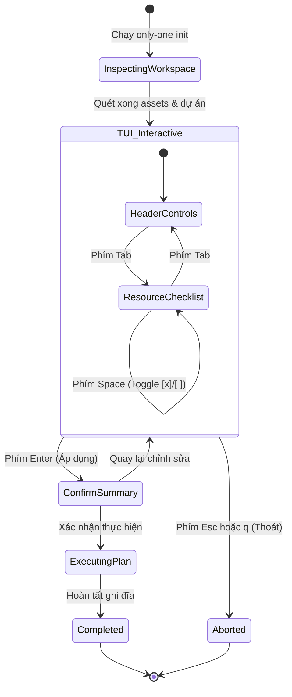

# Concept: TUI Init Wizard (React Ink)

## 1. Problem & Goal (Vấn đề & Mục tiêu)

### Problem (Điểm nghẽn & Thiếu sót hiện tại)
- **Context & Trigger**: Người dùng khởi tạo hoặc đồng bộ workspace qua lệnh `only-one init`.
- **Symptom & Defect**: CLI dùng chuỗi câu hỏi tuần tự qua `@inquirer/prompts`. Người dùng không thấy được trạng thái tài nguyên đã cài sẵn trong dự án.
- **Root Cause**: Giao diện CLI dòng lệnh truyền thống thiếu khả năng đối chiếu hai chiều giữa thư mục `assets/` và thư mục đích.
- **Impact / Blast Radius**: Trải nghiệm dòng lệnh chậm chạp. Người dùng dễ ghi đè nhầm hoặc không biết thành phần nào đã cài đặt.

### Goal (Kết quả kỹ thuật mục tiêu)
- **Core Goal**: Xây dựng bảng điều khiển TUI toàn màn hình bằng React Ink thay thế hoàn toàn các câu hỏi inquirer tuần tự trong `only-one init`.
- **Acceptance Criteria**:
  - Quét và đối chiếu tự động toàn bộ assets với cấu hình thực tế trong workspace đích.
  - Hiển thị nhãn trạng thái rõ ràng cho thành phần đã cài đặt (`[✓] installed`).
  - Hỗ trợ checkbox tương tác: đánh dấu `[x]` để cài đặt hoặc thêm mới, bỏ dấu `[ ]` để gỡ bỏ (`prune`).
  - Tích hợp bộ điều khiển phía trên cho phép chọn Target IDEs (`antigravity`, `cursor`, `claude`, `codex`) và bật/tắt chính sách ghi đè (`Overwrite: YES/NO`).
  - Kết xuất trực tiếp lựa chọn vào engine lập kế hoạch `buildInitPlan` và thực thi đồng bộ qua `executeInitPlan`.

## 2. Scope Boundaries (Ranh giới phạm vi)

### In-Scope (Bắt buộc triển khai)
- Giao diện TUI toàn màn hình dựng bằng React Ink cho lệnh `only-one init`.
- Module quét và đối chiếu trạng thái cục bộ giữa `assets/` và thư mục đích của dự án.
- Bộ chọn IDE đa mục tiêu (Multi-select Toggle: Antigravity, Cursor, Claude, Codex).
- Bộ chuyển đổi cờ ghi đè (Boolean Toggle: Overwrite files).
- Danh sách tài nguyên phân nhóm (Rules, Skills, Agents, Combos) hỗ trợ phím điều hướng `Up/Down`, `Space` để chọn, `Tab` để chuyển vùng.
- Màn hình tóm tắt kế hoạch cài đặt / gỡ bỏ trước khi xác nhận thực thi.

### Explicit Out-of-Scope (Chủ động loại trừ)
- Không thay đổi logic ghi đĩa cốt lõi của `plan-builder` và `plan-executor`.
- Không hỗ trợ chuột trong môi trường TUI (chỉ sử dụng bàn phím chuẩn).
- Không can thiệp vào chế độ chạy tự động không tương tác (`--yes` hoặc cờ headless CI/CD).

## 3. Proposed Solution & Core Mechanism (Giải pháp đề xuất & Cơ chế cốt lõi)

### Core Mechanism (Cơ chế hoạt động)
1. **Giai đoạn quét trạng thái (Inspection Phase)**:
   - Khi chạy `only-one init`, hệ thống phân tích thư mục nguồn `assets/` và workspace hiện tại.
   - Gắn nhãn trạng thái cho từng item: `installed`, `missing`, hoặc `outdated`.
2. **Giai đoạn tương tác trực quan (Interactive TUI Wizard)**:
   - Bảng điều khiển TUI mở ra với 3 khu vực chính:
     - Header: Cấu hình IDE mục tiêu và tùy chọn Overwrite.
     - Body: Danh sách tài nguyên hiển thị trạng thái hiện tại kèm checkbox.
     - Footer: Phím tắt điều hướng và tổng số thay đổi dự kiến (Install/Remove).
3. **Giai đoạn chuyển giao kế hoạch (Handoff to Plan Engine)**:
   - Khi người dùng nhấn `Enter` (Save & Apply), TUI trả về cấu hình đích.
   - `buildInitPlan` tính toán danh sách file cần thêm, sửa hoặc xóa (`prune`).
   - `executeInitPlan` thực hiện ghi đĩa an toàn.

### Conceptual Flow & State Machine (Sơ đồ luồng trạng thái)



### ASCII UI Wireframe (Mô hình giao diện bàn phím)

```text
┌────────────────────────────────────────────────────────────────────────┐
│  ONLY-ONE INIT WIZARD                                v0.1.0            │
├────────────────────────────────────────────────────────────────────────┤
│ Target IDEs: [●] Antigravity   [●] Cursor   [○] Claude   [○] Codex     │
│ Overwrite Files: [ YES ] / NO                                          │
├────────────────────────────────────────────────────────────────────────┤
│ RESOURCES SELECTION                                                    │
│                                                                        │
│ > [x] rules/development-standards.md               [✓] installed       │
│   [x] rules/typescript-style.md                    [✓] installed       │
│   [ ] rules/legacy-angular.md                      (not installed)     │
│   [x] skills/only-one-plan                         [✓] installed       │
│   [x] skills/only-one-idea                         [✓] installed       │
│   [x] skills/only-one-debug                        [+] will install    │
│   [ ] skills/deprecated-eval                       [-] will prune      │
│   [x] combos/only-one-flow                         [✓] installed       │
├────────────────────────────────────────────────────────────────────────┤
│ Summary: 6 to keep/install | 1 to prune | Target: antigravity, cursor  │
│ [↑/↓] Navigate  [Space] Toggle  [Tab] Switch Area  [Enter] Apply  [q] Quit│
└────────────────────────────────────────────────────────────────────────┘
```

### UI State Matrix (Ma trận trạng thái giao diện)

| Trạng thái | Hành vi hiển thị | Tương tác cho phép |
| :--- | :--- | :--- |
| **Scanning** | Spinner hiển thị `Đang đối chiếu tài nguyên dự án...` | Không nhận phím điều hướng |
| **Interactive** | Bảng điều khiển đầy đủ với danh sách và trạng thái | `Tab`, `↑/↓`, `Space`, `Enter`, `q` |
| **Confirming** | Modal overlay tóm tắt số lượng file thêm mới và bị xóa | `y` để xác nhận, `n` để quay lại |
| **Executing** | Thanh tiến trình ghi file qua `plan-executor` | Chặn phím tắt cho đến khi hoàn tất |
| **Finished** | Báo cáo tóm tắt thành công và hướng dẫn sử dụng | Nhấn phím bất kỳ để thoát ra shell |

## 4. Critical Risks & Edge Cases (Rủi ro & Xử lý ngoại lệ)

- **Rủi ro xoá nhầm file người dùng tùy biến khi Prune**:
  - *Giải pháp*: Chỉ cho phép gỡ bỏ các file được quản lý bởi `assets/`. Hiển thị cảnh báo màu đỏ trong modal xác nhận đối với thao tác prune.
- **Môi trường Terminal có kích thước nhỏ (Viewport quá hẹp)**:
  - *Giải pháp*: Tự động phát hiện kích thước `stdout.columns` và `stdout.rows`. Nếu nhỏ hơn 80x24, hiển thị thông báo yêu cầu mở rộng cửa sổ terminal hoặc rơi về chế độ danh sách cuộn.
- **Thoát đột ngột (SIGINT / Ctrl+C / q)**:
  - *Giải pháp*: Bắt sự kiện thoát an toàn của React Ink, dọn dẹp terminal alternate screen buffer, không để lại file rác hoặc ghi đĩa dở dang.
