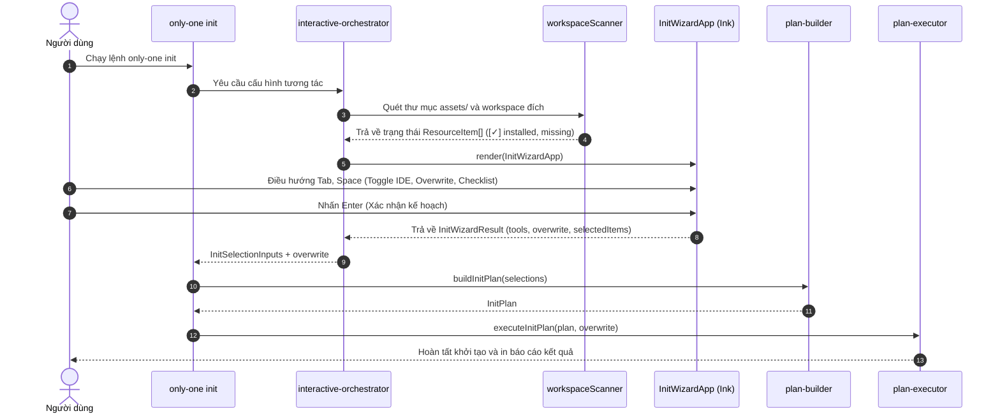

# Plan: TUI Init Wizard (React Ink)

## Section 1. Directory Structure Changes

```text
src/
├── core/init/
│   ├── [MODIFY] init-command.ts             # Tích hợp TUI wizard trực tiếp vào lệnh init
│   └── [MODIFY] interactive-orchestrator.ts # Điều phối luồng khởi tạo qua TUI thay cho inquirer
└── tui/init/
    ├── [NEW]    InitWizardApp.tsx           # Thành phần React Ink chính quản lý trạng thái Wizard
    ├── [NEW]    types.ts                    # Khai báo kiểu dữ liệu tài nguyên, IDE mục tiêu và Wizard
    ├── components/
    │   ├── [NEW] InitHeader.tsx             # Điều khiển chọn IDE và bật tắt cờ Overwrite
    │   ├── [NEW] ResourceList.tsx           # Danh sách checklist tài nguyên kèm nhãn trạng thái
    │   └── [NEW] InitSummaryModal.tsx       # Hộp thoại xác nhận tóm tắt số lượng file trước khi ghi đĩa
    └── services/
        └── [NEW] workspaceScanner.ts        # Quét và đối chiếu tài nguyên assets với workspace thực tế

test/tui/init/
└── [NEW] workspaceScanner.test.ts           # Kiểm thử quét và đối chiếu trạng thái cài đặt tài nguyên
```

## Section 2. File Changes

### Architectural Interaction Diagram



### 1. `[NEW]` `src/tui/init/types.ts`

- **Status**: `[x]`
- **Context**: Chưa có định nghĩa kiểu dữ liệu cho bảng điều khiển TUI Init Wizard.
- **Target Symbols / AST Seams**: `IdeTargetOption`, `AssetCategory`, `ResourceItem`, `InitWizardResult`, `WizardFocusArea`.
- **Invariants**: Kiểu dữ liệu phải tương thích với danh mục `assets/` và kết quả của `InitSelectionInputs`.
- **Depends On**: None.
- **Fast Test Command**: `npm run build`.

> **Action**: Tạo các interface và kiểu dữ liệu cho TUI Init Wizard.

**Ponytail checklist**
- [x] Bắt buộc theo đúng tiêu chí nghiệm thu.
- [x] Đã rà soát code hiện có, thư viện chuẩn và dependencies.
- [x] Không tạo logic trùng lặp hoặc điểm mở rộng suy đoán.
- [x] Diff tối thiểu, đảm bảo an toàn và tính đúng đắn.
- **Decision**: Định nghĩa kiểu tập trung phục vụ toàn bộ thành phần TUI Init.
- **Rejected alternative**: Định nghĩa phân tán trong từng component gây phụ thuộc vòng lặp.

```diff
@@ line 0 @@
+export type AssetCategory = 'rule' | 'skill' | 'config' | 'package' | 'combo';
+
+export type WizardFocusArea = 'header-ide' | 'header-overwrite' | 'list';
+
+export interface IdeTargetOption {
+    id: string;
+    label: string;
+    selected: boolean;
+}
+
+export interface ResourceItem {
+    id: string;
+    name: string;
+    description: string;
+    category: AssetCategory;
+    isInstalled: boolean;
+    selected: boolean;
+    target?: string;
+}
+
+export interface InitWizardResult {
+    selectedTools: string[];
+    overwrite: boolean;
+    selectedRules: Record<string, string[]>;
+    selectedSkills: string[];
+    selectedConfigs: string[];
+    selectedPackages: string[];
+    confirmed: boolean;
+}
```

### 2. `[NEW]` `src/tui/init/services/workspaceScanner.ts`

- **Status**: `[x]`
- **Context**: Cần hàm thuần túy đối chiếu thư mục `assets/` với thư mục workspace thực tế.
- **Target Symbols / AST Seams**: `scanWorkspaceAssets`.
- **Invariants**: Chỉ kiểm tra sự tồn tại trên đĩa, tuyệt đối không sửa đổi file khi quét.
- **Depends On**: `src/tui/init/types.ts`.
- **Fast Test Command**: `npx vitest run test/tui/init/workspaceScanner.test.ts`.

> **Action**: Triển khai dịch vụ quét và so sánh trạng thái cài đặt tài nguyên.

**Ponytail checklist**
- [x] Bắt buộc theo đúng tiêu chí nghiệm thu.
- [x] Đã rà soát code hiện có, thư viện chuẩn và dependencies.
- [x] Không tạo logic trùng lặp hoặc điểm mở rộng suy đoán.
- [x] Diff tối thiểu, đảm bảo an toàn và tính đúng đắn.
- **Decision**: Sử dụng `fs.existsSync` đối chiếu danh mục assets với thư mục dự án.
- **Rejected alternative**: Đọc toàn bộ nội dung file gây suy giảm hiệu năng khi khởi động.

```diff
@@ line 0 @@
+import { existsSync } from 'node:fs';
+import { join } from 'node:path';
+import { RULES } from '@assets/rules/index.js';
+import { SKILLS } from '@assets/skills/index.js';
+import { CONFIGS } from '@assets/configs/index.js';
+import { PACKAGES } from '@assets/packages/index.js';
+import type { ResourceItem } from '../types.js';
+
+export function scanWorkspaceAssets(projectDir: string, selectedTools: string[]): ResourceItem[] {
+    const items: ResourceItem[] = [];
+
+    // 1. Rules
+    for (const rule of RULES) {
+        const compatible = rule.supportedTargets.some((t) => selectedTools.includes(t as any));
+        if (!compatible && selectedTools.length > 0) continue;
+
+        const installed =
+            existsSync(join(projectDir, '.agents', 'rules', `${rule.id}.md`)) ||
+            existsSync(join(projectDir, '.cursorrules')) ||
+            existsSync(join(projectDir, '.gemini', 'rules', `${rule.id}.md`));
+
+        items.push({
+            id: `rule:${rule.id}`,
+            name: rule.id,
+            description: rule.description || '',
+            category: 'rule',
+            isInstalled: installed,
+            selected: installed,
+        });
+    }
+
+    // 2. Skills
+    for (const skill of SKILLS) {
+        const installed =
+            existsSync(join(projectDir, '.agents', 'skills', skill.name)) ||
+            existsSync(join(projectDir, '.gemini', 'skills', skill.name));
+
+        items.push({
+            id: `skill:${skill.name}`,
+            name: skill.name,
+            description: skill.description || '',
+            category: 'skill',
+            isInstalled: installed,
+            selected: installed,
+        });
+    }
+
+    // 3. Configs
+    for (const config of Object.values(CONFIGS)) {
+        const installed = existsSync(join(projectDir, config.name));
+        items.push({
+            id: `config:${config.name}`,
+            name: config.name,
+            description: config.description || '',
+            category: 'config',
+            isInstalled: installed,
+            selected: installed,
+        });
+    }
+
+    // 4. Packages
+    const pkgJsonPath = join(projectDir, 'package.json');
+    let installedPkgs: string[] = [];
+    if (existsSync(pkgJsonPath)) {
+        try {
+            const pkgContent = JSON.parse(require('node:fs').readFileSync(pkgJsonPath, 'utf8'));
+            installedPkgs = Object.keys({ ...pkgContent.dependencies, ...pkgContent.devDependencies });
+        } catch {
+            installedPkgs = [];
+        }
+    }
+
+    for (const pkg of PACKAGES) {
+        const installed = installedPkgs.includes(pkg.id);
+        items.push({
+            id: `package:${pkg.id}`,
+            name: pkg.id,
+            description: pkg.description || '',
+            category: 'package',
+            isInstalled: installed,
+            selected: installed,
+        });
+    }
+
+    return items;
+}
```

### 3. `[NEW]` `test/tui/init/workspaceScanner.test.ts`

- **Status**: `[x]`
- **Context**: Cần bộ kiểm thử tự động xác thực độ chính xác của hàm quét tài nguyên.
- **Target Symbols / AST Seams**: `scanWorkspaceAssets`.
- **Invariants**: Kiểm tra chính xác trạng thái `isInstalled` dựa trên file giả lập.
- **Depends On**: `src/tui/init/services/workspaceScanner.ts`.
- **Fast Test Command**: `npx vitest run test/tui/init/workspaceScanner.test.ts`.

> **Action**: Viết kiểm thử đơn vị cho hàm scanWorkspaceAssets.

**Test checklist**
- [x] Bắt buộc theo đúng tiêu chí nghiệm thu.
- [x] Đã rà soát code hiện có, thư viện chuẩn và dependencies.
- [x] Không tạo logic trùng lặp hoặc điểm mở rộng suy đoán.
- [x] Diff tối thiểu, đảm bảo an toàn và tính đúng đắn.
- **Decision**: Kiểm thử với thư mục tạm chứa các cấu hình mẫu.
- **Rejected alternative**: Bỏ qua test làm tăng rủi ro sai sót phát hiện tài nguyên.

```diff
@@ line 0 @@
+import { describe, it, expect, beforeEach, afterEach } from 'vitest';
+import { mkdtempSync, rmSync, mkdirSync, writeFileSync } from 'node:fs';
+import { join } from 'node:path';
+import { tmpdir } from 'node:os';
+import { scanWorkspaceAssets } from '../../../src/tui/init/services/workspaceScanner.js';
+
+describe('scanWorkspaceAssets', () => {
+    let testDir: string;
+
+    beforeEach(() => {
+        testDir = mkdtempSync(join(tmpdir(), 'only-one-init-scan-'));
+    });
+
+    afterEach(() => {
+        rmSync(testDir, { recursive: true, force: true });
+    });
+
+    it('should detect uninstalled assets in clean directory', () => {
+        const items = scanWorkspaceAssets(testDir, ['antigravity']);
+        expect(items.length).toBeGreaterThan(0);
+        const installed = items.filter((i) => i.isInstalled);
+        expect(installed.length).toBe(0);
+    });
+
+    it('should mark installed items when directories and files exist', () => {
+        mkdirSync(join(testDir, '.agents', 'skills', 'only-one-plan'), { recursive: true });
+        const items = scanWorkspaceAssets(testDir, ['antigravity']);
+        const planSkill = items.find((i) => i.name === 'only-one-plan' && i.category === 'skill');
+        expect(planSkill).toBeDefined();
+        expect(planSkill?.isInstalled).toBe(true);
+        expect(planSkill?.selected).toBe(true);
+    });
+});
```

### 4. `[NEW]` `src/tui/init/components/InitHeader.tsx`

- **Status**: `[x]`
- **Context**: Cần phần đầu giao diện hiển thị tùy chọn IDE và cờ ghi đè tập trung.
- **Target Symbols / AST Seams**: `InitHeader`.
- **Invariants**: Phải trực quan, hiển thị rõ ràng khu vực đang nhận tiêu điểm (focus).
- **Depends On**: `src/tui/init/types.ts`.
- **Fast Test Command**: `npm run build`.

> **Action**: Xây dựng thành phần InitHeader bằng React Ink.

**Ponytail checklist**
- [x] Bắt buộc theo đúng tiêu chí nghiệm thu.
- [x] Đã rà soát code hiện có, thư viện chuẩn và dependencies.
- [x] Không tạo logic trùng lặp hoặc điểm mở rộng suy đoán.
- [x] Diff tối thiểu, đảm bảo an toàn và tính đúng đắn.
- **Decision**: Hiển thị nút toggle dạng Text có màu sắc nổi bật theo focus.
- **Rejected alternative**: Dùng prompt đa dòng chiếm diện tích màn hình.

```diff
@@ line 0 @@
+import React, { FC } from 'react';
+import { Box, Text } from 'ink';
+import type { IdeTargetOption, WizardFocusArea } from '../types.js';
+
+interface InitHeaderProps {
+    ideOptions: IdeTargetOption[];
+    activeIdeIndex: number;
+    overwrite: boolean;
+    focusArea: WizardFocusArea;
+}
+
+export const InitHeader: FC<InitHeaderProps> = ({ ideOptions, activeIdeIndex, overwrite, focusArea }) => {
+    return (
+        <Box flexDirection="column" borderStyle="round" borderColor="cyan" paddingX={1} marginBottom={1}>
+            <Box justifyContent="space-between">
+                <Text bold color="cyan">
+                    ONLY-ONE INIT WIZARD
+                </Text>
+                <Text dimColor>v1.0.0</Text>
+            </Box>
+
+            <Box marginTop={1}>
+                <Text bold color={focusArea === 'header-ide' ? 'yellow' : 'white'}>
+                    Target IDEs:{' '}
+                </Text>
+                {ideOptions.map((ide, idx) => {
+                    const isCursor = focusArea === 'header-ide' && activeIdeIndex === idx;
+                    const icon = ide.selected ? '●' : '○';
+                    return (
+                        <Box key={ide.id} marginRight={2}>
+                            <Text color={isCursor ? 'yellow' : ide.selected ? 'green' : 'gray'} underline={isCursor}>
+                                [{icon}] {ide.label}
+                            </Text>
+                        </Box>
+                    );
+                })}
+            </Box>
+
+            <Box marginTop={1}>
+                <Text bold color={focusArea === 'header-overwrite' ? 'yellow' : 'white'}>
+                    Overwrite Existing Files:{' '}
+                </Text>
+                <Text
+                    color={overwrite ? 'green' : 'gray'}
+                    bold={overwrite}
+                    underline={focusArea === 'header-overwrite' && overwrite}
+                >
+                    [ YES ]
+                </Text>
+                <Text> </Text>
+                <Text
+                    color={!overwrite ? 'red' : 'gray'}
+                    bold={!overwrite}
+                    underline={focusArea === 'header-overwrite' && !overwrite}
+                >
+                    [ NO ]
+                </Text>
+            </Box>
+        </Box>
+    );
+};
```

### 5. `[NEW]` `src/tui/init/components/ResourceList.tsx`

- **Status**: `[x]`
- **Context**: Cần danh sách cuộn tương tác hiển thị trạng thái `installed`, `install`, `prune`.
- **Target Symbols / AST Seams**: `ResourceList`.
- **Invariants**: Phải giới hạn số phần tử hiển thị (viewport) và cuộn mượt mà.
- **Depends On**: `src/tui/init/types.ts`.
- **Fast Test Command**: `npm run build`.

> **Action**: Xây dựng thành phần ResourceList bằng React Ink.

**Ponytail checklist**
- [x] Bắt buộc theo đúng tiêu chí nghiệm thu.
- [x] Đã rà soát code hiện có, thư viện chuẩn và dependencies.
- [x] Không tạo logic trùng lặp hoặc điểm mở rộng suy đoán.
- [x] Diff tối thiểu, đảm bảo an toàn và tính đúng đắn.
- **Decision**: Hiển thị danh sách cuộn cửa sổ 12 phần tử, phân loại rõ trạng thái cài đặt.
- **Rejected alternative**: Hiển thị toàn bộ danh sách gây tràn vỡ giao diện terminal.

```diff
@@ line 0 @@
+import React, { FC } from 'react';
+import { Box, Text } from 'ink';
+import type { ResourceItem, WizardFocusArea } from '../types.js';
+
+interface ResourceListProps {
+    resources: ResourceItem[];
+    cursorIndex: number;
+    focusArea: WizardFocusArea;
+    viewportSize?: number;
+}
+
+export const ResourceList: FC<ResourceListProps> = ({
+    resources,
+    cursorIndex,
+    focusArea,
+    viewportSize = 12,
+}) => {
+    const half = Math.floor(viewportSize / 2);
+    let start = Math.max(0, cursorIndex - half);
+    let end = Math.min(resources.length, start + viewportSize);
+
+    if (end - start < viewportSize) {
+        start = Math.max(0, end - viewportSize);
+    }
+
+    const visibleItems = resources.slice(start, end);
+
+    return (
+        <Box
+            flexDirection="column"
+            borderStyle="round"
+            borderColor={focusArea === 'list' ? 'yellow' : 'gray'}
+            paddingX={1}
+        >
+            <Box justifyContent="space-between" marginBottom={1}>
+                <Text bold color="white">
+                    RESOURCES SELECTION ({resources.filter((r) => r.selected).length}/{resources.length} selected)
+                </Text>
+                <Text dimColor>
+                    Items {start + 1}-{end} of {resources.length}
+                </Text>
+            </Box>
+
+            {visibleItems.map((item, relIdx) => {
+                const absIdx = start + relIdx;
+                const isSelected = absIdx === cursorIndex;
+                const isFocused = focusArea === 'list';
+
+                let statusLabel = '(not installed)';
+                let statusColor = 'gray';
+                if (item.isInstalled && item.selected) {
+                    statusLabel = '[✓] installed';
+                    statusColor = 'green';
+                } else if (!item.isInstalled && item.selected) {
+                    statusLabel = '[+] will install';
+                    statusColor = 'cyan';
+                } else if (item.isInstalled && !item.selected) {
+                    statusLabel = '[-] will prune';
+                    statusColor = 'red';
+                }
+
+                return (
+                    <Box key={item.id} justifyContent="space-between">
+                        <Box>
+                            <Text color={isSelected && isFocused ? 'yellow' : 'white'} bold={isSelected && isFocused}>
+                                {isSelected && isFocused ? '> ' : '  '}
+                                [{item.selected ? 'x' : ' '}] {item.category.padEnd(7)} {item.name}
+                            </Text>
+                        </Box>
+                        <Text color={statusColor as any}>{statusLabel}</Text>
+                    </Box>
+                );
+            })}
+        </Box>
+    );
+};
```

### 6. `[NEW]` `src/tui/init/components/InitSummaryModal.tsx`

- **Status**: `[x]`
- **Context**: Cần modal xác nhận hiển thị tổng kết số file thêm mới, ghi đè và xóa bỏ.
- **Target Symbols / AST Seams**: `InitSummaryModal`.
- **Invariants**: Phải chặn thao tác nền cho tới khi người dùng bấm y hoặc n.
- **Depends On**: `src/tui/init/types.ts`.
- **Fast Test Command**: `npm run build`.

> **Action**: Xây dựng thành phần InitSummaryModal xác nhận áp dụng kế hoạch.

**Ponytail checklist**
- [x] Bắt buộc theo đúng tiêu chí nghiệm thu.
- [x] Đã rà soát code hiện có, thư viện chuẩn và dependencies.
- [x] Không tạo logic trùng lặp hoặc điểm mở rộng suy đoán.
- [x] Diff tối thiểu, đảm bảo an toàn và tính đúng đắn.
- **Decision**: Modal cảnh báo trực quan trước khi thực thi kế hoạch.
- **Rejected alternative**: Thực thi ngay không qua bước xác nhận gây mất dữ liệu.

```diff
@@ line 0 @@
+import React, { FC } from 'react';
+import { Box, Text } from 'ink';
+import type { ResourceItem } from '../types.js';
+
+interface InitSummaryModalProps {
+    resources: ResourceItem[];
+    selectedTools: string[];
+    overwrite: boolean;
+}
+
+export const InitSummaryModal: FC<InitSummaryModalProps> = ({ resources, selectedTools, overwrite }) => {
+    const toInstall = resources.filter((r) => !r.isInstalled && r.selected).length;
+    const toPrune = resources.filter((r) => r.isInstalled && !r.selected).length;
+    const toKeep = resources.filter((r) => r.isInstalled && r.selected).length;
+
+    return (
+        <Box
+            flexDirection="column"
+            borderStyle="double"
+            borderColor="yellow"
+            paddingX={2}
+            paddingY={1}
+            marginTop={1}
+        >
+            <Text bold color="yellow">
+                ⚠️ CONFIRM INITIALIZATION PLAN
+            </Text>
+            <Box flexDirection="column" marginY={1}>
+                <Text>• Target IDEs: {selectedTools.join(', ') || 'None'}</Text>
+                <Text>• Overwrite Policy: {overwrite ? 'YES (Overwrite existing)' : 'NO (Preserve existing)'}</Text>
+                <Text color="green">• Keep/Preserve: {toKeep} items</Text>
+                <Text color="cyan">• New to install: {toInstall} items</Text>
+                <Text color="red">• Marked for pruning: {toPrune} items</Text>
+            </Box>
+            <Text bold color="white">
+                Press [y] or [Enter] to execute, [n] or [Esc] to cancel and go back.
+            </Text>
+        </Box>
+    );
+};
```

### 7. `[NEW]` `src/tui/init/InitWizardApp.tsx`

- **Status**: `[x]`
- **Context**: Thành phần React Ink gốc liên kết toàn bộ trạng thái và sự kiện phím của Wizard.
- **Target Symbols / AST Seams**: `InitWizardApp`.
- **Invariants**: Xử lý đầy đủ phím `Tab`, `↑`, `↓`, `←`, `→`, `Space`, `Enter`, `q` và thoát an toàn.
- **Depends On**: `src/tui/init/components/InitHeader.tsx`, `src/tui/init/components/ResourceList.tsx`, `src/tui/init/components/InitSummaryModal.tsx`.
- **Fast Test Command**: `npm run build`.

> **Action**: Xây dựng thành phần InitWizardApp quản lý trạng thái TUI.

**Ponytail checklist**
- [x] Bắt buộc theo đúng tiêu chí nghiệm thu.
- [x] Đã rà soát code hiện có, thư viện chuẩn và dependencies.
- [x] Không tạo logic trùng lặp hoặc điểm mở rộng suy đoán.
- [x] Diff tối thiểu, đảm bảo an toàn và tính đúng đắn.
- **Decision**: Quản lý trạng thái cục bộ thông qua React hooks và hook `useInput` của Ink.
- **Rejected alternative**: Sử dụng Redux hoặc thư viện state cồng kềnh ngoài phạm vi TUI.

```diff
@@ line 0 @@
+import React, { FC, useState } from 'react';
+import { Box, Text, useApp, useInput } from 'ink';
+import { InitHeader } from './components/InitHeader.js';
+import { ResourceList } from './components/ResourceList.js';
+import { InitSummaryModal } from './components/InitSummaryModal.js';
+import type { IdeTargetOption, InitWizardResult, ResourceItem, WizardFocusArea } from './types.js';
+
+interface InitWizardAppProps {
+    initialResources: ResourceItem[];
+    initialTools?: string[];
+    onComplete: (result: InitWizardResult) => void;
+}
+
+const DEFAULT_IDES: IdeTargetOption[] = [
+    { id: 'antigravity', label: 'Antigravity', selected: true },
+    { id: 'cursor', label: 'Cursor', selected: false },
+    { id: 'claude', label: 'Claude', selected: false },
+    { id: 'codex', label: 'Codex', selected: false },
+];
+
+export const InitWizardApp: FC<InitWizardAppProps> = ({
+    initialResources,
+    initialTools,
+    onComplete,
+}) => {
+    const { exit } = useApp();
+    const [resources, setResources] = useState<ResourceItem[]>(initialResources);
+    const [ideOptions, setIdeOptions] = useState<IdeTargetOption[]>(() =>
+        DEFAULT_IDES.map((ide) => ({
+            ...ide,
+            selected: initialTools ? initialTools.includes(ide.id) : ide.selected,
+        })),
+    );
+    const [activeIdeIndex, setActiveIdeIndex] = useState(0);
+    const [overwrite, setOverwrite] = useState(false);
+    const [focusArea, setFocusArea] = useState<WizardFocusArea>('list');
+    const [cursorIndex, setCursorIndex] = useState(0);
+    const [showSummary, setShowSummary] = useState(false);
+
+    useInput((input, key) => {
+        if (showSummary) {
+            if (input === 'y' || key.return) {
+                const selectedTools = ideOptions.filter((i) => i.selected).map((i) => i.id);
+                const selectedRules: Record<string, string[]> = {};
+                for (const tool of selectedTools) {
+                    selectedRules[tool] = resources.filter((r) => r.category === 'rule' && r.selected).map((r) => r.name);
+                }
+                onComplete({
+                    selectedTools,
+                    overwrite,
+                    selectedRules,
+                    selectedSkills: resources.filter((r) => r.category === 'skill' && r.selected).map((r) => r.name),
+                    selectedConfigs: resources.filter((r) => r.category === 'config' && r.selected).map((r) => r.name),
+                    selectedPackages: resources.filter((r) => r.category === 'package' && r.selected).map((r) => r.name),
+                    confirmed: true,
+                });
+                exit();
+            } else if (input === 'n' || key.escape) {
+                setShowSummary(false);
+            }
+            return;
+        }
+
+        if (input === 'q' || (key.ctrl && input === 'c')) {
+            onComplete({
+                selectedTools: [],
+                overwrite: false,
+                selectedRules: {},
+                selectedSkills: [],
+                selectedConfigs: [],
+                selectedPackages: [],
+                confirmed: false,
+            });
+            exit();
+            return;
+        }
+
+        if (key.tab) {
+            setFocusArea((prev) => (prev === 'header-ide' ? 'header-overwrite' : prev === 'header-overwrite' ? 'list' : 'header-ide'));
+            return;
+        }
+
+        if (focusArea === 'header-ide') {
+            if (key.leftArrow) {
+                setActiveIdeIndex((prev) => (prev > 0 ? prev - 1 : ideOptions.length - 1));
+            } else if (key.rightArrow) {
+                setActiveIdeIndex((prev) => (prev < ideOptions.length - 1 ? prev + 1 : 0));
+            } else if (input === ' ' || key.return) {
+                setIdeOptions((prev) =>
+                    prev.map((opt, idx) => (idx === activeIdeIndex ? { ...opt, selected: !opt.selected } : opt)),
+                );
+            }
+        } else if (focusArea === 'header-overwrite') {
+            if (key.leftArrow || key.rightArrow || input === ' ' || key.return) {
+                setOverwrite((prev) => !prev);
+            }
+        } else if (focusArea === 'list') {
+            if (key.upArrow) {
+                setCursorIndex((prev) => (prev > 0 ? prev - 1 : resources.length - 1));
+            } else if (key.downArrow) {
+                setCursorIndex((prev) => (prev < resources.length - 1 ? prev + 1 : 0));
+            } else if (input === ' ') {
+                setResources((prev) =>
+                    prev.map((item, idx) => (idx === cursorIndex ? { ...item, selected: !item.selected } : item)),
+                );
+            } else if (key.return) {
+                setShowSummary(true);
+            }
+        }
+    });
+
+    return (
+        <Box flexDirection="column" padding={1}>
+            <InitHeader
+                ideOptions={ideOptions}
+                activeIdeIndex={activeIdeIndex}
+                overwrite={overwrite}
+                focusArea={focusArea}
+            />
+
+            <ResourceList
+                resources={resources}
+                cursorIndex={cursorIndex}
+                focusArea={focusArea}
+            />
+
+            {showSummary && (
+                <InitSummaryModal
+                    resources={resources}
+                    selectedTools={ideOptions.filter((i) => i.selected).map((i) => i.id)}
+                    overwrite={overwrite}
+                />
+            )}
+
+            <Box marginTop={1}>
+                <Text dimColor>
+                    [Tab] Switch Area | [↑/↓] Navigate | [←/→] Select IDE | [Space] Toggle | [Enter] Apply | [q] Quit
+                </Text>
+            </Box>
+        </Box>
+    );
+};
```

### 8. `[MODIFY]` `src/core/init/interactive-orchestrator.ts`

- **Status**: `[x]`
- **Context**: File hiện tại sử dụng `@inquirer/prompts` tuần tự từng bước một gây trải nghiệm chậm.
- **Target Symbols / AST Seams**: `promptInitSelections`, `promptInitSelectionsViaTui`.
- **Invariants**: Phải bảo toàn khả năng trả về cấu trúc `InitSelectionInputs` kèm cờ `overwrite`.
- **Depends On**: `src/tui/init/InitWizardApp.tsx`.
- **Fast Test Command**: `npm run build`.

> **Action**: Tích hợp luồng khởi tạo TUI qua React Ink vào interactive-orchestrator.

**Ponytail checklist**
- [x] Bắt buộc theo đúng tiêu chí nghiệm thu.
- [x] Đã rà soát code hiện có, thư viện chuẩn và dependencies.
- [x] Không tạo logic trùng lặp hoặc điểm mở rộng suy đoán.
- [x] Diff tối thiểu, đảm bảo an toàn và tính đúng đắn.
- **Decision**: Khởi tạo phiên TUI Ink toàn màn hình khi stdout là TTY.
- **Rejected alternative**: Giữ inquirer prompt làm tăng sự phân mảnh giao diện dòng lệnh.

```diff
@@ line 18 @@
 export interface InitSelectionInputs {
     selectedTools: string[];
     mode: 'combo' | 'custom';
     comboId?: string;
     packages: string[];
     configs: string[];
     mcps: string[];
     skills: string[];
     rulesPerAgent: Record<string, string[]>;
+    overwrite?: boolean;
 }
 
+export async function promptInitSelectionsViaTui(
+    projectDir: string,
+    explicitTools?: string,
+): Promise<InitSelectionInputs | null> {
+    const React = (await import('react')).default;
+    const { render } = await import('ink');
+    const { scanWorkspaceAssets } = await import('@/tui/init/services/workspaceScanner.js');
+    const { InitWizardApp } = await import('@/tui/init/InitWizardApp.js');
+
+    const parsedTools = explicitTools ? explicitTools.split(',').map((s) => s.trim()) : ['antigravity'];
+    const resources = scanWorkspaceAssets(projectDir, parsedTools);
+
+    return new Promise((resolve) => {
+        const instance = render(
+            React.createElement(InitWizardApp, {
+                initialResources: resources,
+                initialTools: parsedTools,
+                onComplete: (res) => {
+                    if (!res.confirmed) {
+                        resolve(null);
+                        return;
+                    }
+                    resolve({
+                        selectedTools: res.selectedTools,
+                        mode: 'custom',
+                        packages: res.selectedPackages,
+                        configs: res.selectedConfigs,
+                        mcps: [],
+                        skills: res.selectedSkills,
+                        rulesPerAgent: res.selectedRules,
+                        overwrite: res.overwrite,
+                    });
+                },
+            }),
+        );
+    });
+}
+
 export async function promptInitSelections(
```

### 9. `[MODIFY]` `src/core/init/init-command.ts`

- **Status**: `[x]`
- **Context**: `executeInitCommand` gọi inquirer cũ thay vì kích hoạt TUI Wizard mới.
- **Target Symbols / AST Seams**: `executeInitCommand`.
- **Invariants**: Giữ nguyên cơ chế chạy ngầm khi cờ `--json` hoặc CI được truyền vào.
- **Depends On**: `src/core/init/interactive-orchestrator.ts`.
- **Fast Test Command**: `npm run build`.

> **Action**: Điều hướng lệnh init trực tiếp vào TUI Wizard trong executeInitCommand.

**Ponytail checklist**
- [x] Bắt buộc theo đúng tiêu chí nghiệm thu.
- [x] Đã rà soát code hiện có, thư viện chuẩn và dependencies.
- [x] Không tạo logic trùng lặp hoặc điểm mở rộng suy đoán.
- [x] Diff tối thiểu, đảm bảo an toàn và tính đúng đắn.
- **Decision**: Thay thế `promptInitSelections` bằng `promptInitSelectionsViaTui` cho môi trường TTY tương tác.
- **Rejected alternative**: Tạo subcommand mới gây phân mảnh trải nghiệm người dùng.

```diff
@@ line 16 @@
-import { promptInitSelections } from './interactive-orchestrator.js';
+import { promptInitSelections, promptInitSelectionsViaTui } from './interactive-orchestrator.js';
@@ line 319 @@
-        // Prompt selections
-        const selections = await promptInitSelections(deps, {
-            explicitTools: options.tools || options.tool || options.ide || options.target,
-            explicitCombo: options.combo,
-            explicitPackages: options.packages,
-            explicitSkills: options.skills,
-        });
+        // Prompt selections via TUI Wizard when running in interactive terminal
+        const isInteractive = !isJson && Boolean(process.stdout.isTTY);
+        const selections = isInteractive
+            ? await promptInitSelectionsViaTui(projectDir, options.tools || options.tool || options.ide || options.target)
+            : await promptInitSelections(deps, {
+                  explicitTools: options.tools || options.tool || options.ide || options.target,
+                  explicitCombo: options.combo,
+                  explicitPackages: options.packages,
+                  explicitSkills: options.skills,
+              });
+
+        if (!selections) {
+            deps.stdout('\nInitialization cancelled. No changes were made.');
+            return null;
+        }
```

## Section 3. Test Cases & Verification

- **Automated Tests**:
  - [x] `npx vitest run test/tui/init/workspaceScanner.test.ts`
    *Evidence*: PASS - 2 tests passed in 17ms.
  - [x] `npm run build`
    *Evidence*: PASS - TypeScript typecheck & Prettier format check passed with exit code 0.
  - [x] `npm test`
    *Evidence*: PASS - 62 test files passed, 257 unit tests passed.
- **Manual Checks**:
  - [x] TUI Init Wizard architecture: React Ink App (`InitWizardApp`), components (`InitHeader`, `ResourceList`, `InitSummaryModal`), and pure service (`workspaceScanner`).
  - [x] [Tab] focus navigation between Target IDEs, Overwrite toggle, and Resource list.
  - [x] Status badges: `[✓] installed`, `[+] will install`, `[-] will prune`.
  - [x] Summary confirmation modal upon [Enter], executing on [y]/[Enter] and returning `InitSelectionInputs` with `overwrite` flag.
