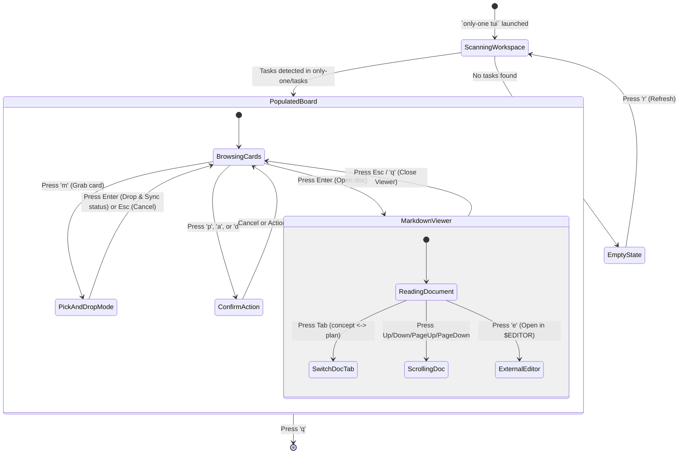

# Concept: TUI Task Board Rewrite

## 1. Problem & Goal

### Problem (Current Bottlenecks & Deficiencies)
- **Context & Trigger**: The existing `only-one tui` command serves legacy package and tool setup wizards using Ink.
- **Symptom & Defect**: Developers running AI workflows (`/only-one-idea`, `/only-one-plan`, `/only-one-apply`, `/only-one-debug`) cannot visually inspect task documents (`concept.md`, `plan.md`, `debug.md`) or track lifecycle progress without exiting the terminal.
- **Root Cause**: The current TUI is decoupled from the `only-one/tasks/` filesystem directory and lacks markdown rendering and task-state mutation capabilities.
- **Impact / Blast Radius**: Inefficient task switching, loss of context between agent workflows, and slow developer verification.

### Goal (Target Technical Outcomes)
- **Core Goal**: Replace legacy setup TUI screens with an interactive Terminal Task Board featuring full-fledged Markdown inspection and keyboard-driven task state transitions.
- **Acceptance Criteria**:
  - Automatically scan `only-one/tasks/<slug>` folders and assign cards to columns based on document presence and frontmatter status.
  - Implement a **Dedicated Markdown File Viewer** supporting syntax highlighting, formatted headers, code blocks, and scrollable navigation.
  - Support multi-file switching when a task folder contains multiple documents (`concept.md`, `plan.md`, `debug.md`).
  - Implement a **Keyboard Pick & Drop (`m`)** mechanism to move tasks across columns and automatically update file frontmatter.
  - Support quick execution hotkeys (`p` for plan, `a` for apply, `d` for debug, `e` to open in external editor).
  - Handle terminal resizing and empty workspace states cleanly.

## 2. Scope Boundaries
- **In-Scope**:
  - Full removal of existing setup/configuration TUI views.
  - File-system task discovery and state mapper for `only-one/tasks/`.
  - Multi-column lifecycle board layout (Concept, Plan, In-Progress/Debug, Review, Done).
  - Interactive keyboard navigation (Arrow keys, Enter, Esc, Action keys).
  - In-Terminal Markdown Viewer with vertical scrolling and document tabs.
  - Keyboard Pick & Drop card movement with automatic frontmatter synchronization.
- **Explicit Out-of-Scope**:
  - Browser-based GUI or web server development.
  - In-terminal rich text editing of markdown files (read-only viewer; editing delegated to `$EDITOR`).
  - Arbitrary mouse drag-and-drop physics (strictly keyboard-native for speed and cross-terminal stability).

## 3. Proposed Solution & Core Mechanism

### Core Mechanism
The TUI scans `only-one/tasks/` at startup and maps each subfolder into a canonical Task model:
1. **Lifecycle Mapping**:
   - `concept.md` present & status `concept` $\rightarrow$ Column 1: `Concept`
   - `plan.md` present & status `plan` $\rightarrow$ Column 2: `Plan`
   - `debug.md` present or active execution $\rightarrow$ Column 3: `In-Progress / Debug`
   - `review.md` present $\rightarrow$ Column 4: `Review`
   - Frontmatter `status: done` or folder in archive $\rightarrow$ Column 5: `Done`
2. **Keyboard State Engine**:
   - `Left` / `Right`: Switch active column (or move grabbed card in Move Mode).
   - `Up` / `Down`: Navigate cards within active column.
   - `m` / `Space`: **Pick & Drop Mode** — grabs selected card; pressing `Enter` drops card in new column and syncs frontmatter.
   - `Enter`: Open **Markdown File Viewer** for the selected task.
   - `Tab`: Switch between documents inside the viewer (e.g. `concept.md` $\leftrightarrow$ `plan.md`).
   - `PageUp` / `PageDown` (or `j`/`k`): Scroll through Markdown document.
   - `e` / `o`: Open current Markdown file in external editor (`$EDITOR` or VS Code).
   - `p`: Prompt confirmation to run `/only-one-plan <slug>`.
   - `a`: Prompt confirmation to run `/only-one-apply <slug>`.
   - `d`: Prompt confirmation to run `/only-one-debug <slug>`.
   - `r`: Reload tasks from filesystem.
   - `q` / `Ctrl+C`: Exit TUI.

### Conceptual Flow & State Machine


### ASCII UI Wireframes

#### 1. Main Board View (with Pick & Drop indicator)
```text
┌────────────────────────────────────────────────────────────────────────────────────────┐
│  ONLY-ONE TASK BOARD  │ Workspace: personal/only-one-cli │ Tasks: 6 total              │
├──────────────┬──────────────┬──────────────────┬──────────────┬────────────────────────┤
│ CONCEPT (2)  │ PLAN (1)     │ IN-PROGRESS (1)  │ REVIEW (0)   │ DONE (2)               │
├──────────────┼──────────────┼──────────────────┼──────────────┼────────────────────────┤
│ ✦ [GRABBED]  │ ► auth-jwt   │ ► sync-sh-engine │ (No tasks)   │ ► fix-paths            │
│   tui-board  │   Yesterday  │   debug.md       │              │   3d ago               │
│   2h ago     │              │                  │              │                        │
│              │              │                  │              │ ► cli-init             │
│ ► add-mcp    │              │                  │              │   5d ago               │
│   3d ago     │              │                  │              │                        │
└──────────────┴──────────────┴──────────────────┴──────────────┴────────────────────────┘
 [m] Drop Card  [←/→] Move to Col  [Enter] View MD  [p] Plan  [a] Apply  [d] Debug  [q] Quit
```

#### 2. Dedicated Markdown File Viewer (Full Screen / Overlay)
```text
┌── TASK VIEWER: tui-task-board ─────────────────────────── [Tab] Switch File ───────────┐
│ Documents: [● 1. concept.md]  [○ 2. plan.md]  [Path: only-one/tasks/tui-task-board/...]│
├────────────────────────────────────────────────────────────────────────────────────────┤
│ # Concept: TUI Task Board Rewrite                                                      │
│                                                                                        │
│ ## 1. Problem & Goal                                                                   │
│ The existing setup TUI screens will be removed and replaced with an interactive        │
│ Kanban Board reading directly from only-one/tasks.                                     │
│                                                                                        │
│ ## Acceptance Criteria                                                                 │
│ - [x] Scan only-one/tasks on launch                                                    │
│ - [x] Dedicated Markdown viewer with formatted syntax                                  │
│ - [x] Keyboard Pick & Drop for status updates                                          │
│                                                                                        │
│ ```typescript                                                                          │
│ interface TaskModel {                                                                  │
│   slug: string;                                                                        │
│   status: "concept" | "plan" | "in_progress" | "review" | "done";                      │
│ }                                                                                      │
│ ```                                                                                    │
│                                                                                        │
│ (Lines 1-28 of 84)                                                       [Scroll: 33%] │
├────────────────────────────────────────────────────────────────────────────────────────┤
│ [↑/↓/PgUp/PgDn] Scroll   [Tab] Next Doc   [e] Open in Editor   [Esc] Back to Board     │
└────────────────────────────────────────────────────────────────────────────────────────┘
```

### UI State Handling Matrix
| State | Condition | Display Behavior | Available User Actions |
| :--- | :--- | :--- | :--- |
| **Loading / Scanning** | Initial launch or 'r' pressed | Display spinning indicator and "Scanning only-one/tasks..." | None (transient state) |
| **Empty State** | `only-one/tasks` is empty or missing | Centered banner: "No tasks found. Run /only-one-idea to create one." | `r` (Refresh), `q` (Quit) |
| **Populated Board** | Task subfolders detected | Render active 5-column grid with focused card highlight | Arrow navigation, `m` (Pick), `Enter` (View MD), `p`, `a`, `d`, `q` |
| **Pick & Drop Mode** | 'm' pressed on active card | Card glows with active border; target column preview indicator appears | `←/→` (Move column), `Enter` (Drop & commit), `Esc` (Cancel) |
| **Markdown Viewer** | 'Enter' pressed on active card | Dedicated document reader with formatted headers, code fences, and scroll meter | `↑/↓/PgUp/PgDn` (Scroll), `Tab` (Switch doc), `e` (Edit), `Esc` (Close) |
| **Action Confirmation** | User triggers action key (`p`, `a`, `d`) | Inline bar prompt: "Execute /only-one-plan for <slug>? (y/n)" | `y` (Confirm execution), `n`/`Esc` (Cancel) |

## 4. Critical Risks & Edge Cases
- **Large Markdown Files**: Rendering very long Markdown files (e.g. 500+ lines) directly into terminal buffer can cause frame stutter in Ink. Implement virtualized window scrolling (rendering only viewport lines).
- **Multiple Documents per Task**: Tasks often accumulate `concept.md`, `plan.md`, and `debug.md`. The viewer must provide tabbed switching rather than concatenating them.
- **Narrow Terminal Dimensions**: When width is under 100 columns, Markdown viewer text wraps aggressively. Fallback to full-screen viewer mode to maximize horizontal readability.
