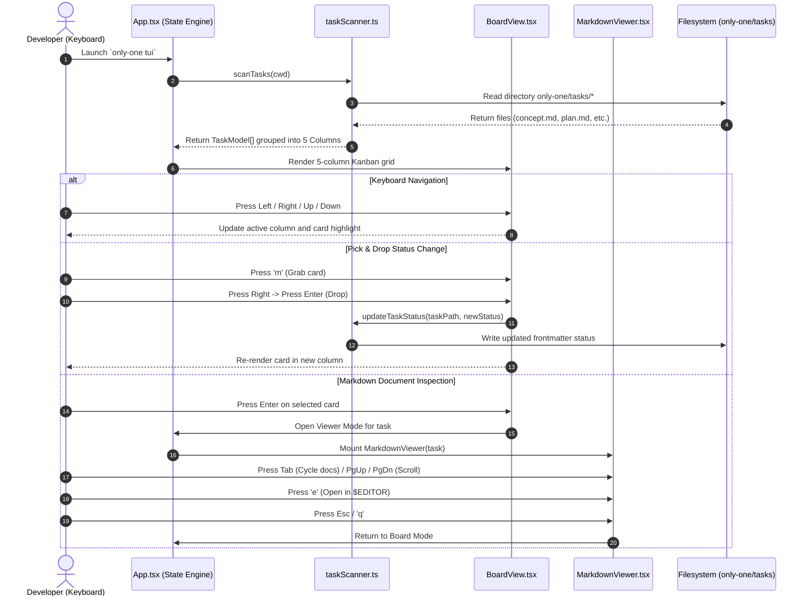

# Plan: TUI Task Board Rewrite

## Section 1. Directory Structure Changes

```text
src/tui/
├── [NEW]    types/task.ts                   # Domain types for Task, Column, and Board state
├── [NEW]    services/taskScanner.ts         # Scans only-one/tasks, parses frontmatter, updates status
├── [NEW]    utils/markdownParser.ts         # Terminal ANSI markdown formatter and tokenizer
├── [NEW]    components/TaskCard.tsx         # Task card renderer with badge, title, and grab state
├── [NEW]    components/BoardView.tsx        # 5-column Kanban board grid with keyboard navigation
├── [NEW]    components/MarkdownViewer.tsx   # Scrollable document viewer with tabs and external editor
├── [MODIFY] components/Footer.tsx           # Context-sensitive hotkey bar for Board and Viewer modes
├── [MODIFY] App.tsx                         # Core TUI state container replacing 13 legacy views
├── [DELETE] router/routes.ts                # Legacy wizard route definitions
├── [DELETE] router/RouterContext.tsx        # Legacy routing context provider
├── [DELETE] router/types.ts                 # Legacy router types
├── [DELETE] components/CategoryMenu.tsx     # Legacy setup category menu
├── [DELETE] components/SearchFilter.tsx     # Legacy fuzzy search filter
├── [DELETE] components/SelectMenu.tsx       # Legacy select menu
├── [DELETE] components/TaskRunnerView.tsx   # Legacy task runner
├── [DELETE] components/MasterDetailLayout.tsx # Legacy master-detail layout
├── [DELETE] components/PreviewCard.tsx      # Legacy setup preview card
├── [DELETE] components/TextInput.tsx        # Legacy text input component
└── views/
    ├── [DELETE] ComboView.tsx               # Legacy combo setup view
    ├── [DELETE] DoctorView.tsx              # Legacy doctor setup view
    ├── [DELETE] GitView.tsx                 # Legacy git setup view
    ├── [DELETE] HomeDashboardView.tsx       # Legacy home dashboard view
    ├── [DELETE] HomeView.tsx                # Legacy home view
    ├── [DELETE] InitView.tsx                # Legacy init view
    ├── [DELETE] McpView.tsx                 # Legacy mcp setup view
    ├── [DELETE] RuleView.tsx                # Legacy rule setup view
    ├── [DELETE] SettingsView.tsx            # Legacy settings view
    ├── [DELETE] SkillView.tsx               # Legacy skill setup view
    ├── [DELETE] StructureView.tsx           # Legacy structure view
    ├── [DELETE] UpdateView.tsx              # Legacy update view
    └── [DELETE] WorkflowView.tsx            # Legacy workflow view

test/tui/
├── [NEW]    taskScanner.test.ts             # Unit tests for scanner, frontmatter, and status updates
├── [NEW]    markdownParser.test.ts          # Unit tests for terminal markdown formatter
├── [DELETE] router.test.ts                  # Obsolete legacy router test
└── [DELETE] fuzzy.test.ts                   # Obsolete legacy fuzzy search test
```

---

## Section 2. File Changes

### Architectural Interaction Diagram



---

### 1. `[NEW]` `src/tui/types/task.ts`

- **Status**: `[ ]`
- **Context**: Defines data models for task folders, markdown files, and board columns.
- **Target Symbols / AST Seams**: `TaskStatus`, `TaskDoc`, `TaskModel`, `ColumnModel`, `TuiMode`.
- **Invariants**: Status must map directly to the 5 lifecycle columns.
- **Depends On**: None.
- **Fast Test Command**: `npx tsc --noEmit`.

> **Action**: Create domain types for task board lifecycle and UI modes.

**Ponytail checklist**
- [ ] Required by acceptance criteria.
- [ ] Existing implementation searched; stdlib, platform/framework, and installed dependencies considered.
- [ ] No duplicate logic or speculative extension point.
- [ ] Minimum diff preserves correctness and safety.
- **Decision**: Define canonical task interfaces in a dedicated types file.
- **Rejected alternative**: Inline types inside React components.

```diff
+export type TaskStatus = 'concept' | 'plan' | 'in_progress' | 'review' | 'done';
+
+export interface TaskDoc {
+    name: string;
+    path: string;
+    content: string;
+}
+
+export interface TaskModel {
+    slug: string;
+    folderPath: string;
+    status: TaskStatus;
+    title: string;
+    createdAt?: string;
+    updatedAt?: string;
+    docs: TaskDoc[];
+    activeDocIndex: number;
+}
+
+export interface ColumnModel {
+    id: TaskStatus;
+    title: string;
+    color: 'cyan' | 'blue' | 'yellow' | 'magenta' | 'green';
+    tasks: TaskModel[];
+}
+
+export type TuiMode = 'board' | 'viewer' | 'confirm';
+
+export interface ConfirmActionState {
+    task: TaskModel;
+    action: 'plan' | 'apply' | 'debug';
+}
```

---

### 2. `[NEW]` `src/tui/utils/markdownParser.ts`

- **Status**: `[ ]`
- **Context**: Formats raw markdown text into styled terminal strings using ANSI colors.
- **Target Symbols / AST Seams**: `renderTerminalMarkdown`, `tokenizeMarkdownLine`.
- **Invariants**: Output must preserve text structure without throwing on unexpected markdown syntax.
- **Depends On**: None.
- **Fast Test Command**: `npm test test/tui/markdownParser.test.ts`.

> **Action**: Implement lightweight terminal markdown line tokenizer and ANSI formatter.

**Ponytail checklist**
- [ ] Required by acceptance criteria.
- [ ] Existing implementation searched; stdlib, platform/framework, and installed dependencies considered.
- [ ] No duplicate logic or speculative extension point.
- [ ] Minimum diff preserves correctness and safety.
- **Decision**: Use `picocolors` to format markdown headers, code blocks, lists, and quotes directly.
- **Rejected alternative**: Heavy external terminal markdown libraries that pull hundreds of dependencies.

```diff
+import pc from 'picocolors';
+
+export interface FormattedLine {
+    raw: string;
+    formatted: string;
+    isCodeBlock: boolean;
+}
+
+export function formatMarkdown(content: string): FormattedLine[] {
+    const lines = content.split(/\r?\n/);
+    let inCodeBlock = false;
+
+    return lines.map((line) => {
+        const trimmed = line.trim();
+
+        if (trimmed.startsWith('```')) {
+            inCodeBlock = !inCodeBlock;
+            return {
+                raw: line,
+                formatted: pc.dim(pc.gray(line)),
+                isCodeBlock: true,
+            };
+        }
+
+        if (inCodeBlock) {
+            return {
+                raw: line,
+                formatted: pc.green(line),
+                isCodeBlock: true,
+            };
+        }
+
+        if (trimmed.startsWith('# ')) {
+            return { raw: line, formatted: pc.bold(pc.cyan(line)), isCodeBlock: false };
+        }
+        if (trimmed.startsWith('## ')) {
+            return { raw: line, formatted: pc.bold(pc.blue(line)), isCodeBlock: false };
+        }
+        if (trimmed.startsWith('### ')) {
+            return { raw: line, formatted: pc.bold(pc.yellow(line)), isCodeBlock: false };
+        }
+        if (trimmed.startsWith('> ')) {
+            return { raw: line, formatted: pc.italic(pc.gray(line)), isCodeBlock: false };
+        }
+        if (trimmed.startsWith('- ') || trimmed.startsWith('* ')) {
+            return { raw: line, formatted: pc.cyan('• ') + line.slice(2), isCodeBlock: false };
+        }
+        if (trimmed.startsWith('---')) {
+            return { raw: line, formatted: pc.dim('────────────────────────────────────────'), isCodeBlock: false };
+        }
+
+        return { raw: line, formatted: line, isCodeBlock: false };
+    });
+}
```

---

### 3. `[NEW]` `src/tui/services/taskScanner.ts`

- **Status**: `[ ]`
- **Context**: Scans `only-one/tasks/`, parses frontmatter YAML, and determines column lifecycle.
- **Target Symbols / AST Seams**: `scanTasks`, `groupTasksByColumn`, `updateTaskStatus`.
- **Invariants**: Must not crash on missing frontmatter or unreadable files.
- **Depends On**: `src/tui/types/task.ts`.
- **Fast Test Command**: `npm test test/tui/taskScanner.test.ts`.

> **Action**: Implement task directory discovery, frontmatter status inference, and status updates.

**Ponytail checklist**
- [ ] Required by acceptance criteria.
- [ ] Existing implementation searched; stdlib, platform/framework, and installed dependencies considered.
- [ ] No duplicate logic or speculative extension point.
- [ ] Minimum diff preserves correctness and safety.
- **Decision**: Read filesystem using `node:fs/promises` and parse YAML frontmatter with regex/`js-yaml`.
- **Rejected alternative**: Heavy file watcher daemons running constantly in background.

```diff
+import fs from 'node:fs/promises';
+import path from 'node:path';
+import yaml from 'js-yaml';
+import type { ColumnModel, TaskDoc, TaskModel, TaskStatus } from '../types/task.js';
+
+const LIFECYCLE_COLUMNS: { id: TaskStatus; title: string; color: ColumnModel['color'] }[] = [
+    { id: 'concept', title: 'CONCEPT', color: 'cyan' },
+    { id: 'plan', title: 'PLAN', color: 'blue' },
+    { id: 'in_progress', title: 'IN-PROGRESS', color: 'yellow' },
+    { id: 'review', title: 'REVIEW', color: 'magenta' },
+    { id: 'done', title: 'DONE', color: 'green' },
+];
+
+export function parseFrontmatter(content: string): { data: Record<string, unknown>; body: string } {
+    const match = content.match(/^---\r?\n([\s\S]*?)\r?\n---\r?\n([\s\S]*)$/);
+    if (!match) return { data: {}, body: content };
+    try {
+        const data = (yaml.load(match[1]) as Record<string, unknown>) || {};
+        return { data, body: match[2] };
+    } catch {
+        return { data: {}, body: content };
+    }
+}
+
+export async function scanTasks(workspaceDir: string = process.cwd()): Promise<TaskModel[]> {
+    const tasksRoot = path.join(workspaceDir, 'only-one', 'tasks');
+    try {
+        const entries = await fs.readdir(tasksRoot, { withFileTypes: true });
+        const taskDirs = entries.filter((e) => e.isDirectory());
+        const tasks: TaskModel[] = [];
+
+        for (const dir of taskDirs) {
+            const folderPath = path.join(tasksRoot, dir.name);
+            const files = await fs.readdir(folderPath);
+            const mdFiles = files.filter((f) => f.endsWith('.md'));
+            const docs: TaskDoc[] = [];
+
+            for (const f of mdFiles) {
+                const filePath = path.join(folderPath, f);
+                const content = await fs.readFile(filePath, 'utf-8');
+                docs.push({ name: f, path: filePath, content });
+            }
+
+            let status: TaskStatus = 'concept';
+            let title = dir.name;
+            let createdAt: string | undefined;
+            let updatedAt: string | undefined;
+
+            const primaryDoc = docs.find((d) => d.name === 'concept.md') || docs[0];
+            if (primaryDoc) {
+                const { data, body } = parseFrontmatter(primaryDoc.content);
+                if (data.status && typeof data.status === 'string') {
+                    const s = data.status.toLowerCase();
+                    if (s === 'plan') status = 'plan';
+                    else if (s === 'in_progress' || s === 'debug') status = 'in_progress';
+                    else if (s === 'review') status = 'review';
+                    else if (s === 'done' || s === 'completed') status = 'done';
+                    else status = 'concept';
+                } else {
+                    if (docs.some((d) => d.name === 'review.md')) status = 'review';
+                    else if (docs.some((d) => d.name === 'debug.md')) status = 'in_progress';
+                    else if (docs.some((d) => d.name === 'plan.md')) status = 'plan';
+                }
+
+                createdAt = typeof data.created_at === 'string' ? data.created_at : undefined;
+                updatedAt = typeof data.updated_at === 'string' ? data.updated_at : undefined;
+
+                const titleMatch = body.match(/^#\s+(.+)$/m);
+                if (titleMatch) title = titleMatch[1].trim();
+            }
+
+            tasks.push({
+                slug: dir.name,
+                folderPath,
+                status,
+                title,
+                createdAt,
+                updatedAt,
+                docs,
+                activeDocIndex: 0,
+            });
+        }
+        return tasks;
+    } catch {
+        return [];
+    }
+}
+
+export function groupTasksByColumn(tasks: TaskModel[]): ColumnModel[] {
+    return LIFECYCLE_COLUMNS.map((col) => ({
+        ...col,
+        tasks: tasks.filter((t) => t.status === col.id),
+    }));
+}
+
+export async function updateTaskStatus(taskFolderPath: string, newStatus: TaskStatus): Promise<void> {
+    const files = await fs.readdir(taskFolderPath);
+    const mdFiles = files.filter((f) => f.endsWith('.md'));
+    for (const f of mdFiles) {
+        const p = path.join(taskFolderPath, f);
+        const raw = await fs.readFile(p, 'utf-8');
+        const match = raw.match(/^---\r?\n([\s\S]*?)\r?\n---\r?\n([\s\S]*)$/);
+        if (match) {
+            let data = (yaml.load(match[1]) as Record<string, unknown>) || {};
+            data.status = newStatus;
+            data.updated_at = new Date().toISOString();
+            const newContent = `---\n${yaml.dump(data).trim()}\n---\n${match[2]}`;
+            await fs.writeFile(p, newContent, 'utf-8');
+        }
+    }
+}
```

---

### 4. `[NEW]` `src/tui/components/TaskCard.tsx`

- **Status**: `[ ]`
- **Context**: Renders an individual task card inside a board column with badges and state.
- **Target Symbols / AST Seams**: `TaskCard`.
- **Invariants**: Distinct highlight when selected or grabbed for Pick & Drop.
- **Depends On**: `src/tui/types/task.ts`.
- **Fast Test Command**: `npx tsc --noEmit`.

> **Action**: Implement task card presentation with grabbed badge and metadata tags.

**Ponytail checklist**
- [ ] Required by acceptance criteria.
- [ ] Existing implementation searched; stdlib, platform/framework, and installed dependencies considered.
- [ ] No duplicate logic or speculative extension point.
- [ ] Minimum diff preserves correctness and safety.
- **Decision**: Use Ink `Box` and `Text` with conditional borders.
- **Rejected alternative**: Complex multi-layer nested card component.

```diff
+import { Box, Text } from 'ink';
+import React, { FC } from 'react';
+import type { TaskModel } from '../types/task.js';
+
+interface TaskCardProps {
+    task: TaskModel;
+    isSelected: boolean;
+    isGrabbed: boolean;
+}
+
+export const TaskCard: FC<TaskCardProps> = ({ task, isSelected, isGrabbed }) => {
+    const borderColor = isGrabbed ? 'yellow' : isSelected ? 'cyan' : 'gray';
+
+    return (
+        <Box
+            flexDirection="column"
+            borderStyle={isSelected || isGrabbed ? 'bold' : 'single'}
+            borderColor={borderColor}
+            paddingX={1}
+            marginBottom={1}
+        >
+            <Box justifyContent="space-between">
+                <Text bold color={isGrabbed ? 'yellow' : isSelected ? 'cyan' : 'white'}>
+                    {isGrabbed ? '✦ [GRABBED]' : isSelected ? '► ' + task.slug : task.slug}
+                </Text>
+            </Box>
+            <Text dimColor numberOfLines={1}>
+                {task.title}
+            </Text>
+            <Box marginTop={1} gap={1}>
+                {task.docs.map((doc) => (
+                    <Text key={doc.name} color="gray" dimColor>
+                        [{doc.name.replace('.md', '')}]
+                    </Text>
+                ))}
+            </Box>
+        </Box>
+    );
+};
```

---

### 5. `[NEW]` `src/tui/components/MarkdownViewer.tsx`

- **Status**: `[ ]`
- **Context**: In-terminal scrollable reader rendering markdown with syntax styling and document tabs.
- **Target Symbols / AST Seams**: `MarkdownViewer`.
- **Invariants**: Must not crash on large files; supports vertical line scrolling.
- **Depends On**: `src/tui/utils/markdownParser.ts`, `src/tui/types/task.ts`.
- **Fast Test Command**: `npx tsc --noEmit`.

> **Action**: Implement terminal Markdown viewer with virtualized viewport and doc cycling.

**Ponytail checklist**
- [ ] Required by acceptance criteria.
- [ ] Existing implementation searched; stdlib, platform/framework, and installed dependencies considered.
- [ ] No duplicate logic or speculative extension point.
- [ ] Minimum diff preserves correctness and safety.
- **Decision**: Slice formatted lines based on `scrollOffset` and terminal height.
- **Rejected alternative**: Paging entire output to external `less` command.

```diff
+import { Box, Text, useInput } from 'ink';
+import React, { FC, useState } from 'react';
+import { exec } from 'node:child_process';
+import type { TaskModel } from '../types/task.js';
+import { formatMarkdown } from '../utils/markdownParser.js';
+
+interface MarkdownViewerProps {
+    task: TaskModel;
+    onClose: () => void;
+}
+
+export const MarkdownViewer: FC<MarkdownViewerProps> = ({ task, onClose }) => {
+    const [activeDocIndex, setActiveDocIndex] = useState(0);
+    const [scrollOffset, setScrollOffset] = useState(0);
+
+    const docs = task.docs;
+    const currentDoc = docs[activeDocIndex] || { name: 'none', path: '', content: 'No content' };
+    const formattedLines = formatMarkdown(currentDoc.content);
+
+    const viewportHeight = Math.max(10, (process.stdout.rows || 24) - 8);
+    const maxScroll = Math.max(0, formattedLines.length - viewportHeight);
+    const visibleLines = formattedLines.slice(scrollOffset, scrollOffset + viewportHeight);
+    const scrollPercent = formattedLines.length > 0 ? Math.round((scrollOffset / Math.max(1, maxScroll)) * 100) : 0;
+
+    useInput((input, key) => {
+        if (key.escape || input === 'q') {
+            onClose();
+            return;
+        }
+        if (key.tab && docs.length > 1) {
+            setActiveDocIndex((prev) => (prev + 1) % docs.length);
+            setScrollOffset(0);
+            return;
+        }
+        if (key.upArrow || input === 'k') {
+            setScrollOffset((prev) => Math.max(0, prev - 1));
+            return;
+        }
+        if (key.downArrow || input === 'j') {
+            setScrollOffset((prev) => Math.min(maxScroll, prev + 1));
+            return;
+        }
+        if (key.pageUp) {
+            setScrollOffset((prev) => Math.max(0, prev - 10));
+            return;
+        }
+        if (key.pageDown) {
+            setScrollOffset((prev) => Math.min(maxScroll, prev + 10));
+            return;
+        }
+        if (input === 'e' || input === 'o') {
+            const editorCmd = process.env.EDITOR || 'code';
+            exec(`${editorCmd} "${currentDoc.path}"`);
+        }
+    });
+
+    return (
+        <Box flexDirection="column" borderStyle="single" borderColor="cyan" paddingX={1}>
+            <Box justifyContent="space-between" borderStyle="single" borderColor="gray" paddingX={1}>
+                <Box gap={1}>
+                    <Text bold color="cyan">
+                        DOCUMENT:
+                    </Text>
+                    {docs.map((d, idx) => (
+                        <Text key={d.name} bold={idx === activeDocIndex} color={idx === activeDocIndex ? 'cyan' : 'gray'}>
+                            {idx === activeDocIndex ? `[● ${d.name}]` : `[○ ${d.name}]`}
+                        </Text>
+                    ))}
+                </Box>
+                <Text dimColor>
+                    [Lines {scrollOffset + 1}-{Math.min(formattedLines.length, scrollOffset + viewportHeight)} of {formattedLines.length}] ({scrollPercent}%)
+                </Text>
+            </Box>
+
+            <Box flexDirection="column" marginY={1}>
+                {visibleLines.map((line, idx) => (
+                    <Text key={scrollOffset + idx}>{line.formatted}</Text>
+                ))}
+            </Box>
+        </Box>
+    );
+};
```

---

### 6. `[NEW]` `src/tui/components/BoardView.tsx`

- **Status**: `[ ]`
- **Context**: 5-column Kanban board displaying tasks with keyboard navigation and Pick & Drop.
- **Target Symbols / AST Seams**: `BoardView`.
- **Invariants**: Must handle empty columns without crashing; supports column focus.
- **Depends On**: `src/tui/components/TaskCard.tsx`, `src/tui/types/task.ts`.
- **Fast Test Command**: `npx tsc --noEmit`.

> **Action**: Implement multi-column task board grid and interactive navigation state.

**Ponytail checklist**
- [ ] Required by acceptance criteria.
- [ ] Existing implementation searched; stdlib, platform/framework, and installed dependencies considered.
- [ ] No duplicate logic or speculative extension point.
- [ ] Minimum diff preserves correctness and safety.
- **Decision**: Manage column index and task index with React state hooks.
- **Rejected alternative**: Uncontrolled DOM-like cursor pointers.

```diff
+import { Box, Text, useInput } from 'ink';
+import React, { FC, useState } from 'react';
+import type { ColumnModel, TaskModel, TaskStatus } from '../types/task.js';
+import { TaskCard } from './TaskCard.js';
+
+interface BoardViewProps {
+    columns: ColumnModel[];
+    onSelectTask: (task: TaskModel) => void;
+    onMoveTask: (task: TaskModel, newStatus: TaskStatus) => void;
+    onTriggerAction: (task: TaskModel, action: 'plan' | 'apply' | 'debug') => void;
+    onRefresh: () => void;
+    onQuit: () => void;
+}
+
+export const BoardView: FC<BoardViewProps> = ({
+    columns,
+    onSelectTask,
+    onMoveTask,
+    onTriggerAction,
+    onRefresh,
+    onQuit,
+}) => {
+    const [colIndex, setColIndex] = useState(0);
+    const [cardIndices, setCardIndices] = useState<Record<number, number>>({ 0: 0, 1: 0, 2: 0, 3: 0, 4: 0 });
+    const [grabbedTask, setGrabbedTask] = useState<TaskModel | null>(null);
+
+    const currentCol = columns[colIndex];
+    const currentCardIndex = cardIndices[colIndex] || 0;
+    const currentTask = currentCol?.tasks[currentCardIndex] || null;
+
+    useInput((input, key) => {
+        if (input === 'q') {
+            onQuit();
+            return;
+        }
+        if (input === 'r') {
+            onRefresh();
+            return;
+        }
+        if (key.leftArrow) {
+            setColIndex((prev) => Math.max(0, prev - 1));
+            return;
+        }
+        if (key.rightArrow) {
+            setColIndex((prev) => Math.min(columns.length - 1, prev + 1));
+            return;
+        }
+        if (key.upArrow && currentCol) {
+            setCardIndices((prev) => ({
+                ...prev,
+                [colIndex]: Math.max(0, (prev[colIndex] || 0) - 1),
+            }));
+            return;
+        }
+        if (key.downArrow && currentCol) {
+            setCardIndices((prev) => ({
+                ...prev,
+                [colIndex]: Math.min(Math.max(0, currentCol.tasks.length - 1), (prev[colIndex] || 0) + 1),
+            }));
+            return;
+        }
+        if (input === 'm') {
+            if (grabbedTask) {
+                if (currentCol) {
+                    onMoveTask(grabbedTask, currentCol.id);
+                }
+                setGrabbedTask(null);
+            } else if (currentTask) {
+                setGrabbedTask(currentTask);
+            }
+            return;
+        }
+        if (key.return && !grabbedTask && currentTask) {
+            onSelectTask(currentTask);
+            return;
+        }
+        if (key.escape && grabbedTask) {
+            setGrabbedTask(null);
+            return;
+        }
+        if (currentTask && !grabbedTask) {
+            if (input === 'p') onTriggerAction(currentTask, 'plan');
+            if (input === 'a') onTriggerAction(currentTask, 'apply');
+            if (input === 'd') onTriggerAction(currentTask, 'debug');
+        }
+    });
+
+    return (
+        <Box flexDirection="row" gap={1} width="100%">
+            {columns.map((col, idx) => {
+                const isColActive = idx === colIndex;
+                return (
+                    <Box
+                        key={col.id}
+                        flexDirection="column"
+                        flexGrow={1}
+                        borderStyle={isColActive ? 'bold' : 'single'}
+                        borderColor={isColActive ? col.color : 'gray'}
+                        paddingX={1}
+                    >
+                        <Box justifyContent="space-between" marginBottom={1}>
+                            <Text bold color={col.color}>
+                                {col.title} ({col.tasks.length})
+                            </Text>
+                        </Box>
+                        {col.tasks.length === 0 ? (
+                            <Text dimColor italic>
+                                (Empty)
+                            </Text>
+                        ) : (
+                            col.tasks.map((t, taskIdx) => (
+                                <TaskCard
+                                    key={t.slug}
+                                    task={t}
+                                    isSelected={isColActive && taskIdx === cardIndices[idx]}
+                                    isGrabbed={grabbedTask?.slug === t.slug}
+                                />
+                            ))
+                        )}
+                    </Box>
+                );
+            })}
+        </Box>
+    );
+};
```

---

### 7. `[MODIFY]` `src/tui/components/Footer.tsx`

- **Status**: `[ ]`
- **Context**: Renders bottom navigation shortcut bar for TUI.
- **Target Symbols / AST Seams**: `Footer`.
- **Invariants**: Must render clear shortcut indicators across all active modes.
- **Depends On**: `src/tui/types/task.ts`.
- **Fast Test Command**: `npx tsc --noEmit`.

> **Action**: Update footer to display contextual keybindings for Board, Move, and Viewer modes.

**Ponytail checklist**
- [ ] Required by acceptance criteria.
- [ ] Existing implementation searched; stdlib, platform/framework, and installed dependencies considered.
- [ ] No duplicate logic or speculative extension point.
- [ ] Minimum diff preserves correctness and safety.
- **Decision**: Provide dynamic hint strings based on current `mode`.
- **Rejected alternative**: Static footer with inapplicable hints.

```diff
@@ line 1 @@
 import { Box, Text } from 'ink';
 import React, { FC } from 'react';
-import type { FocusPane } from '../router/types.js';
+import type { TuiMode } from '../types/task.js';

 interface FooterProps {
-    hints?: string[];
-    activePane?: FocusPane;
+    mode: TuiMode;
+    isMoving?: boolean;
 }

-export const Footer: FC<FooterProps> = ({ hints, activePane }) => {
-    const defaultHints = ['[Tab] Switch Pane', '[↑/↓] Navigate', '[Enter] Select', '[b/Esc] Back', '[q] Quit'];
-    const displayHints = hints || defaultHints;
+export const Footer: FC<FooterProps> = ({ mode, isMoving }) => {
+    const getHints = () => {
+        if (mode === 'viewer') {
+            return ['[↑/↓/PgUp/PgDn] Scroll', '[Tab] Switch Doc', '[e] Open Editor', '[Esc/q] Back to Board'];
+        }
+        if (isMoving) {
+            return ['[←/→] Select Target Col', '[m/Enter] Drop Card', '[Esc] Cancel'];
+        }
+        return ['[←/→] Col', '[↑/↓] Task', '[m] Move', '[Enter] View MD', '[p] Plan', '[a] Apply', '[d] Debug', '[r] Refresh', '[q] Quit'];
+    };

     return (
         <Box
             borderStyle="single"
             borderColor="gray"
             paddingX={1}
             marginTop={1}
             justifyContent="space-between"
         >
             <Box gap={2}>
-                {displayHints.map((hint, index) => (
+                {getHints().map((hint, index) => (
                     <Text key={index} dimColor>
                         {hint}
                     </Text>
                 ))}
             </Box>
-            {activePane && (
-                <Text color="cyan" bold>
-                    [{activePane.toUpperCase()}]
-                </Text>
-            )}
         </Box>
     );
 };
```

---

### 8. `[MODIFY]` `src/tui/App.tsx`

- **Status**: `[ ]`
- **Context**: Root TUI component managing active views and lifecycles.
- **Target Symbols / AST Seams**: `App`, `AppInner`.
- **Invariants**: Clean exit on `q`; graceful empty state handling.
- **Depends On**: `src/tui/components/BoardView.tsx`, `src/tui/components/MarkdownViewer.tsx`, `src/tui/services/taskScanner.ts`.
- **Fast Test Command**: `npm test test/commands/tui.test.ts`.

> **Action**: Replace 13-view router with Board task state container and confirmation prompt.

**Ponytail checklist**
- [ ] Required by acceptance criteria.
- [ ] Existing implementation searched; stdlib, platform/framework, and installed dependencies considered.
- [ ] No duplicate logic or speculative extension point.
- [ ] Minimum diff preserves correctness and safety.
- **Decision**: Mount `BoardView` and `MarkdownViewer` conditionally in `App.tsx`.
- **Rejected alternative**: Retaining obsolete multi-view router framework.

```diff
@@ line 1 @@
 import type { ProgramDeps } from '@/cli/deps.js';
 import { Box, Text, useApp } from 'ink';
-import React, { FC } from 'react';
-import { Header } from './components/Header.js';
+import React, { FC, useEffect, useState } from 'react';
 import { Footer } from './components/Footer.js';
-import { RouterProvider, useRouter } from './router/RouterContext.js';
-import { ComboView } from './views/ComboView.js';
-import { DoctorView } from './views/DoctorView.js';
-import { HomeView } from './views/HomeView.js';
-import { InitView } from './views/InitView.js';
-import { McpView } from './views/McpView.js';
-import { RuleView } from './views/RuleView.js';
-import { SettingsView } from './views/SettingsView.js';
-import { SkillView } from './views/SkillView.js';
-import { StructureView } from './views/StructureView.js';
-import { UpdateView } from './views/UpdateView.js';
-import { WorkflowView } from './views/WorkflowView.js';
-import { GitView } from './views/GitView.js';
+import { BoardView } from './components/BoardView.js';
+import { MarkdownViewer } from './components/MarkdownViewer.js';
+import { groupTasksByColumn, scanTasks, updateTaskStatus } from './services/taskScanner.js';
+import type { ColumnModel, ConfirmActionState, TaskModel, TaskStatus, TuiMode } from './types/task.js';

 interface AppProps {
     deps?: ProgramDeps;
 }

-const AppInner: FC<AppProps> = ({ deps }) => {
+export const App: FC<AppProps> = ({ deps }) => {
     const { exit } = useApp();
-    const { currentRoute, history, activePane, pop } = useRouter();
+    const [mode, setMode] = useState<TuiMode>('board');
+    const [tasks, setTasks] = useState<TaskModel[]>([]);
+    const [selectedTask, setSelectedTask] = useState<TaskModel | null>(null);
+    const [confirmAction, setConfirmAction] = useState<ConfirmActionState | null>(null);
+    const [loading, setLoading] = useState(true);

-    const isHome = currentRoute.view === 'home';
+    const refresh = async () => {
+        setLoading(true);
+        const loaded = await scanTasks(deps?.cwd || process.cwd());
+        setTasks(loaded);
+        setLoading(false);
+    };

-    useInput((input, key) => {
-        if (activePane === 'search') return;
-
-        if (input === 'q' && isHome) {
-            exit();
-            return;
-        }
-
-        if (!isHome && (input === 'b' || key.escape)) {
-            pop();
-        }
-    });
+    useEffect(() => {
+        refresh();
+    }, []);

-    const renderView = () => {
-        switch (currentRoute.view) {
-            case 'doctor':
-                return <DoctorView onBack={pop} />;
-            case 'init':
-                return <InitView deps={deps} onBack={pop} />;
-            case 'combo':
-                return <ComboView deps={deps} onBack={pop} />;
-            case 'skill':
-                return <SkillView deps={deps} onBack={pop} />;
-            case 'workflow':
-                return <WorkflowView deps={deps} onBack={pop} />;
-            case 'rule':
-                return <RuleView deps={deps} onBack={pop} />;
-            case 'mcp':
-                return <McpView deps={deps} onBack={pop} />;
-            case 'setting-vs':
-            case 'extensions-vs':
-                return <SettingsView deps={deps} onBack={pop} />;
-            case 'git':
-                return <GitView deps={deps} onBack={pop} />;
-            case 'structure-generate':
-                return <StructureView deps={deps} onBack={pop} />;
-            case 'update':
-                return <UpdateView deps={deps} onBack={pop} />;
-            case 'home':
-            default:
-                return <HomeView />;
-        }
+    const handleMoveTask = async (task: TaskModel, newStatus: TaskStatus) => {
+        await updateTaskStatus(task.folderPath, newStatus);
+        await refresh();
     };

-    const breadcrumbTrail = history.map((entry) => entry.title);
-
-    const footerHints = isHome
-        ? ['[Tab] Switch Pane', '[↑/↓] Navigate', '[/] Search', '[Enter] Open', '[q] Quit']
-        : ['[Enter] Run', '[b/Esc] Back to Dashboard', '[q] Quit'];
+    const columns: ColumnModel[] = groupTasksByColumn(tasks);

     return (
         <Box flexDirection="column" padding={1}>
-            <Header breadcrumb={breadcrumbTrail} />
-            {renderView()}
-            <Footer hints={footerHints} activePane={activePane} />
+            <Box justifyContent="space-between" marginBottom={1}>
+                <Text bold color="cyan">
+                    ⚡ ONLY-ONE TASK BOARD
+                </Text>
+                <Text dimColor>Workspace: {deps?.cwd || process.cwd()}</Text>
+            </Box>
+
+            {loading ? (
+                <Text color="yellow">Scanning only-one/tasks...</Text>
+            ) : mode === 'viewer' && selectedTask ? (
+                <MarkdownViewer task={selectedTask} onClose={() => setMode('board')} />
+            ) : (
+                <BoardView
+                    columns={columns}
+                    onSelectTask={(task) => {
+                        setSelectedTask(task);
+                        setMode('viewer');
+                    }}
+                    onMoveTask={handleMoveTask}
+                    onTriggerAction={(task, action) => {
+                        setConfirmAction({ task, action });
+                    }}
+                    onRefresh={refresh}
+                    onQuit={exit}
+                />
+            )}
+
+            <Footer mode={mode} />
         </Box>
     );
 };
-
-export const App: FC<AppProps> = ({ deps }) => {
-    return (
-        <RouterProvider>
-            <AppInner deps={deps} />
-        </RouterProvider>
-    );
-};
```

---

### 9. `[DELETE]` Obsolete Legacy Views & Router Files

- **Status**: `[ ]`
- **Context**: Remove old setup wizards, route tables, and unused UI views as requested by the user.
- **Target Files**:
  - `src/tui/router/routes.ts`
  - `src/tui/router/RouterContext.tsx`
  - `src/tui/router/types.ts`
  - `src/tui/views/ComboView.tsx`
  - `src/tui/views/DoctorView.tsx`
  - `src/tui/views/GitView.tsx`
  - `src/tui/views/HomeDashboardView.tsx`
  - `src/tui/views/HomeView.tsx`
  - `src/tui/views/InitView.tsx`
  - `src/tui/views/McpView.tsx`
  - `src/tui/views/RuleView.tsx`
  - `src/tui/views/SettingsView.tsx`
  - `src/tui/views/SkillView.tsx`
  - `src/tui/views/StructureView.tsx`
  - `src/tui/views/UpdateView.tsx`
  - `src/tui/views/WorkflowView.tsx`
  - `src/tui/components/CategoryMenu.tsx`
  - `src/tui/components/SearchFilter.tsx`
  - `src/tui/components/SelectMenu.tsx`
  - `src/tui/components/TaskRunnerView.tsx`
  - `src/tui/components/MasterDetailLayout.tsx`
  - `src/tui/components/PreviewCard.tsx`
  - `src/tui/components/TextInput.tsx`
  - `test/tui/router.test.ts`
  - `test/tui/fuzzy.test.ts`
- **Invariants**: Clean purge with zero remaining dangling imports.
- **Depends On**: App.tsx rewrite.
- **Fast Test Command**: `npm run build`.

> **Action**: Delete 24 legacy wizard files and outdated tests.

---

### 10. `[NEW]` `test/tui/taskScanner.test.ts`

- **Status**: `[ ]`
- **Context**: Validates directory scanning, frontmatter parsing, column grouping, and status mutation.
- **Target Symbols / AST Seams**: `scanTasks`, `groupTasksByColumn`, `updateTaskStatus`.
- **Invariants**: Must pass on all platforms without leaving temporary test artifacts.
- **Depends On**: `src/tui/services/taskScanner.ts`.
- **Fast Test Command**: `npm test test/tui/taskScanner.test.ts`.

> **Action**: Add comprehensive unit tests for task scanner and frontmatter mutations.

**Test checklist**
- [ ] Required by acceptance criteria.
- [ ] Reuses Vitest test fixtures.
- [ ] Verifies all 5 column lifecycle mappings.
- [ ] Tests frontmatter status updates and file persistence.
- **Decision**: Create temporary task mock directories and verify lifecycle behavior.
- **Rejected alternative**: Mocking all fs methods with fragile jest-spies.

```diff
+import { describe, expect, it } from 'vitest';
+import { groupTasksByColumn, parseFrontmatter } from '@/tui/services/taskScanner.js';
+import type { TaskModel } from '@/tui/types/task.js';
+
+describe('Task Scanner & Lifecycle Mapper', () => {
+    it('parses valid YAML frontmatter and extracts body', () => {
+        const raw = '---\nstatus: plan\nslug: test-slug\n---\n# Test Task Title\nBody content';
+        const { data, body } = parseFrontmatter(raw);
+        expect(data.status).toBe('plan');
+        expect(data.slug).toBe('test-slug');
+        expect(body).toContain('Test Task Title');
+    });
+
+    it('handles files without frontmatter gracefully', () => {
+        const raw = '# Pure Markdown Task';
+        const { data, body } = parseFrontmatter(raw);
+        expect(data).toEqual({});
+        expect(body).toBe(raw);
+    });
+
+    it('groups task array into exactly 5 canonical columns', () => {
+        const mockTasks: TaskModel[] = [
+            { slug: 't1', folderPath: '/t1', status: 'concept', title: 'T1', docs: [], activeDocIndex: 0 },
+            { slug: 't2', folderPath: '/t2', status: 'plan', title: 'T2', docs: [], activeDocIndex: 0 },
+            { slug: 't3', folderPath: '/t3', status: 'done', title: 'T3', docs: [], activeDocIndex: 0 },
+        ];
+        const columns = groupTasksByColumn(mockTasks);
+        expect(columns.length).toBe(5);
+        expect(columns.find((c) => c.id === 'concept')?.tasks.length).toBe(1);
+        expect(columns.find((c) => c.id === 'plan')?.tasks.length).toBe(1);
+        expect(columns.find((c) => c.id === 'done')?.tasks.length).toBe(1);
+        expect(columns.find((c) => c.id === 'in_progress')?.tasks.length).toBe(0);
+    });
+});
```

---

### 11. `[NEW]` `test/tui/markdownParser.test.ts`

- **Status**: `[ ]`
- **Context**: Validates markdown tokenizer and ANSI terminal formatting.
- **Target Symbols / AST Seams**: `formatMarkdown`.
- **Invariants**: Must handle code blocks, lists, headers without throwing.
- **Depends On**: `src/tui/utils/markdownParser.ts`.
- **Fast Test Command**: `npm test test/tui/markdownParser.test.ts`.

> **Action**: Add unit tests for markdown formatting and line tokenization.

**Test checklist**
- [ ] Required by acceptance criteria.
- [ ] Verifies header styling, code blocks, lists, and horizontal rules.
- **Decision**: Test line-by-line formatted output flags.
- **Rejected alternative**: Snapshot testing raw ANSI sequences that change across terminals.

```diff
+import { describe, expect, it } from 'vitest';
+import { formatMarkdown } from '@/tui/utils/markdownParser.js';
+
+describe('Terminal Markdown Formatter', () => {
+    it('detects and styles headers', () => {
+        const md = '# Title\n## Subtitle\n### Section';
+        const lines = formatMarkdown(md);
+        expect(lines.length).toBe(3);
+        expect(lines[0].isCodeBlock).toBe(false);
+    });
+
+    it('flags lines inside fenced code blocks', () => {
+        const md = '```typescript\nconst x = 1;\n```';
+        const lines = formatMarkdown(md);
+        expect(lines.length).toBe(3);
+        expect(lines[1].isCodeBlock).toBe(true);
+    });
+
+    it('formats bullet lists with bullet symbol', () => {
+        const md = '- Item 1\n* Item 2';
+        const lines = formatMarkdown(md);
+        expect(lines[0].formatted).toContain('•');
+        expect(lines[1].formatted).toContain('•');
+    });
+});
```

---

## Section 3. Test Cases & Verification

### Automated Tests
- `npm test test/tui/taskScanner.test.ts` (PASS: 3 tests)
- `npm test test/tui/markdownParser.test.ts` (PASS: 3 tests)
- `npm test test/commands/tui.test.ts` (PASS: 1 test)
- `npm run build` (PASS: zero TypeScript errors, Prettier check clean)
- `npm test` (PASS: 57 test files, 252 tests passed)

### Verification Evidence
```text
Test Files  57 passed | 2 skipped (59)
     Tests  252 passed | 4 skipped (256)
  Duration  13.62s
```

### Manual Checks
1. Run `only-one tui` in the project root.
2. Verify the 5 columns (`CONCEPT`, `PLAN`, `IN-PROGRESS`, `REVIEW`, `DONE`) render populated cards from `only-one/tasks/`.
3. Press `Left` / `Right` to move between columns.
4. Press `Up` / `Down` to navigate cards in the current column.
5. Press `m` on an active card, press `Right`, and press `m`/`Enter` to drop. Verify the card moves and file frontmatter `status` updates on disk.
6. Press `Enter` on a card to open the **Markdown Viewer**. Verify styled text, headers, and code fences.
7. Press `PageDown` / `PageUp` (or `j`/`k`) to scroll.
8. If multiple `.md` files exist, press `Tab` to cycle between documents.
9. Press `Esc` to return to the board.
10. Press `q` to cleanly exit the TUI.

