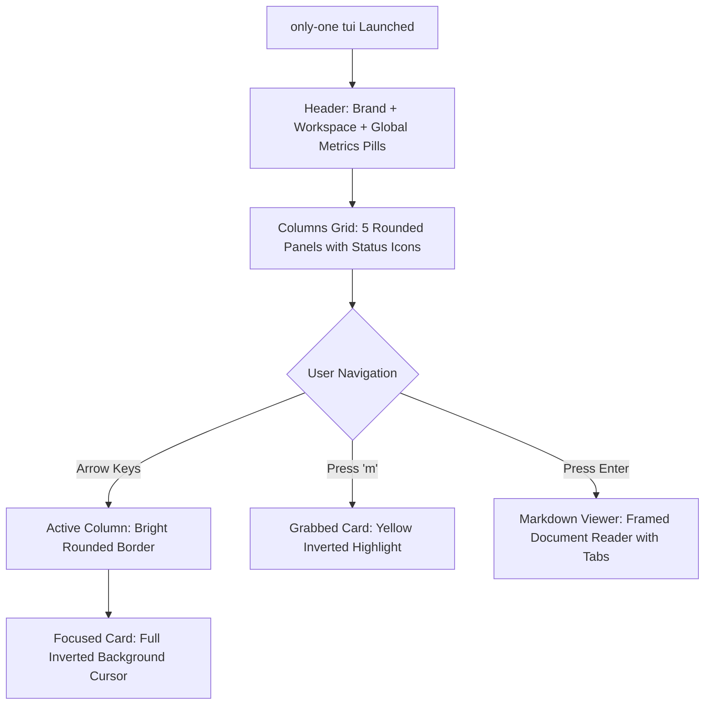

# Concept: LazyGit & K9s Visual Aesthetic Upgrade for TUI Board

## 1. Problem & Goal

### Problem (Current Bottlenecks & Deficiencies)
- **Context & Trigger**: The existing TUI board renders functional columns and cards, but the visual presentation uses basic sharp borders and simple text highlights.
- **Symptom & Defect**: 
  - Selected cards lack immediate visual punch (only a thin cyan border), causing cursor location ambiguity on dense screens.
  - Columns blend together with uniform gray borders, lacking visual hierarchy.
  - Header is plain without high-level metrics or project context.
- **Root Cause**: The initial implementation focused purely on functional data binding and lacked a cohesive design token system for terminal UI aesthetics.
- **Impact / Blast Radius**: Reduced developer engagement, eye fatigue, and slower navigation speed.

### Goal (Target Technical Outcomes)
- **Core Goal**: Transform the TUI into a premium **LazyGit / K9s-inspired Terminal Workstation** featuring rounded borders, inverted cursor highlight bars, status pill meters, and colored document tags.
- **Acceptance Criteria**:
  - Header with rounded borders, mini status counter pills (`[ 2 Concept | 1 Plan | 1 Doing | 0 Review | 2 Done ]`), and active Git branch tag.
  - Active column visual elevation with distinct colored rounded border and glowing title icon.
  - Active focused card renders with an **inverted background highlight bar** (`backgroundColor="cyan"` with black bold text) for zero-latency cursor tracking.
  - Grabbed card (Pick & Drop) renders with an eye-catching amber/yellow inverted cursor (`backgroundColor="yellow"` with black bold text).
  - Document badges rendered as colorful micro-pills (`[● concept]` in cyan, `[● plan]` in blue, `[● debug]` in yellow).
  - Enhanced Markdown Viewer with styled modal frame and progress gauge.

## 2. Scope Boundaries
- **In-Scope**:
  - Redesign `TaskCard.tsx` with inverted highlight background and pill badges.
  - Redesign `BoardView.tsx` with rounded borders, active column glow, and column status icons.
  - Redesign `Header.tsx` with summary status pills and workspace metadata.
  - Enhance `Footer.tsx` with styled keybinding pill badges.
  - Enhance `MarkdownViewer.tsx` with rounded container frame and formatted title bars.
- **Explicit Out-of-Scope**:
  - Modifying backend task scanning logic or filesystem mutations.
  - Adding mouse drag-and-drop physics (strictly retain high-speed keyboard navigation).
  - External web GUI or desktop electron wrappers.

## 3. Proposed Solution & Core Mechanism

### Core Mechanism
1. **Design Tokens & Theme System**:
   - `borderStyle="round"` across all primary panels (Header, Columns, Modal).
   - Inverted cursor pattern: `<Box backgroundColor={isGrabbed ? "yellow" : "cyan"}><Text color="black" bold> ► {slug} </Text></Box>`.
   - Lifecycle Palette:
     - 💡 **Concept**: Cyan (`#00f0ff`)
     - 📋 **Plan**: Blue / Indigo (`#4d88ff`)
     - ⚡ **In-Progress**: Yellow / Gold (`#ffcc00`)
     - 🔍 **Review**: Magenta / Purple (`#ff55ff`)
     - ✅ **Done**: Green / Emerald (`#00ff88`)
2. **Visual Hierarchy Flow**:
   - Header $\rightarrow$ Global Metrics Bar $\rightarrow$ 5 Rounded Column Containers $\rightarrow$ Inverted Highlight Card $\rightarrow$ Keybinding Pill Footer.

### Conceptual Flow


### ASCII UI Wireframe

#### 1. LazyGit-Style Main Board View
```text
╭── 🚀 ONLY-ONE ⚡ WORKFLOW BOARD ─────────────── [repo: personal/only-one-cli] ── [git: main] ╮
│ Metrics: [💡 2 Concept]  [📋 1 Plan]  [⚡ 1 Doing]  [🔍 0 Review]  [✅ 2 Done]  │ Total: 6 Tasks │
╰─────────────────────────────────────────────────────────────────────────────────────────────╯

╭─ 💡 CONCEPT (2) ─╮ ╭─ 📋 PLAN (1) ─────╮ ╭─ ⚡ DOING (1) ────╮ ╭─ 🔍 REVIEW (0) ──╮ ╭─ ✅ DONE (2) ─────╮
│ █ ► tui-board    │ │ ► auth-jwt        │ │ ► sync-sh-engine  │ │                  │ │ ► fix-paths       │
│   (Active Cursor)│ │   2d ago          │ │   debug.md        │ │   (No tasks)     │ │   3d ago          │
│   [concept]      │ │   [plan]          │ │   [debug]         │ │                  │ │   [concept] [done]│
│                  │ │                   │ │                   │ │                  │ │                   │
│   add-mcp        │ │                   │ │                   │ │                  │ │   cli-init        │
│   3d ago         │ │                   │ │                   │ │                  │ │   5d ago          │
│   [concept]      │ │                   │ │                   │ │                  │ │   [concept] [done]│
╰──────────────────╯ ╰───────────────────╯ ╰───────────────────╯ ╰──────────────────╯ ╰───────────────────╯

╭─────────────────────────────────────────────────────────────────────────────────────────────╮
│ [←/→] Column  [↑/↓] Select  [m] Move (Pick & Drop)  [Enter] Read MD  [p] Plan  [a] Apply  [q] Quit  │
╰─────────────────────────────────────────────────────────────────────────────────────────────╯
```

#### 2. Grabbed State (Pick & Drop Mode)
```text
╭─ 💡 CONCEPT (2) ─╮ ╭─ 📋 PLAN (1) ─────╮
│ █ ✦ [GRABBED]    │ │                   │
│   tui-board      │ │                   │
│   (Glowing Amber)│ │                   │
╰──────────────────╯ ╰───────────────────╯
```

### UI State Handling Matrix
| Component / State | Visual Presentation | Colors & Attributes |
| :--- | :--- | :--- |
| **Header Panel** | Rounded box containing brand title and summary metrics | Cyan frame, white bold text, colored mini pills |
| **Active Column** | Thick/colored rounded border around the column | Column color (`cyan`/`blue`/`yellow`/`green`), `borderStyle="round"` |
| **Inactive Column** | Dim single rounded border | Dim gray border, muted title text |
| **Focused Task Card** | Inverted background bar across card header | `backgroundColor="cyan"`, text `color="black"`, `bold` |
| **Grabbed Task Card** | Inverted yellow/amber background with grab indicator | `backgroundColor="yellow"`, text `color="black"`, `✦ [GRABBED]` |
| **Unfocused Card** | Clean card box with title and doc badges | Muted border, white text, gray badges |
| **Markdown Viewer** | Rounded overlay with distinct document tab bar | Cyan border, scroll meter `[Scroll: XX%]`, syntax styling |

## 4. Critical Risks & Edge Cases
- **Terminal Width Constraints**: On terminals with width < 120 columns, horizontal 5-column layout can compress card titles. Provide automatic text truncation (`wrap="truncate-end"`) and minimum column width clamping.
- **Truecolor Support**: Ensure color combinations use standard ANSI colors (`cyan`, `blue`, `yellow`, `green`, `magenta`, `gray`, `black`, `white`) to remain readable across dark and light terminal themes.
