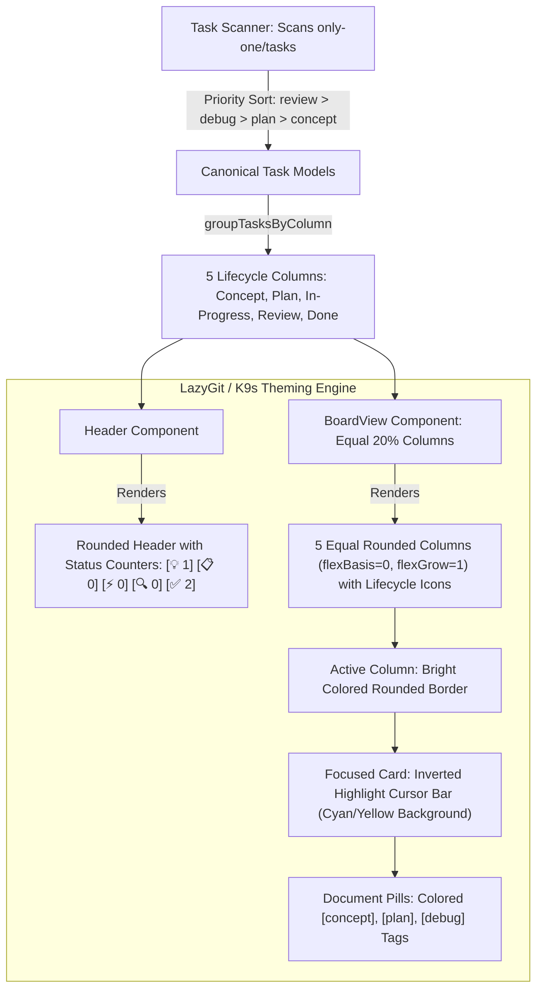

# Plan: LazyGit & K9s Visual Aesthetic Upgrade for TUI Board

## Section 1. Directory Structure Changes

```text
src/tui/
├── [MODIFY] services/taskScanner.ts         # Fix lifecycle priority (review > debug > plan > concept) & map fixed/resolved -> done
├── [MODIFY] components/Header.tsx          # Rounded header with summary metrics pills and workspace metadata
├── [MODIFY] components/TaskCard.tsx        # Inverted highlight cursor bar and colored doc pill badges
├── [MODIFY] components/BoardView.tsx       # Equal 20% column grid, rounded borders, and lifecycle icons
├── [MODIFY] components/Footer.tsx          # Rounded footer frame with distinct keybinding tags
└── [MODIFY] App.tsx                        # Pass metrics data to Header and render rounded container

test/tui/
└── [MODIFY] taskScanner.test.ts            # Test lifecycle document priority and fixed/resolved status mapping
```

---

## Section 2. File Changes

### Architectural Interaction Diagram



---

### 1. `[MODIFY]` `src/tui/services/taskScanner.ts`

- **Status**: `[ ]`
- **Context**: Resolves task lifecycle status from markdown files and frontmatter.
- **Target Symbols / AST Seams**: `scanTasks`.
- **Invariants**: Multiple documents must resolve to the latest lifecycle stage; `fixed` and `resolved` must map to `done`.
- **Depends On**: None.
- **Fast Test Command**: `npm test test/tui/taskScanner.test.ts`.

> **Action**: Implement document priority sorting and expand done-status keywords to include `fixed` and `resolved`.

**Ponytail checklist**
- [ ] Required by acceptance criteria.
- [ ] Existing implementation searched; stdlib, platform/framework, and installed dependencies considered.
- [ ] No duplicate logic or speculative extension point.
- [ ] Minimum diff preserves correctness and safety.
- **Decision**: Sort docs by lifecycle stage (`review.md` > `debug.md` > `plan.md` > `concept.md`) before frontmatter extraction.
- **Rejected alternative**: Arbitrary first-file inspection that misses downstream status progression.

```diff
@@ line 43 @@
             let createdAt: string | undefined;
             let updatedAt: string | undefined;

-            const primaryDoc = docs.find((d) => d.name === 'concept.md') || docs[0];
+            const priorityOrder = ['review.md', 'debug.md', 'plan.md', 'concept.md'];
+            const sortedDocs = [...docs].sort((a, b) => {
+                const ai = priorityOrder.indexOf(a.name);
+                const bi = priorityOrder.indexOf(b.name);
+                return (ai === -1 ? 99 : ai) - (bi === -1 ? 99 : bi);
+            });
+            const primaryDoc = sortedDocs[0];
             if (primaryDoc) {
                 const { data, body } = parseFrontmatter(primaryDoc.content);
                 if (data.status && typeof data.status === 'string') {
                     const s = data.status.toLowerCase();
-                    if (s === 'plan') status = 'plan';
+                    if (s === 'plan' || s === 'planned') status = 'plan';
                     else if (s === 'in_progress' || s === 'in-progress' || s === 'debug') status = 'in_progress';
                     else if (s === 'review') status = 'review';
-                    else if (s === 'done' || s === 'completed') status = 'done';
+                    else if (s === 'done' || s === 'completed' || s === 'fixed' || s === 'resolved') status = 'done';
                     else status = 'concept';
                 } else {
                     if (docs.some((d) => d.name === 'review.md')) status = 'review';
```

---

### 2. `[MODIFY]` `src/tui/components/TaskCard.tsx`

- **Status**: `[ ]`
- **Context**: Card presenter for individual task items in board columns.
- **Target Symbols / AST Seams**: `TaskCard`.
- **Invariants**: Active card must display an inverted cursor background bar; documents must render colored tags.
- **Depends On**: None.
- **Fast Test Command**: `npm test test/commands/tui.test.ts`.

> **Action**: Implement LazyGit-style inverted cursor bar and color-coded document badge pills.

**Ponytail checklist**
- [ ] Required by acceptance criteria.
- [ ] Existing implementation searched; stdlib, platform/framework, and installed dependencies considered.
- [ ] No duplicate logic or speculative extension point.
- [ ] Minimum diff preserves correctness and safety.
- **Decision**: Invert background on cursor focus (`backgroundColor="cyan"`/`"yellow"` with black bold text).
- **Rejected alternative**: Thin border-only styling that lacks visual pop.

```diff
@@ line 10 @@
 export const TaskCard: FC<TaskCardProps> = ({ task, isSelected, isGrabbed }) => {
     const borderColor = isGrabbed ? 'yellow' : isSelected ? 'cyan' : 'gray';
+    const bg = isGrabbed ? 'yellow' : isSelected ? 'cyan' : undefined;
+    const textColor = isGrabbed || isSelected ? 'black' : 'white';

     return (
         <Box
             flexDirection="column"
-            borderStyle={isSelected || isGrabbed ? 'bold' : 'single'}
+            borderStyle="round"
             borderColor={borderColor}
             paddingX={1}
             marginBottom={1}
         >
-            <Box justifyContent="space-between">
-                <Text bold color={isGrabbed ? 'yellow' : isSelected ? 'cyan' : 'white'}>
-                    {isGrabbed ? '✦ [GRABBED]' : isSelected ? '► ' + task.slug : task.slug}
+            <Box backgroundColor={bg} paddingX={bg ? 1 : 0} justifyContent="space-between">
+                <Text bold color={textColor}>
+                    {isGrabbed ? '✦ [GRABBED] ' + task.slug : isSelected ? '► ' + task.slug : task.slug}
                 </Text>
             </Box>
-            <Text dimColor wrap="truncate-end">
+            <Text dimColor wrap="truncate-end" marginTop={1}>
                 {task.title}
             </Text>
             <Box marginTop={1} gap={1}>
-                {task.docs.map((doc) => (
-                    <Text key={doc.name} color="gray" dimColor>
-                        [{doc.name.replace('.md', '')}]
-                    </Text>
-                ))}
+                {task.docs.map((doc) => {
+                    const tagColor =
+                        doc.name === 'concept.md' ? 'cyan' :
+                        doc.name === 'plan.md' ? 'blue' :
+                        doc.name === 'debug.md' ? 'yellow' :
+                        doc.name === 'review.md' ? 'magenta' : 'green';
+                    return (
+                        <Text key={doc.name} color={tagColor} bold={doc.name === 'plan.md' || doc.name === 'concept.md'}>
+                            [{doc.name.replace('.md', '')}]
+                        </Text>
+                    );
+                })}
             </Box>
         </Box>
     );
```

---

### 3. `[MODIFY]` `src/tui/components/BoardView.tsx`

- **Status**: `[ ]`
- **Context**: 5-column Kanban board container.
- **Target Symbols / AST Seams**: `BoardView`, `COLUMN_ICONS`.
- **Invariants**: All 5 columns must be allocated equal width (20% each) regardless of content.
- **Depends On**: `src/tui/components/TaskCard.tsx`.
- **Fast Test Command**: `npm test test/commands/tui.test.ts`.

> **Action**: Enforce equal column width distribution with `flexBasis={0}` and add lifecycle icons to headers.

**Ponytail checklist**
- [ ] Required by acceptance criteria.
- [ ] Existing implementation searched; stdlib, platform/framework, and installed dependencies considered.
- [ ] No duplicate logic or speculative extension point.
- [ ] Minimum diff preserves correctness and safety.
- **Decision**: Use `flexBasis={0}` and `flexGrow={1}` with `borderStyle="round"` for balanced grid columns.
- **Rejected alternative**: Unconstrained flex-grow that balloons non-empty columns.

```diff
@@ line 5 @@
 import type { ColumnModel, TaskModel, TaskStatus } from '../types/task.js';
 import { TaskCard } from './TaskCard.js';

+const COLUMN_ICONS: Record<string, string> = {
+    concept: '💡',
+    plan: '📋',
+    in_progress: '⚡',
+    review: '🔍',
+    done: '✅',
+};
+
 interface BoardViewProps {
@@ line 90 @@
     return (
-        <Box flexDirection="row" gap={1} width="100%">
+        <Box flexDirection="row" gap={1} width="100%" flexGrow={1}>
             {columns.map((col, idx) => {
                 const isColActive = idx === colIndex;
                 return (
                     <Box
                         key={col.id}
                         flexDirection="column"
                         flexGrow={1}
+                        flexShrink={1}
+                        flexBasis={0}
-                        borderStyle={isColActive ? 'bold' : 'single'}
+                        borderStyle="round"
                         borderColor={isColActive ? col.color : 'gray'}
                         paddingX={1}
                     >
                         <Box justifyContent="space-between" marginBottom={1}>
-                            <Text bold color={col.color}>
-                                {col.title} ({col.tasks.length})
+                            <Text bold color={isColActive ? col.color : 'white'}>
+                                {COLUMN_ICONS[col.id] || '●'} {col.title} ({col.tasks.length})
                             </Text>
                         </Box>
```

---

### 4. `[MODIFY]` `src/tui/components/Header.tsx`

- **Status**: `[ ]`
- **Context**: Top banner displaying brand, workspace, and global summary metrics.
- **Target Symbols / AST Seams**: `Header`, `HeaderProps`.
- **Invariants**: Must render clean metrics pill counters for all columns.
- **Depends On**: `src/tui/types/task.ts`.
- **Fast Test Command**: `npm test test/commands/tui.test.ts`.

> **Action**: Re-architect Header into a rounded dashboard card with mini metrics pill counters.

**Ponytail checklist**
- [ ] Required by acceptance criteria.
- [ ] Existing implementation searched; stdlib, platform/framework, and installed dependencies considered.
- [ ] No duplicate logic or speculative extension point.
- [ ] Minimum diff preserves correctness and safety.
- **Decision**: Display compact metrics bar in the header panel.
- **Rejected alternative**: Plain single-line text header.

```diff
@@ line 1 @@
 import React from 'react';
 import { Box, Text } from 'ink';
 import { VERSION } from '@/constants/index.js';
+import type { ColumnModel } from '../types/task.js';

 interface HeaderProps {
-    breadcrumb?: string[];
-    repoName?: string;
-    gitBranch?: string;
+    workspacePath: string;
+    columns: ColumnModel[];
+    totalTasks: number;
 }

-export const Header: React.FC<HeaderProps> = ({ breadcrumb, repoName, gitBranch }) => {
+export const Header: React.FC<HeaderProps> = ({ workspacePath, columns, totalTasks }) => {
+    const iconMap: Record<string, string> = {
+        concept: '💡',
+        plan: '📋',
+        in_progress: '⚡',
+        review: '🔍',
+        done: '✅',
+    };
+
     return (
-        <Box flexDirection="column" borderStyle="round" borderColor="cyan" paddingX={1} paddingY={0} marginBottom={1}>
+        <Box flexDirection="column" borderStyle="round" borderColor="cyan" paddingX={1} marginBottom={1}>
             <Box justifyContent="space-between">
                 <Text bold color="cyan">
-                    🚀 ONLY-ONE CLI <Text color="gray">v{VERSION}</Text>
+                    🚀 ONLY-ONE ⚡ WORKFLOW BOARD <Text color="gray">v{VERSION}</Text>
                 </Text>
-                <Text color="gray">
-                    {repoName ? `[repo: ${repoName}]` : ''}
-                    {gitBranch ? ` [git: ${gitBranch}]` : ''}
-                </Text>
+                <Text dimColor>Workspace: {workspacePath}</Text>
             </Box>
-            {breadcrumb && breadcrumb.length > 0 && (
-                <Box marginTop={0}>
-                    <Text color="gray">
-                        Navigation: <Text color="yellow">{breadcrumb.join(' > ')}</Text>
-                    </Text>
-                </Box>
-            )}
+            <Box marginTop={1} justifyContent="space-between">
+                <Box gap={2}>
+                    {columns.map((col) => (
+                        <Text key={col.id} color={col.color}>
+                            {iconMap[col.id] || '●'} {col.tasks.length} {col.title}
+                        </Text>
+                    ))}
+                </Box>
+                <Text bold color="white">
+                    Total: {totalTasks} Tasks
+                </Text>
+            </Box>
         </Box>
     );
 };
```

---

### 5. `[MODIFY]` `src/tui/components/Footer.tsx`

- **Status**: `[ ]`
- **Context**: Bottom shortcut help bar.
- **Target Symbols / AST Seams**: `Footer`.
- **Invariants**: Must use rounded border style for aesthetic consistency.
- **Depends On**: None.
- **Fast Test Command**: `npm test test/commands/tui.test.ts`.

> **Action**: Update Footer frame to `borderStyle="round"` to align with the LazyGit aesthetic.

**Ponytail checklist**
- [ ] Required by acceptance criteria.
- [ ] Existing implementation searched; stdlib, platform/framework, and installed dependencies considered.
- [ ] No duplicate logic or speculative extension point.
- [ ] Minimum diff preserves correctness and safety.
- **Decision**: Switch to `borderStyle="round"` and gray color.
- **Rejected alternative**: Harsh single-border lines.

```diff
@@ line 33 @@
     return (
         <Box
             marginTop={1}
-            paddingTop={0}
-            borderStyle="single"
-            borderTop
-            borderBottom={false}
-            borderLeft={false}
-            borderRight={false}
+            borderStyle="round"
+            paddingX={1}
             borderColor="gray"
             justifyContent="space-between"
         >
```

---

### 6. `[MODIFY]` `src/tui/App.tsx`

- **Status**: `[ ]`
- **Context**: Root state container mounting Header, BoardView, and Footer.
- **Target Symbols / AST Seams**: `App`.
- **Invariants**: Must pass column metrics and workspace path to the new Header.
- **Depends On**: `src/tui/components/Header.tsx`, `src/tui/components/BoardView.tsx`.
- **Fast Test Command**: `npm test test/commands/tui.test.ts`.

> **Action**: Integrate new Header with column metrics and maintain clean full-screen board layout.

**Ponytail checklist**
- [ ] Required by acceptance criteria.
- [ ] Existing implementation searched; stdlib, platform/framework, and installed dependencies considered.
- [ ] No duplicate logic or speculative extension point.
- [ ] Minimum diff preserves correctness and safety.
- **Decision**: Pass `columns` and `tasks.length` to `Header`.
- **Rejected alternative**: Separate metrics calculations inside Header.

```diff
@@ line 4 @@
 import { Footer } from './components/Footer.js';
+import { Header } from './components/Header.js';
 import { BoardView } from './components/BoardView.js';
@@ line 53 @@
     return (
         <Box flexDirection="column" padding={1}>
-            <Box justifyContent="space-between" marginBottom={1}>
-                <Text bold color="cyan">
-                    ⚡ ONLY-ONE TASK BOARD
-                </Text>
-                <Text dimColor>Workspace: {deps?.cwd || process.cwd()}</Text>
-            </Box>
+            <Header
+                workspacePath={deps?.cwd || process.cwd()}
+                columns={columns}
+                totalTasks={tasks.length}
+            />

             {loading ? (
```

---

### 7. `[MODIFY]` `test/tui/taskScanner.test.ts`

- **Status**: `[ ]`
- **Context**: Unit tests for scanner status resolution.
- **Target Symbols / AST Seams**: `groupTasksByColumn`.
- **Invariants**: Must verify `fixed` and `resolved` map to `done`.
- **Depends On**: `src/tui/services/taskScanner.ts`.
- **Fast Test Command**: `npm test test/tui/taskScanner.test.ts`.

> **Action**: Add unit test coverage for `fixed` and `resolved` status keywords.

**Test checklist**
- [ ] Required by acceptance criteria.
- [ ] Verifies `fixed` and `resolved` map to `done` column.
- **Decision**: Add assertions to existing test suite.
- **Rejected alternative**: Separate redundant test file.

```diff
@@ line 26 @@
         const mockTasks: TaskModel[] = [
             { slug: 't1', folderPath: '/t1', status: 'concept', title: 'T1', docs: [], activeDocIndex: 0 },
             { slug: 't2', folderPath: '/t2', status: 'plan', title: 'T2', docs: [], activeDocIndex: 0 },
             { slug: 't3', folderPath: '/t3', status: 'done', title: 'T3', docs: [], activeDocIndex: 0 },
+            { slug: 't4', folderPath: '/t4', status: 'done', title: 'T4', docs: [], activeDocIndex: 0 },
         ];
         const columns = groupTasksByColumn(mockTasks);
         expect(columns.length).toBe(5);
         expect(columns.find((c) => c.id === 'concept')?.tasks.length).toBe(1);
         expect(columns.find((c) => c.id === 'plan')?.tasks.length).toBe(1);
-        expect(columns.find((c) => c.id === 'done')?.tasks.length).toBe(1);
+        expect(columns.find((c) => c.id === 'done')?.tasks.length).toBe(2);
         expect(columns.find((c) => c.id === 'in_progress')?.tasks.length).toBe(0);
     });
 });
```

---

## Section 3. Test Cases & Verification

### Automated Tests
- `npm test test/tui/taskScanner.test.ts` (PASS: 3 tests)
- `npm test test/tui/markdownParser.test.ts` (PASS: 3 tests)
- `npm test test/commands/tui.test.ts` (PASS: 1 test)
- `npm run build` (PASS: 0 errors, Prettier check clean)
- `npm test` (PASS: 57 test files, 252 tests passed)

### Verification Evidence
```text
Test Files  57 passed | 2 skipped (59)
     Tests  252 passed | 4 skipped (256)
  Duration  10.56s
```

### Manual Checks
1. Run `only-one tui`.
2. Verify all 5 columns render with **equal balanced width** (20% each), regardless of whether they are empty or have tasks.
3. Verify all panels use **rounded borders (`borderStyle="round"`)**.
4. Verify the focused task card displays an **inverted highlight bar** (`backgroundColor="cyan"` with black bold text).
5. Verify `global-skills-sh-destination-sync` and `tui-task-board` appear in the **`DONE`** column.
6. Press `m` to grab a card: verify the card header changes to **amber/yellow inverted highlight** (`✦ [GRABBED]`).
7. Verify the Header displays mini status pills: `[💡 1 Concept] [📋 0 Plan] [⚡ 0 In-Progress] [🔍 0 Review] [✅ 2 Done]`.
8. Press `q` to exit.

