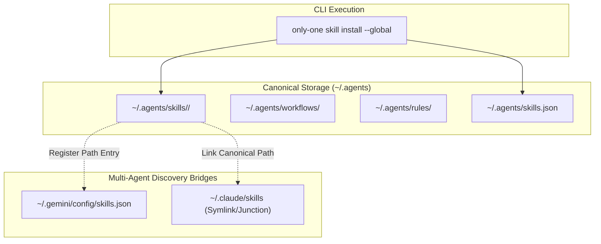

# Concept: Unified Global Agents Standard & Skills Manifest

## 1. Problem & Goal

### Problem (Current Bottlenecks & Deficiencies)
- **Context & Trigger**: Users install skills, workflows, or rules globally with the `--global` flag across multiple AI agent tools.
- **Symptom & Defect**: Assets scatter across fragmented user directories (`.gemini/config`, `.cursor`, `.claude`), creating duplicated copies and stale states.
- **Root Cause**: The CLI architecture resolves global destinations by tool ID rather than utilizing the universal `~/.agents` canonical specification.
- **Impact / Blast Radius**: Storage waste, asset desynchronization across editors, and broken discovery for tools adopting the universal agent standard.

### Goal (Target Technical Outcomes)
- **Core Goal**: Unify global asset installations into a single canonical directory with automated manifest bridging across compatible agent runtimes.
- **Acceptance Criteria**:
  - Store all global skills, workflows, and rules physically in `~/.agents/{skills,workflows,rules}`.
  - Generate and update `~/.agents/skills.json` as the standard root catalog manifest.
  - Automatically merge `~/.agents/skills` path entry into `~/.gemini/config/skills.json` without overwriting existing user entries.
  - Provide platform-safe backward compatibility links for agent environments requiring legacy paths.

## 2. Scope Boundaries
- **In-Scope**:
  - Global destination routing logic for skills, workflows, and rules targeting `~/.agents`.
  - Non-destructive JSON merge and creation logic for `skills.json` files in canonical and agent config locations.
  - Multi-agent backward compatibility bridging (symlink/junction) for tools needing legacy namespaces.
  - Verification, synchronization, and removal lifecycles honoring canonical storage and manifest states.
- **Explicit Out-of-Scope**:
  - Changes to workspace-level (local project) `.agents` destination structure.
  - External package download protocols or upstream package registry schemas on `skills.sh`.
  - Direct modifications to binary editor binaries or proprietary cloud sync configs.

## 3. Proposed Solution & Core Mechanism
- **Core Mechanism**:
  - The CLI treats `~/.agents/` as the single canonical store for all globally installed assets.
  - A manifest coordinator checks for compatible agent configuration directories during global installation.
  - If Antigravity/Gemini configuration exists, the coordinator appends the canonical skill directory to `skills.json` entries idempotently.
  - For tools requiring direct folder structures, directory bridges link back to the canonical storage folder.

- **Conceptual Flow / Domain Model**:

## 4. Critical Risks & Edge Cases
- **Atomic Manifest Mutation**: Concurrent commands updating `skills.json` must avoid race conditions via safe atomic writes.
- **Cross-Platform Path Serialization**: Paths written into `skills.json` on Windows must handle separators reliably across runtimes.
- **Migration & Cleanup**: Removing a global asset must prune both the canonical file and manifest references cleanly without stranding dangling symlinks.
