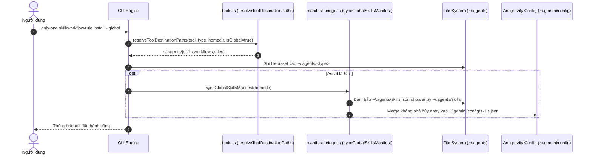

# Plan: Chuẩn hóa Global Agents và Manifest Skills Đa Nền tảng

## Section 1. Thay đổi Cấu trúc Thư mục (Directory Structure Changes)

```text
src/
├── core/
│   ├── agent/
│   │   └── [MODIFY] tools.ts                      # Định tuyến toàn bộ global assets về ~/.agents/
│   ├── assets/
│   │   └── [MODIFY] sync.ts                       # Thu gọn thư mục quét global thành ['.agents']
│   └── skill/
│       ├── [NEW]    manifest-bridge.ts            # Đồng bộ an toàn file manifest skills.json
│       ├── [MODIFY] index.ts                      # Kích hoạt manifest bridge khi cài skill global
│       └── remote/
│           └── [MODIFY] skills-sh-installer.ts    # Kích hoạt manifest bridge khi cài remote skill
test/
├── core/
│   ├── [NEW]    manifest-bridge.test.ts           # Unit tests kiểm tra merge và tính bất biến của skills.json
│   └── [MODIFY] skill-installer-global.test.ts    # Cập nhật assertion đích đến về ~/.agents/skills
└── commands/
    └── [MODIFY] global-commands.test.ts           # Cập nhật integration assertions về ~/.agents/
```

## Section 2. Chi tiết Thay đổi File (File Changes)

### Sơ đồ Tương tác Kiến trúc (Architectural Interaction Diagram)



---

### 1. `[MODIFY]` `src/core/agent/tools.ts`

- **Status**: `[ ]`
- **Context**: Định tuyến đường dẫn đích cho assets qua các tool và phạm vi global/local.
- **Target Symbols / AST Seams**: `resolveToolDestinationPaths`
- **Invariants**: Khi `isGlobal` là true, mọi tool đều phân giải về `join(targetDir, '.agents', assetType)`.
- **Depends On**: Không có.
- **Fast Test Command**: `npm test test/core/agent/tools.test.ts`

> **Action**: Chuyển hướng toàn bộ global assets về `.agents/{skills,workflows,rules}`.

**Ponytail checklist**
- [x] Required by acceptance criteria.
- [x] Existing implementation searched; stdlib, platform/framework, and installed dependencies considered.
- [x] No duplicate logic or speculative extension point.
- [x] Minimum diff preserves correctness and safety.
- **Decision**: Thu gọn các nhánh rẽ tool riêng biệt trong `resolveToolDestinationPaths` khi `isGlobal` là true.
- **Rejected alternative**: Giữ thư mục riêng cho từng tool dẫn đến nhân bản dữ liệu nhiều lần.

```diff
@@ -25,14 +25,2 @@ export function resolveToolDestinationPaths(
-    if (tool.value === 'antigravity') {
-        return join(targetDir, '.gemini/config', assetType);
-    }
-    if (tool.value === 'claude') {
-        return join(targetDir, '.claude', assetType);
-    }
-    if (tool.value === 'cursor') {
-        return join(targetDir, '.cursor', assetType);
-    }
-    if (tool.value === 'codex') {
-        return join(targetDir, '.codex', assetType);
-    }
-    return join(targetDir, tool.skillsDir || '.agents', assetType);
+    return join(targetDir, '.agents', assetType);
 }
```

---

### 2. `[MODIFY]` `src/core/assets/sync.ts`

- **Status**: `[ ]`
- **Context**: Xác định các thư mục agent cần kiểm tra, khôi phục hoặc dọn dẹp assets.
- **Target Symbols / AST Seams**: `getTargetAgentDirs`
- **Invariants**: Khi `isGlobal` là true, chỉ trả về `['.agents']` để tránh tạo bản sao thừa.
- **Depends On**: Không có.
- **Fast Test Command**: `npm test test/core/assets/sync.test.ts`

> **Action**: Thống nhất danh sách thư mục agent global về duy nhất `['.agents']`.

**Ponytail checklist**
- [x] Required by acceptance criteria.
- [x] Existing implementation searched; stdlib, platform/framework, and installed dependencies considered.
- [x] No duplicate logic or speculative extension point.
- [x] Minimum diff preserves correctness and safety.
- **Decision**: Trả về `['.agents']` khi `isGlobal` là true.
- **Rejected alternative**: Trả về `['.gemini/config', '.claude', '.cursor', '.codex']` gây nhân bản 4 lần file vật lý.

```diff
@@ -35,3 +35,3 @@ function getTargetAgentDirs(projectDir: string, isGlobal = false): string[] {
     if (isGlobal) {
-        return ['.gemini/config', '.claude', '.cursor', '.codex'];
+        return ['.agents'];
     }
```

---

### 3. `[NEW]` `src/core/skill/manifest-bridge.ts`

- **Status**: `[ ]`
- **Context**: Cầu nối quản lý manifest `skills.json` cho chuẩn mở chung và Antigravity IDE.
- **Target Symbols / AST Seams**: `syncGlobalSkillsManifest`
- **Invariants**: Merge an toàn không phá hủy `{ path: '~/.agents/skills' }` vào manifest hiện có.
- **Depends On**: Không có.
- **Fast Test Command**: `npm test test/core/manifest-bridge.test.ts`

> **Action**: Tạo manifest bridge module để đồng bộ `skills.json`.

**Ponytail checklist**
- [x] Required by acceptance criteria.
- [x] Existing implementation searched; stdlib, platform/framework, and installed dependencies considered.
- [x] No duplicate logic or speculative extension point.
- [x] Minimum diff preserves correctness and safety.
- **Decision**: Module riêng chuyên trách đọc, merge và lưu `skills.json` an toàn.
- **Rejected alternative**: Viết code inline rải rác trong các command file.

```typescript
import { existsSync } from 'node:fs';
import { mkdir, readFile, writeFile } from 'node:fs/promises';
import { join } from 'node:path';

export type SkillsManifestEntry = {
    path: string;
    exclude?: string[];
};

export type SkillsManifest = {
    entries: SkillsManifestEntry[];
};

const CANONICAL_SKILL_PATH = '~/.agents/skills';

export async function mergeSkillsManifest(filePath: string): Promise<void> {
    let manifest: SkillsManifest = { entries: [] };

    if (existsSync(filePath)) {
        try {
            const content = await readFile(filePath, 'utf-8');
            const parsed = JSON.parse(content);
            if (parsed && Array.isArray(parsed.entries)) {
                manifest = parsed;
            }
        } catch {
            manifest = { entries: [] };
        }
    } else {
        await mkdir(join(filePath, '..'), { recursive: true });
    }

    const hasEntry = manifest.entries.some((e) => e.path === CANONICAL_SKILL_PATH || e.path === '~/.agents/skills/');
    if (!hasEntry) {
        manifest.entries.push({ path: CANONICAL_SKILL_PATH });
    }

    await writeFile(filePath, JSON.stringify(manifest, null, 2) + '\n', 'utf-8');
}

export async function syncGlobalSkillsManifest(homeDir: string): Promise<void> {
    const agentsManifestPath = join(homeDir, '.agents', 'skills.json');
    const geminiManifestPath = join(homeDir, '.gemini', 'config', 'skills.json');

    await mergeSkillsManifest(agentsManifestPath);
    await mergeSkillsManifest(geminiManifestPath);
}
```

---

### 4. `[MODIFY]` `src/core/skill/index.ts`

- **Status**: `[ ]`
- **Context**: Cài đặt skills nội bộ vào các thư mục công cụ đích.
- **Target Symbols / AST Seams**: `installSkills`
- **Invariants**: Kích hoạt `syncGlobalSkillsManifest` khi `isGlobal` là true.
- **Depends On**: `src/core/skill/manifest-bridge.ts`
- **Fast Test Command**: `npm test test/commands/skill/skill.test.ts`

> **Action**: Gọi manifest bridge sau khi hoàn tất cài đặt skill global.

**Ponytail checklist**
- [x] Required by acceptance criteria.
- [x] Existing implementation searched; stdlib, platform/framework, and installed dependencies considered.
- [x] No duplicate logic or speculative extension point.
- [x] Minimum diff preserves correctness and safety.
- **Decision**: Gọi `syncGlobalSkillsManifest(projectDir)` sau khi lưu skill global.
- **Rejected alternative**: Bắt người dùng tự tạo `skills.json` thủ công.

```diff
@@ -6,2 +6,3 @@ import { resolveToolDestinationPaths } from '@/core/agent/tools.js';
 import { fetchSkillContentFromGitHub } from '@/core/skill/remote/github-fetcher.js';
+import { syncGlobalSkillsManifest } from './manifest-bridge.js';
 import { saveSkillToLockfile } from './remote/lockfile.js';
@@ -165,2 +166,6 @@ export const installSkills = async (request: {
     }
+
+    if (isGlobal) {
+        await syncGlobalSkillsManifest(projectDir);
     }
 
     return results;
```

---

### 5. `[MODIFY]` `src/core/skill/remote/skills-sh-installer.ts`

- **Status**: `[ ]`
- **Context**: Trình cài đặt remote skills từ `skills.sh`.
- **Target Symbols / AST Seams**: `installSkillViaSkillsCli`
- **Invariants**: Đồng bộ manifests khi `isGlobal` là true.
- **Depends On**: `src/core/skill/manifest-bridge.ts`
- **Fast Test Command**: `npm test test/core/skill-installer-global.test.ts`

> **Action**: Kích hoạt manifest bridge sau khi cài remote skill global.

**Ponytail checklist**
- [x] Required by acceptance criteria.
- [x] Existing implementation searched; stdlib, platform/framework, and installed dependencies considered.
- [x] No duplicate logic or speculative extension point.
- [x] Minimum diff preserves correctness and safety.
- **Decision**: Gọi `syncGlobalSkillsManifest(projectDir)` nếu `isGlobal` là true.
- **Rejected alternative**: Bỏ quên việc index remote skills trong `skills.json`.

```diff
@@ -7,2 +7,3 @@ import { resolveToolDestinationPaths, type AgentToolOption } from '@/core/agent/
+import { syncGlobalSkillsManifest } from '../manifest-bridge.js';
 
@@ -82,2 +83,6 @@ export async function installSkillViaSkillsCli(params: {
     }
+
+    if (isGlobal) {
+        await syncGlobalSkillsManifest(projectDir);
     }
 }
```

---

### 6. `[NEW]` `test/core/manifest-bridge.test.ts`

- **Status**: `[ ]`
- **Context**: Unit tests cho `syncGlobalSkillsManifest` và `mergeSkillsManifest`.
- **Target Symbols / AST Seams**: `mergeSkillsManifest`, `syncGlobalSkillsManifest`
- **Invariants**: Kiểm tra tính bất biến (idempotency), bảo toàn cấu hình cũ và tạo thư mục cha.
- **Depends On**: `src/core/skill/manifest-bridge.ts`
- **Fast Test Command**: `npm test test/core/manifest-bridge.test.ts`

> **Action**: Bổ sung bộ unit test cho việc đồng bộ manifest.

**Test checklist**
- [x] Fixture/helper reuse verified.
- [x] No duplicate setup.
- [x] Tests changed behavior only.
- [x] Existing toolchain (Vitest) used.
- **Decision**: Kiểm tra việc tạo file, tính bất biến khi chạy lặp lại và merge an toàn.
- **Rejected alternative**: Chỉ trông cậy vào integration test.

```typescript
import { describe, expect, it, beforeEach, afterEach } from 'vitest';
import { mkdtemp, readFile, rm, writeFile, mkdir } from 'node:fs/promises';
import { existsSync } from 'node:fs';
import { tmpdir } from 'node:os';
import { join } from 'node:path';
import { mergeSkillsManifest, syncGlobalSkillsManifest } from '@src/core/skill/manifest-bridge.js';

describe('Skills Manifest Bridge', () => {
    let tempDir: string;

    beforeEach(async () => {
        tempDir = await mkdtemp(join(tmpdir(), 'manifest-bridge-test-'));
    });

    afterEach(async () => {
        if (tempDir && existsSync(tempDir)) {
            await rm(tempDir, { recursive: true, force: true });
        }
    });

    it('creates manifest file with canonical path when missing', async () => {
        const manifestPath = join(tempDir, 'skills.json');
        await mergeSkillsManifest(manifestPath);

        expect(existsSync(manifestPath)).toBe(true);
        const data = JSON.parse(await readFile(manifestPath, 'utf-8'));
        expect(data.entries).toEqual([{ path: '~/.agents/skills' }]);
    });

    it('is idempotent and does not duplicate existing entry', async () => {
        const manifestPath = join(tempDir, 'skills.json');
        await mergeSkillsManifest(manifestPath);
        await mergeSkillsManifest(manifestPath);

        const data = JSON.parse(await readFile(manifestPath, 'utf-8'));
        expect(data.entries).toHaveLength(1);
    });

    it('preserves existing custom entries', async () => {
        const manifestPath = join(tempDir, 'skills.json');
        await mkdir(tempDir, { recursive: true });
        await writeFile(manifestPath, JSON.stringify({ entries: [{ path: '/custom/path' }] }), 'utf-8');

        await mergeSkillsManifest(manifestPath);

        const data = JSON.parse(await readFile(manifestPath, 'utf-8'));
        expect(data.entries).toEqual([
            { path: '/custom/path' },
            { path: '~/.agents/skills' },
        ]);
    });

    it('syncs both ~/.agents and ~/.gemini/config manifests', async () => {
        await syncGlobalSkillsManifest(tempDir);

        const agentsManifest = join(tempDir, '.agents', 'skills.json');
        const geminiManifest = join(tempDir, '.gemini', 'config', 'skills.json');

        expect(existsSync(agentsManifest)).toBe(true);
        expect(existsSync(geminiManifest)).toBe(true);
    });
});
```

---

### 7. `[MODIFY]` `test/core/skill-installer-global.test.ts`

- **Status**: `[ ]`
- **Context**: Kiểm tra định tuyến đường dẫn cài đặt global skill.
- **Target Symbols / AST Seams**: `global skill destination sync`
- **Invariants**: Khẳng định đường dẫn global skill của Antigravity trỏ về `.agents/skills`.
- **Depends On**: `src/core/agent/tools.ts`
- **Fast Test Command**: `npm test test/core/skill-installer-global.test.ts`

> **Action**: Cập nhật bài test định tuyến global để assert đường dẫn canonical `.agents/skills`.

**Ponytail checklist**
- [x] Required by acceptance criteria.
- [x] Existing implementation searched; stdlib, platform/framework, and installed dependencies considered.
- [x] No duplicate logic or speculative extension point.
- [x] Minimum diff preserves correctness and safety.
- **Decision**: Khẳng định `~/.agents/skills` được trả về khi `isGlobal` là true.
- **Rejected alternative**: Xóa bài test.

```diff
@@ -9,4 +9,4 @@ describe('global skill destination sync', () => {
-    it('strictly checks resolved global destination without false-positive fallback', async () => {
+    it('strictly resolves global destination to canonical .agents/skills', async () => {
         const tempDir = await mkdtemp(join(tmpdir(), 'global-skill-test-'));
         const antigravity = AI_TOOLS.find((t) => t.value === 'antigravity')!;
 
@@ -15,7 +15,6 @@ describe('global skill destination sync', () => {
-            // Only in .agents, not in .gemini/config
             await mkdir(join(tempDir, '.agents', 'skills', 'test-skill'), { recursive: true });
             await writeFile(join(tempDir, '.agents', 'skills', 'test-skill', 'SKILL.md'), '# Test Skill');
 
-            // Must NOT return true/path for global if not in .gemini/config
             const path = getExternalSkillPath(tempDir, antigravity, 'test-skill', true);
-            expect(existsSync(path!)).toBe(false);
+            expect(path).toBe(join(tempDir, '.agents', 'skills', 'test-skill', 'SKILL.md'));
+            expect(existsSync(path!)).toBe(true);
         } finally {
```

---

### 8. `[MODIFY]` `test/commands/global-commands.test.ts`

- **Status**: `[ ]`
- **Context**: Integration test cho các lệnh CLI chạy với cờ `--global`.
- **Target Symbols / AST Seams**: `Global Commands Integration (--global flag)`
- **Invariants**: Đảm bảo assets được cài vào `.agents/` và file manifest `skills.json` được tạo.
- **Depends On**: `src/core/agent/tools.ts`, `src/core/assets/sync.ts`
- **Fast Test Command**: `npm test test/commands/global-commands.test.ts`

> **Action**: Cập nhật assertions tích hợp global về `.agents/` và kiểm tra sinh manifests.

**Ponytail checklist**
- [x] Required by acceptance criteria.
- [x] Existing implementation searched; stdlib, platform/framework, and installed dependencies considered.
- [x] No duplicate logic or speculative extension point.
- [x] Minimum diff preserves correctness and safety.
- **Decision**: Cập nhật kỳ vọng kiểm thử theo chuẩn canonical và manifest bridge.
- **Rejected alternative**: Giữ assertion cũ trỏ về `.gemini/config`.

```diff
@@ -44,3 +44,5 @@ describe('Global Commands Integration (--global flag)', () => {
 
-        const skillDest = join(tempHome, '.gemini/config/skills/c4-diagrams/SKILL.md');
+        const skillDest = join(tempHome, '.agents/skills/c4-diagrams/SKILL.md');
         expect(existsSync(skillDest)).toBe(true);
+        expect(existsSync(join(tempHome, '.agents/skills.json'))).toBe(true);
+        expect(existsSync(join(tempHome, '.gemini/config/skills.json'))).toBe(true);
@@ -67,3 +69,3 @@ describe('Global Commands Integration (--global flag)', () => {
 
-        const wfDest = join(tempHome, '.gemini/config/workflows/only-one-idea.md');
+        const wfDest = join(tempHome, '.agents/workflows/only-one-idea.md');
         expect(existsSync(wfDest)).toBe(true);
@@ -85,3 +87,3 @@ describe('Global Commands Integration (--global flag)', () => {
 
-        const ruleDest = join(tempHome, '.gemini/config/rules/02-next-architecture-stack.md');
+        const ruleDest = join(tempHome, '.agents/rules/02-next-architecture-stack.md');
         expect(existsSync(ruleDest)).toBe(true);
@@ -103,3 +105,3 @@ describe('Global Commands Integration (--global flag)', () => {
 
-        const wfDest = join(tempHome, '.gemini/config/workflows/only-one-pr-git.md');
+        const wfDest = join(tempHome, '.agents/workflows/only-one-pr-git.md');
         expect(existsSync(wfDest)).toBe(true);
```

---

## Section 3. Kế hoạch Kiểm thử & Nghiệm thu (Test Cases & Verification)

- **Kiểm thử tự động (Automated Tests)**:
  - `npm test test/core/agent/tools.test.ts`
  - `npm test test/core/assets/sync.test.ts`
  - `npm test test/core/manifest-bridge.test.ts`
  - `npm test test/core/skill-installer-global.test.ts`
  - `npm test test/commands/global-commands.test.ts`
  - Chạy toàn bộ test suite: `npm test`
- **Kiểm thử thủ công (Manual Checks)**:
  - Chạy `only-one skill install c4-diagrams --global` và kiểm tra file tại `~/.agents/skills/c4-diagrams/SKILL.md`.
  - Xác nhận `~/.agents/skills.json` và `~/.gemini/config/skills.json` chứa `{ "path": "~/.agents/skills" }`.
  - Chạy `only-one workflow install only-one-idea --global` và xác nhận file tại `~/.agents/workflows/only-one-idea.md`.
