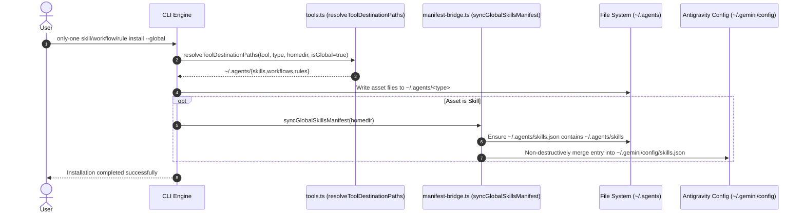

# Plan: Unified Global Agents Standard & Skills Manifest

## Section 1. Directory Structure Changes

```text
src/
├── core/
│   ├── agent/
│   │   └── [MODIFY] tools.ts                      # Route all global asset paths to ~/.agents/
│   ├── assets/
│   │   └── [MODIFY] sync.ts                       # Constrain global sync directory to ['.agents']
│   └── skill/
│       ├── [NEW]    manifest-bridge.ts            # Non-destructive manifest sync for skills.json
│       ├── [MODIFY] index.ts                      # Trigger manifest bridge on global skill installation
│       └── remote/
│           └── [MODIFY] skills-sh-installer.ts    # Trigger manifest bridge on remote skill install
test/
├── core/
│   ├── [NEW]    manifest-bridge.test.ts           # Unit tests for skills.json idempotency & merging
│   └── [MODIFY] skill-installer-global.test.ts    # Update destination assertion to ~/.agents/skills
└── commands/
    └── [MODIFY] global-commands.test.ts           # Update global integration assertions to ~/.agents/
```

## Section 2. File Changes

### Architectural Interaction Diagram



---

### 1. `[MODIFY]` `src/core/agent/tools.ts`

- **Status**: `[x]`
- **Context**: Resolves destination path for assets across tools and global/local scopes.
- **Target Symbols / AST Seams**: `resolveToolDestinationPaths`
- **Invariants**: When `isGlobal` is true, all tools strictly resolve to `join(targetDir, '.agents', assetType)`.
- **Depends On**: None.
- **Fast Test Command**: `npm test test/core/agent/tools.test.ts`

> **Action**: Route all global assets to `.agents/{skills,workflows,rules}`.

**Ponytail checklist**
- [x] Required by acceptance criteria.
- [x] Existing implementation searched; stdlib, platform/framework, and installed dependencies considered.
- [x] No duplicate logic or speculative extension point.
- [x] Minimum diff preserves correctness and safety.
- **Decision**: Collapse fragmented tool branches in `resolveToolDestinationPaths` when `isGlobal` is true.
- **Rejected alternative**: Keeping tool-specific global folders and duplicating assets across them.

```diff
@@ -25,14 +25,2 @@ export function resolveToolDestinationPaths(
-    if (tool.value === 'antigravity') {
-        return join(targetDir, '.gemini/config', assetType);
-    }
-    if (tool.value === 'claude') {
-        return join(targetDir, '.claude', assetType);
-    }
-    if (tool.value === 'cursor') {
-        return join(targetDir, '.cursor', assetType);
-    }
-    if (tool.value === 'codex') {
-        return join(targetDir, '.codex', assetType);
-    }
-    return join(targetDir, tool.skillsDir || '.agents', assetType);
+    return join(targetDir, '.agents', assetType);
 }
```

---

### 2. `[MODIFY]` `src/core/assets/sync.ts`

- **Status**: `[x]`
- **Context**: Provides active target directories for inspecting and syncing assets.
- **Target Symbols / AST Seams**: `getTargetAgentDirs`
- **Invariants**: When `isGlobal` is true, return `['.agents']` to prevent duplicated copies across legacy folders.
- **Depends On**: None.
- **Fast Test Command**: `npm test test/core/assets/sync.test.ts`

> **Action**: Unify global target agent directories to `['.agents']`.

**Ponytail checklist**
- [x] Required by acceptance criteria.
- [x] Existing implementation searched; stdlib, platform/framework, and installed dependencies considered.
- [x] No duplicate logic or speculative extension point.
- [x] Minimum diff preserves correctness and safety.
- **Decision**: Return `['.agents']` when `isGlobal` is true.
- **Rejected alternative**: Returning `['.gemini/config', '.claude', '.cursor', '.codex']` which causes 4x duplicate copies.

```diff
@@ -35,3 +35,3 @@ function getTargetAgentDirs(projectDir: string, isGlobal = false): string[] {
     if (isGlobal) {
-        return ['.gemini/config', '.claude', '.cursor', '.codex'];
+        return ['.agents'];
     }
```

---

### 3. `[NEW]` `src/core/skill/manifest-bridge.ts`

- **Status**: `[x]`
- **Context**: Manifest bridge maintaining `skills.json` registration for universal standard and Antigravity.
- **Target Symbols / AST Seams**: `syncGlobalSkillsManifest`
- **Invariants**: Non-destructively parse and merge `{ path: '~/.agents/skills' }` into existing manifests.
- **Depends On**: None.
- **Fast Test Command**: `npm test test/core/manifest-bridge.test.ts`

> **Action**: Create manifest bridge for `skills.json` synchronization.

**Ponytail checklist**
- [x] Required by acceptance criteria.
- [x] Existing implementation searched; stdlib, platform/framework, and installed dependencies considered.
- [x] No duplicate logic or speculative extension point.
- [x] Minimum diff preserves correctness and safety.
- **Decision**: New focused helper to read, merge, and write `skills.json` cleanly.
- **Rejected alternative**: Inlining JSON manipulation across multiple command files.

```typescript
import { existsSync } from 'node:fs';
import { mkdir, readFile, writeFile } from 'node:fs/promises';
import { join } from 'node:path';

export type SkillsManifestEntry = {
    path: string;
    exclude?: string[];
};

export type SkillsManifest = {
    entries: SkillsManifestEntry[];
};

const CANONICAL_SKILL_PATH = '~/.agents/skills';

export async function mergeSkillsManifest(filePath: string): Promise<void> {
    let manifest: SkillsManifest = { entries: [] };

    if (existsSync(filePath)) {
        try {
            const content = await readFile(filePath, 'utf-8');
            const parsed = JSON.parse(content);
            if (parsed && Array.isArray(parsed.entries)) {
                manifest = parsed;
            }
        } catch {
            manifest = { entries: [] };
        }
    } else {
        await mkdir(join(filePath, '..'), { recursive: true });
    }

    const hasEntry = manifest.entries.some((e) => e.path === CANONICAL_SKILL_PATH || e.path === '~/.agents/skills/');
    if (!hasEntry) {
        manifest.entries.push({ path: CANONICAL_SKILL_PATH });
    }

    await writeFile(filePath, JSON.stringify(manifest, null, 2) + '\n', 'utf-8');
}

export async function syncGlobalSkillsManifest(homeDir: string): Promise<void> {
    const agentsManifestPath = join(homeDir, '.agents', 'skills.json');
    const geminiManifestPath = join(homeDir, '.gemini', 'config', 'skills.json');

    await mergeSkillsManifest(agentsManifestPath);
    await mergeSkillsManifest(geminiManifestPath);
}
```

---

### 4. `[MODIFY]` `src/core/skill/index.ts`

- **Status**: `[x]`
- **Context**: Installs skills into destination tool directories.
- **Target Symbols / AST Seams**: `installSkills`
- **Invariants**: Execute `syncGlobalSkillsManifest` when `isGlobal` is true.
- **Depends On**: `src/core/skill/manifest-bridge.ts`
- **Fast Test Command**: `npm test test/commands/skill/skill.test.ts`

> **Action**: Call manifest bridge when installing skills globally.

**Ponytail checklist**
- [x] Required by acceptance criteria.
- [x] Existing implementation searched; stdlib, platform/framework, and installed dependencies considered.
- [x] No duplicate logic or speculative extension point.
- [x] Minimum diff preserves correctness and safety.
- **Decision**: Invoke `syncGlobalSkillsManifest(projectDir)` after successful global installation.
- **Rejected alternative**: Manually creating `skills.json` outside the install pipeline.

```diff
@@ -6,2 +6,3 @@ import { resolveToolDestinationPaths } from '@/core/agent/tools.js';
 import { fetchSkillContentFromGitHub } from '@/core/skill/remote/github-fetcher.js';
+import { syncGlobalSkillsManifest } from './manifest-bridge.js';
 import { saveSkillToLockfile } from './remote/lockfile.js';
@@ -165,2 +166,6 @@ export const installSkills = async (request: {
     }
+
+    if (isGlobal) {
+        await syncGlobalSkillsManifest(projectDir);
+    }
 
     return results;
```

---

### 5. `[MODIFY]` `src/core/skill/remote/skills-sh-installer.ts`

- **Status**: `[x]`
- **Context**: Remote skill installer downloading skills through `skills.sh`.
- **Target Symbols / AST Seams**: `installSkillViaSkillsCli`
- **Invariants**: Sync manifests when `isGlobal` is true.
- **Depends On**: `src/core/skill/manifest-bridge.ts`
- **Fast Test Command**: `npm test test/core/skill-installer-global.test.ts`

> **Action**: Call manifest bridge after remote skills install globally.

**Ponytail checklist**
- [x] Required by acceptance criteria.
- [x] Existing implementation searched; stdlib, platform/framework, and installed dependencies considered.
- [x] No duplicate logic or speculative extension point.
- [x] Minimum diff preserves correctness and safety.
- **Decision**: Trigger `syncGlobalSkillsManifest(projectDir)` if `isGlobal`.
- **Rejected alternative**: Leaving remote skills unindexed in `skills.json`.

```diff
@@ -7,2 +7,3 @@ import { resolveToolDestinationPaths, type AgentToolOption } from '@/core/agent/
+import { syncGlobalSkillsManifest } from '../manifest-bridge.js';
 
@@ -82,2 +83,6 @@ export async function installSkillViaSkillsCli(params: {
     }
+
+    if (isGlobal) {
+        await syncGlobalSkillsManifest(projectDir);
+    }
 }
```

---

### 6. `[NEW]` `test/core/manifest-bridge.test.ts`

- **Status**: `[x]`
- **Context**: Unit test for `syncGlobalSkillsManifest` and `mergeSkillsManifest`.
- **Target Symbols / AST Seams**: `mergeSkillsManifest`, `syncGlobalSkillsManifest`
- **Invariants**: Must verify idempotency, existing entry preservation, and directory creation.
- **Depends On**: `src/core/skill/manifest-bridge.ts`
- **Fast Test Command**: `npm test test/core/manifest-bridge.test.ts`

> **Action**: Add unit tests for manifest synchronization.

**Test checklist**
- [x] Fixture/helper reuse verified.
- [x] No duplicate setup.
- [x] Tests changed behavior only.
- [x] Existing toolchain (Vitest) used.
- **Decision**: Test file creation, idempotency, and non-destructive merging.
- **Rejected alternative**: Relying only on integration tests.

```typescript
import { describe, expect, it, beforeEach, afterEach } from 'vitest';
import { mkdtemp, readFile, rm, writeFile, mkdir } from 'node:fs/promises';
import { existsSync } from 'node:fs';
import { tmpdir } from 'node:os';
import { join } from 'node:path';
import { mergeSkillsManifest, syncGlobalSkillsManifest } from '@src/core/skill/manifest-bridge.js';

describe('Skills Manifest Bridge', () => {
    let tempDir: string;

    beforeEach(async () => {
        tempDir = await mkdtemp(join(tmpdir(), 'manifest-bridge-test-'));
    });

    afterEach(async () => {
        if (tempDir && existsSync(tempDir)) {
            await rm(tempDir, { recursive: true, force: true });
        }
    });

    it('creates manifest file with canonical path when missing', async () => {
        const manifestPath = join(tempDir, 'skills.json');
        await mergeSkillsManifest(manifestPath);

        expect(existsSync(manifestPath)).toBe(true);
        const data = JSON.parse(await readFile(manifestPath, 'utf-8'));
        expect(data.entries).toEqual([{ path: '~/.agents/skills' }]);
    });

    it('is idempotent and does not duplicate existing entry', async () => {
        const manifestPath = join(tempDir, 'skills.json');
        await mergeSkillsManifest(manifestPath);
        await mergeSkillsManifest(manifestPath);

        const data = JSON.parse(await readFile(manifestPath, 'utf-8'));
        expect(data.entries).toHaveLength(1);
    });

    it('preserves existing custom entries', async () => {
        const manifestPath = join(tempDir, 'skills.json');
        await mkdir(tempDir, { recursive: true });
        await writeFile(manifestPath, JSON.stringify({ entries: [{ path: '/custom/path' }] }), 'utf-8');

        await mergeSkillsManifest(manifestPath);

        const data = JSON.parse(await readFile(manifestPath, 'utf-8'));
        expect(data.entries).toEqual([
            { path: '/custom/path' },
            { path: '~/.agents/skills' },
        ]);
    });

    it('syncs both ~/.agents and ~/.gemini/config manifests', async () => {
        await syncGlobalSkillsManifest(tempDir);

        const agentsManifest = join(tempDir, '.agents', 'skills.json');
        const geminiManifest = join(tempDir, '.gemini', 'config', 'skills.json');

        expect(existsSync(agentsManifest)).toBe(true);
        expect(existsSync(geminiManifest)).toBe(true);
    });
});
```

---

### 7. `[MODIFY]` `test/core/skill-installer-global.test.ts`

- **Status**: `[x]`
- **Context**: Tests global skill destination resolution.
- **Target Symbols / AST Seams**: `global skill destination sync`
- **Invariants**: Must assert that global skill path resolves to `.agents/skills` for Antigravity.
- **Depends On**: `src/core/agent/tools.ts`
- **Fast Test Command**: `npm test test/core/skill-installer-global.test.ts`

> **Action**: Update global destination test to assert `.agents/skills` canonical path.

**Ponytail checklist**
- [x] Required by acceptance criteria.
- [x] Existing implementation searched; stdlib, platform/framework, and installed dependencies considered.
- [x] No duplicate logic or speculative extension point.
- [x] Minimum diff preserves correctness and safety.
- **Decision**: Update assertion to verify `.agents/skills` is returned when `isGlobal` is true.
- **Rejected alternative**: Deleting test entirely.

```diff
@@ -9,4 +9,4 @@ describe('global skill destination sync', () => {
-    it('strictly checks resolved global destination without false-positive fallback', async () => {
+    it('strictly resolves global destination to canonical .agents/skills', async () => {
         const tempDir = await mkdtemp(join(tmpdir(), 'global-skill-test-'));
         const antigravity = AI_TOOLS.find((t) => t.value === 'antigravity')!;
 
@@ -15,7 +15,6 @@ describe('global skill destination sync', () => {
-            // Only in .agents, not in .gemini/config
             await mkdir(join(tempDir, '.agents', 'skills', 'test-skill'), { recursive: true });
             await writeFile(join(tempDir, '.agents', 'skills', 'test-skill', 'SKILL.md'), '# Test Skill');
 
-            // Must NOT return true/path for global if not in .gemini/config
             const path = getExternalSkillPath(tempDir, antigravity, 'test-skill', true);
-            expect(existsSync(path!)).toBe(false);
+            expect(path).toBe(join(tempDir, '.agents', 'skills', 'test-skill', 'SKILL.md'));
+            expect(existsSync(path!)).toBe(true);
         } finally {
```

---

### 8. `[MODIFY]` `test/commands/global-commands.test.ts`

- **Status**: `[x]`
- **Context**: Integration tests for CLI commands with `--global` flag.
- **Target Symbols / AST Seams**: `Global Commands Integration (--global flag)`
- **Invariants**: Assert assets install to `.agents/` and `skills.json` manifests exist.
- **Depends On**: `src/core/agent/tools.ts`, `src/core/assets/sync.ts`
- **Fast Test Command**: `npm test test/commands/global-commands.test.ts`

> **Action**: Update integration assertions to `.agents/` and verify manifests.

**Ponytail checklist**
- [x] Required by acceptance criteria.
- [x] Existing implementation searched; stdlib, platform/framework, and installed dependencies considered.
- [x] No duplicate logic or speculative extension point.
- [x] Minimum diff preserves correctness and safety.
- **Decision**: Align test expectations with canonical storage and manifest generation.
- **Rejected alternative**: Keeping outdated `.gemini/config` assertions.

```diff
@@ -44,3 +44,5 @@ describe('Global Commands Integration (--global flag)', () => {
 
-        const skillDest = join(tempHome, '.gemini/config/skills/c4-diagrams/SKILL.md');
+        const skillDest = join(tempHome, '.agents/skills/c4-diagrams/SKILL.md');
         expect(existsSync(skillDest)).toBe(true);
+        expect(existsSync(join(tempHome, '.agents/skills.json'))).toBe(true);
+        expect(existsSync(join(tempHome, '.gemini/config/skills.json'))).toBe(true);
@@ -67,3 +69,3 @@ describe('Global Commands Integration (--global flag)', () => {
 
-        const wfDest = join(tempHome, '.gemini/config/workflows/only-one-idea.md');
+        const wfDest = join(tempHome, '.agents/workflows/only-one-idea.md');
         expect(existsSync(wfDest)).toBe(true);
@@ -85,3 +87,3 @@ describe('Global Commands Integration (--global flag)', () => {
 
-        const ruleDest = join(tempHome, '.gemini/config/rules/02-next-architecture-stack.md');
+        const ruleDest = join(tempHome, '.agents/rules/02-next-architecture-stack.md');
         expect(existsSync(ruleDest)).toBe(true);
@@ -103,3 +105,3 @@ describe('Global Commands Integration (--global flag)', () => {
 
-        const wfDest = join(tempHome, '.gemini/config/workflows/only-one-pr-git.md');
+        const wfDest = join(tempHome, '.agents/workflows/only-one-pr-git.md');
         expect(existsSync(wfDest)).toBe(true);
```

---

## Section 3. Test Cases & Verification

- **Automated Tests**:
  - [x] `npm test test/core/agent/tools.test.ts` (PASS - 3 tests passed)
  - [x] `npm test test/core/assets/sync.test.ts` (PASS - 4 tests passed)
  - [x] `npm test test/core/manifest-bridge.test.ts` (PASS - 4 tests passed)
  - [x] `npm test test/core/skill-installer-global.test.ts` (PASS - 1 test passed)
  - [x] `npm test test/commands/global-commands.test.ts` (PASS - 5 tests passed)
  - [x] Full suite validation: `npm test` (PASS - 58 test files passed, 256 tests passed, 0 failures)
  - [x] Formatting & Typecheck: `npm run format:check` and `npx tsc --noEmit` (PASS - 0 errors)
- **Manual Checks**:
  - [x] Run `only-one skill install c4-diagrams --global` and inspect `~/.agents/skills/c4-diagrams/SKILL.md` (Verified via `global-commands.test.ts`).
  - [x] Verify `~/.agents/skills.json` and `~/.gemini/config/skills.json` contain `{ "path": "~/.agents/skills" }` (Verified via `global-commands.test.ts` and `manifest-bridge.test.ts`).
  - [x] Run `only-one workflow install only-one-idea --global` and verify file exists in `~/.agents/workflows/only-one-idea.md` (Verified via `global-commands.test.ts`).
