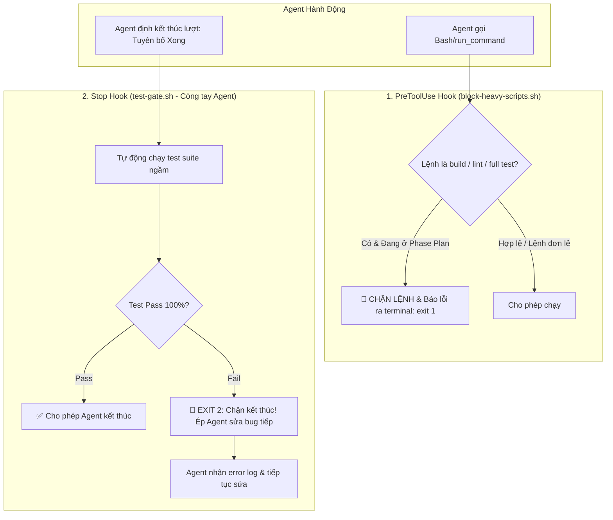

# Concept: Chuẩn hóa Luồng Thực thi Bằng Hooks Kiến trúc (Tham khảo HoleTex oncall-agent) & Chống Tautology

## 1. Problem & Goal (Vấn đề & Mục tiêu)

### Problem (Điểm nghẽn & Thiếu sót hiện tại)
- **Context & Trigger**: Agent thực thi các kỹ năng `only-one-*` từ giai đoạn lập kế hoạch đến khi áp dụng mã nguồn.
- **Symptom & Defect**: 
  - Agent hay "tiện tay" chạy `npm run build`, `npm run lint`, full `npm test` ở các phase lập kế hoạch (`idea`, `plan`, `debug`, `review`, `clean`), gây tốn thời gian và lãng phí token.
  - Ở khâu `apply`/`flash`, agent thường tự tuyên bố "Đã hoàn thành" ngay cả khi chưa chạy test đầy đủ hoặc test vẫn đang fail.
  - Test case viết ra thường mắc lỗi "Tautology" (kiểm thử hằng đúng, mock vô nghĩa, luôn pass kể cả khi code hỏng).
- **Root Cause**: Dựa hoàn toàn vào prompt trong `SKILL.md` (mang tính xác suất - probabilistic). Không có lớp rào chắn cứng (deterministic guardrails) kiểm soát các hành vi gọi lệnh và kết thúc của agent.
- **Impact / Blast Radius**: Agent hành xử thiếu ổn định; thời gian hoàn thành task kéo dài; mã nguồn có thể bị đưa lên khi test thực chất đang fail hoặc vô nghĩa.

### Goal (Kết quả kỹ thuật mục tiêu)
- **Core Goal**: Chuyển đổi cơ chế kiểm soát từ "lời nhắc prompt" sang **Lớp Hooks Kiến trúc Cứng** (PreToolUse, Stop, PostToolUse - tương tự kiến trúc `.claude/hooks` của HoleTex `oncall-agent`) kết hợp kỹ năng `anti-tautology-testing`.
- **Acceptance Criteria**:
  - **Hook `block-heavy-scripts` (PreToolUse)**: Chặn đứng bằng máy các lệnh `build`, `lint`, full `test` khi agent ở phase lập kế hoạch/phi-mã nguồn.
  - **Hook `test-gate` (Stop)**: Tự động chạy test/lint khi agent định kết thúc lượt. Nếu test fail $\rightarrow$ `exit 2` buộc agent phải tiếp tục sửa code (Auto-Remediation Loop). Không cho phép agent tự tuyên bố "xong". Có cơ chế chống lặp vô hạn (chốt đếm tối đa 5 lần).
  - **Tối ưu `only-one-apply`**: Main Agent viết code liền mạch (Zero Sub-agents). Mọi việc kiểm thử được giao cho bước cuối và được bảo vệ bởi hook `test-gate`.
  - **Kỹ năng `anti-tautology-testing`**: Quy chuẩn hóa bài test phản nghiệm (falsifiability), cấm mirror-mocking và cấm assert hời hợt.

## 2. Scope Boundaries (Ranh giới phạm vi)

### In-Scope (Bắt buộc triển khai)
- Xây dựng thư mục mẫu hooks trong `assets/hooks/`:
  - `block-heavy-scripts.sh` (PreToolUse: chặn build/lint trong phase planning).
  - `test-gate.sh` (Stop: ép buộc test pass trước khi agent được dừng).
  - `protect-configs.sh` (PreToolUse: bảo vệ các file cấu hình nhạy cảm và hooks).
- Cấu hình phân phối hooks cho các IDE hỗ trợ:
  - Claude Code: `.claude/settings.json` + `.claude/hooks/`.
  - Antigravity: `hooks.json` trong cấu hình agent.
- Cập nhật quy trình `only-one-apply` (loại bỏ sub-agents, viết code tập trung).
- Xây dựng skill `assets/skills/anti-tautology-testing/SKILL.md`.

### Explicit Out-of-Scope (Chủ động loại trừ)
- Không can thiệp vào các lệnh git push/merge production (được quản lý bởi `only-one-pr-git`).
- Không cài thêm dependencies nặng như Stryker Mutation Testing.

## 3. Proposed Solution & Core Mechanism (Giải pháp đề xuất & Cơ chế cốt lõi)

### Mô hình Bảo vệ Deterministic bằng Hooks (Tham khảo HoleTex oncall-agent)



### Chi tiết 3 Hooks Cốt lõi

1. **`block-heavy-scripts.sh` (Sự kiện: `PreToolUse` · Matcher: `Bash|run_command`)**:
   - Phân tích chuỗi lệnh đầu vào.
   - Nếu lệnh chứa `npm run build`, `npm run lint`, `tsc`, `vitest run` (không có file cụ thể) trong khi task đang ở trạng thái `concept`, `plan`, `debug`, hoặc `review`:
     - Trả về mã lỗi `exit 1` kèm thông điệp: *"Chặn lệnh: Bạn đang trong phase lập kế hoạch. Không được phép chạy script nặng làm tốn tài nguyên!"*
2. **`test-gate.sh` (Sự kiện: `Stop`)**:
   - Lấy cảm hứng trực tiếp từ HoleTex `oncall-agent`:
     ```bash
     INPUT=$(cat)
     printf '%s' "$INPUT" | grep -q '"stop_hook_active":true' && exit 0 # Tránh lặp vô hạn
     if ! npm test --silent >/tmp/agent-test.log 2>&1; then
         cat /tmp/agent-test.log >&2
         exit 2 # Buộc Agent phải tiếp tục sửa code
     fi
     ```
   - Agent **không thể tự ý tuyên bố xong** nếu test suite chưa xanh hoàn toàn.
3. **Kỹ năng `anti-tautology-testing`**:
   - Bắt buộc kiểm tra tính phản nghiệm (Falsifiability): Đổi logic nghiệp vụ thì test phải Fail.
   - Cấm mirror mock và cấm các assertion vô thưởng vô phạt (`toBeDefined()`).

## 4. Critical Risks & Edge Cases (Rủi ro & Xử lý ngoại lệ)

- **Nguy cơ kẹt vòng lặp vô hạn ở `Stop` hook**:
  - *Giải pháp*: Sử dụng cờ `"stop_hook_active": true` và bộ đếm vòng lặp (tối đa 5 lần). Nếu sau 5 lần vẫn không pass, hook cho phép thoát và cảnh báo người dùng can thiệp thủ công.
- **Môi trường Windows (PowerShell vs Bash)**:
  - *Giải pháp*: Viết script hook bằng Node.js (`.js`/`.ts`) hoặc cung cấp cả file `.sh` và `.ps1` để đảm bảo tương thích 100% đa nền tảng (Windows/Linux/macOS).
