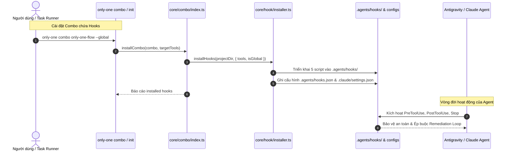

# Plan: Chuẩn hóa Luồng Thực thi Bằng Hooks Kiến trúc (HoleTex oncall-agent) & Kiểm thử Chống Tautology

## Section 1. Directory Structure Changes

```text
assets/
├── [MODIFY] types.ts                            # Bổ sung trường hooks vào ComboManifest
├── combos/
│   └── [MODIFY] index.ts                        # Bổ sung hooks và anti-tautology-testing vào combo only-one-flow
├── hooks/
│   ├── [NEW]    block-heavy-scripts.sh          # PreToolUse: Chặn lệnh build/lint/test ở các phase planning
│   ├── [NEW]    claude-settings.json            # Template cấu hình Claude Code trỏ vào .agents/hooks/
│   ├── [NEW]    format-on-edit.sh               # PostToolUse: Tự động format Prettier ngay khi vừa sửa file
│   ├── [NEW]    hooks.json                      # Template cấu hình Antigravity .agents/hooks.json
│   ├── [NEW]    no-secrets.sh                   # PreToolUse: Chặn hardcode secrets/token trước khi chạm đĩa
│   ├── [NEW]    protect-configs.sh              # PreToolUse: Bảo vệ các file cấu hình và hooks của agent
│   └── [NEW]    test-gate.sh                    # Stop Hook: Ép buộc test pass trước khi agent dừng (exit 2)
└── skills/
    ├── [MODIFY] index.ts                        # Đăng ký anti-tautology-testing vào danh mục kỹ năng
    ├── anti-tautology-testing/
    │   └── [NEW] SKILL.md                       # Kỹ năng kiểm thử hành vi thực chất và chống test rỗng
    ├── only-one-apply/
    │   └── [MODIFY] SKILL.md                    # Bỏ sub-agents, viết code liền mạch, dồn test về bước cuối
    ├── only-one-debug/
    │   └── [MODIFY] SKILL.md                    # Cấm tuyệt đối build/lint, chỉ chạy test reproducer
    ├── only-one-flash/
    │   └── [MODIFY] SKILL.md                    # Dồn toàn bộ test/lint về cuối và tích hợp remediation loop
    └── only-one-plan/
        └── [MODIFY] SKILL.md                    # Cấm tuyệt đối build/lint, chỉ chạy validate-plan.ts

src/
├── commands/combo/actions/
│   └── [MODIFY] step-5-execute-and-report.ts    # Báo cáo kết quả cài đặt hooks trong combo
└── core/
    ├── combo/
    │   └── [MODIFY] index.ts                    # Tự động gọi installHooks khi combo có khai báo hooks
    └── hook/
        └── [NEW]    installer.ts                # Module cài đặt hooks vào .agents/hooks/ (local & global)

test/
├── core/
│   └── hook/
│       └── [NEW] installer.test.ts              # Kiểm thử cài đặt hooks vào .agents/hooks và đồng bộ IDE
└── hooks/
    └── [NEW]    hooks-integrity.test.ts         # Kiểm thử tính toàn vẹn của các scripts hook
```

## Section 2. File Changes

### Architectural Interaction Diagram



### 1. `[MODIFY]` `assets/types.ts`

- **Status**: `[x]`
- **Context**: `ComboManifest` chưa có trường hooks để khai báo danh sách hooks đi kèm combo.
- **Target Symbols / AST Seams**: `ComboManifest`.
- **Invariants**: Thêm trường `hooks?: string[]` tùy chọn, không gây lỗi các combo cũ.
- **Depends On**: None.
- **Fast Test Command**: `npm run build`.

> **Action**: Thêm trường hooks vào định nghĩa interface ComboManifest.

**Ponytail checklist**
- [ ] Bắt buộc theo đúng tiêu chí nghiệm thu.
- [ ] Đã rà soát code hiện có, thư viện chuẩn và dependencies.
- [ ] Không tạo logic trùng lặp hoặc điểm mở rộng suy đoán.
- [ ] Diff tối thiểu, đảm bảo an toàn và tính đúng đắn.
- **Decision**: Mở rộng ComboManifest để hỗ trợ cài đặt hooks tự động qua combo.
- **Rejected alternative**: Cài hooks riêng rẽ tách biệt với hệ thống combo.

```diff
@@ line 97 @@
     configs?: string[];
     workflows?: string[];
+    hooks?: string[];
 }
 
 export interface GitAssetManifest {
```

### 2. `[NEW]` `assets/hooks/block-heavy-scripts.sh`

- **Status**: `[x]`
- **Context**: Chưa có cơ chế deterministic chặn các lệnh build và lint ở phase lập kế hoạch.
- **Target Symbols / AST Seams**: Shell Script: `block-heavy-scripts.sh`.
- **Invariants**: Phải chặn đứng các lệnh nặng khi phát hiện đang ở phase non-code, thoát mã 1.
- **Depends On**: None.
- **Fast Test Command**: `npx vitest run test/hooks/hooks-integrity.test.ts`.

> **Action**: Tạo hook PreToolUse chặn lệnh build, lint và full test ở phase planning.

**Ponytail checklist**
- [ ] Bắt buộc theo đúng tiêu chí nghiệm thu.
- [ ] Đã rà soát code hiện có, thư viện chuẩn và dependencies.
- [ ] Không tạo logic trùng lặp hoặc điểm mở rộng suy đoán.
- [ ] Diff tối thiểu, đảm bảo an toàn và tính đúng đắn.
- **Decision**: Dùng shell script lọc chuỗi lệnh của Bash/run_command trước khi chạm hệ điều hành.
- **Rejected alternative**: Chỉ nhắc nhở trong prompt làm agent thường xuyên quên và chạy sai lệnh.

```diff
@@ line 0 @@
+#!/usr/bin/env bash
+# PreToolUse · Bash|run_command
+# Chặn các lệnh kiểm tra nặng (build, lint, full test) khi đang ở phase planning/spec
+
+INPUT=$(cat)
+COMMAND=$(printf '%s' "$INPUT" | grep -o '"command":"[^"]*"' | cut -d'"' -f4)
+
+if [ -z "$COMMAND" ]; then
+    exit 0
+fi
+
+# Kiểm tra nếu lệnh chứa build, lint hoặc tsc
+if echo "$COMMAND" | grep -qE "(npm run build|npm run lint|npm run format:check|tsc --noEmit)"; then
+    # Kiểm tra xem có đang ở trong phase planning hay không (concept.md, plan.md, debug.md đang diagnosing)
+    if [ -f "only-one/tasks/"*"/concept.md" ] || grep -q "status: planning" only-one/tasks/*/*.md 2>/dev/null; then
+        echo "🛑 [ONLY-ONE HOOK] Lệnh '$COMMAND' bị chặn trong phase lập kế hoạch!" >&2
+        echo "💡 Chỉ được phép chạy script kiểm tra nhẹ (validate-plan.ts) hoặc test reproducer đơn lẻ." >&2
+        exit 1
+    fi
+fi
+
+exit 0
```

### 3. `[NEW]` `assets/hooks/no-secrets.sh`

- **Status**: `[x]`
- **Context**: Agent AI hay tiện tay dán cứng token, secret vào code hoặc test để chạy cho nhanh.
- **Target Symbols / AST Seams**: Shell Script: `no-secrets.sh`.
- **Invariants**: Phát hiện token nhạy cảm phải lập tức chặn ghi đĩa và thoát mã 2.
- **Depends On**: None.
- **Fast Test Command**: `npx vitest run test/hooks/hooks-integrity.test.ts`.

> **Action**: Tạo hook PreToolUse quét nội dung sắp ghi và chặn secret trước khi chạm đĩa.

**Ponytail checklist**
- [ ] Bắt buộc theo đúng tiêu chí nghiệm thu.
- [ ] Đã rà soát code hiện có, thư viện chuẩn và dependencies.
- [ ] Không tạo logic trùng lặp hoặc điểm mở rộng suy đoán.
- [ ] Diff tối thiểu, đảm bảo an toàn và tính đúng đắn.
- **Decision**: Quét regex phát hiện secret trước khi write_to_file được thực hiện.
- **Rejected alternative**: Quét secret sau khi commit làm lộ thông tin trên git log.

```diff
@@ line 0 @@
+#!/usr/bin/env bash
+# PreToolUse · Write|Edit|replace_file_content
+# Quét nội dung sắp ghi để chặn hardcode secret trước khi chạm đĩa
+
+INPUT=$(cat)
+CONTENT=$(printf '%s' "$INPUT" | grep -o '"(CodeContent|ReplacementContent|content)":"[^"]*"' | head -n 1 | cut -d'"' -f4)
+
+if [ -z "$CONTENT" ]; then
+    exit 0
+fi
+
+# Regex phát hiện các token nhạy cảm phổ biến
+SECRET_REGEX="(sk-[a-zA-Z0-9]{20,}|ghp_[a-zA-Z0-9]{20,}|AKIA[0-9A-Z]{16}|postgres://[^:]+:[^@]+@)"
+
+if echo "$CONTENT" | grep -qE "$SECRET_REGEX"; then
+    echo "🛑 [ONLY-ONE NO-SECRETS] Bị chặn: Phát hiện secret hoặc access token bị hardcode trong nội dung!" >&2
+    echo "💡 Vui lòng sử dụng process.env hoặc biến môi trường thay vì ghi trực tiếp vào mã nguồn." >&2
+    exit 2
+fi
+
+exit 0
```

### 4. `[NEW]` `assets/hooks/format-on-edit.sh`

- **Status**: `[x]`
- **Context**: Code do agent viết hay bị lệch indent và sai format, gây fail khâu kiểm tra cuối.
- **Target Symbols / AST Seams**: Shell Script: `format-on-edit.sh`.
- **Invariants**: Tự động chạy Prettier trên file vừa chỉnh sửa, không gây chậm trễ hệ thống.
- **Depends On**: None.
- **Fast Test Command**: `npx vitest run test/hooks/hooks-integrity.test.ts`.

> **Action**: Tạo hook PostToolUse tự động format code bằng Prettier cục bộ ngay khi vừa sửa.

**Ponytail checklist**
- [ ] Bắt buộc theo đúng tiêu chí nghiệm thu.
- [ ] Đã rà soát code hiện có, thư viện chuẩn và dependencies.
- [ ] Không tạo logic trùng lặp hoặc điểm mở rộng suy đoán.
- [ ] Diff tối thiểu, đảm bảo an toàn và tính đúng đắn.
- **Decision**: Format cục bộ đúng 1 file vừa sửa để đạt tốc độ tối đa vài mili-giây.
- **Rejected alternative**: Chờ đến cuối mới format toàn repo gây tốn thời gian.

```diff
@@ line 0 @@
+#!/usr/bin/env bash
+# PostToolUse · Write|Edit|replace_file_content
+# Tự động format file vừa sửa bằng prettier cục bộ
+
+INPUT=$(cat)
+FILE=$(printf '%s' "$INPUT" | grep -o '"(TargetFile|path)":"[^"]*"' | head -n 1 | cut -d'"' -f4)
+
+if [ -z "$FILE" ] || [ ! -f "$FILE" ]; then
+    exit 0
+fi
+
+PRETTIER_BIN="node_modules/.bin/prettier"
+if [ -x "$PRETTIER_BIN" ] || command -v npx >/dev/null 2>&1; then
+    npx prettier --write "$FILE" >/dev/null 2>&1 || true
+fi
+
+exit 0
```

### 5. `[NEW]` `assets/hooks/test-gate.sh`

- **Status**: `[x]`
- **Context**: Agent thường tự ý báo xong khi test vẫn còn lỗi hoặc chưa chạy test.
- **Target Symbols / AST Seams**: Shell Script: `test-gate.sh`.
- **Invariants**: Nếu test fail phải thoát mã 2 để bắt buộc agent tiếp tục chu trình sửa lỗi.
- **Depends On**: None.
- **Fast Test Command**: `npx vitest run test/hooks/hooks-integrity.test.ts`.

> **Action**: Tạo Stop hook ép buộc test pass trước khi kết thúc lượt thực thi.

**Ponytail checklist**
- [ ] Bắt buộc theo đúng tiêu chí nghiệm thu.
- [ ] Đã rà soát code hiện có, thư viện chuẩn và dependencies.
- [ ] Không tạo logic trùng lặp hoặc điểm mở rộng suy đoán.
- [ ] Diff tối thiểu, đảm bảo an toàn và tính đúng đắn.
- **Decision**: Áp dụng pattern exit 2 của HoleTex oncall-agent ép AI tiếp tục remediate.
- **Rejected alternative**: Cho agent tự do kết thúc dẫn đến code lỗi được đẩy lên repo.

```diff
@@ line 0 @@
+#!/usr/bin/env bash
+# Stop Hook · Chạy khi agent định kết thúc lượt.
+# Test fail thì exit 2 => agent PHẢI sửa tiếp, không được tự ý báo xong.
+
+INPUT=$(cat)
+# Tránh lặp vô hạn nếu đã có cờ kích hoạt
+printf '%s' "$INPUT" | grep -q '"stop_hook_active":true' && exit 0
+
+[ -f package.json ] || exit 0
+grep -q '"test":' package.json || exit 0
+
+TEMP_LOG=$(mktemp 2>/dev/null || echo "/tmp/only-one-test-gate.log")
+
+if ! npm test --silent > "$TEMP_LOG" 2>&1; then
+    echo "🛑 [ONLY-ONE TEST-GATE] Kiểm tra thất bại! Bạn không được phép kết thúc lượt." >&2
+    echo "🔍 Chi tiết lỗi kiểm thử:" >&2
+    cat "$TEMP_LOG" >&2
+    rm -f "$TEMP_LOG"
+    exit 2
+fi
+
+rm -f "$TEMP_LOG"
+exit 0
```

### 6. `[NEW]` `assets/hooks/protect-configs.sh`

- **Status**: `[x]`
- **Context**: Cần ngăn chặn việc agent tự ý sửa đổi file cấu hình hooks để nới lỏng quyền.
- **Target Symbols / AST Seams**: Shell Script: `protect-configs.sh`.
- **Invariants**: Chặn mọi thao tác ghi đè vào thư mục `.agents/hooks/` hoặc cấu hình hooks.
- **Depends On**: None.
- **Fast Test Command**: `npx vitest run test/hooks/hooks-integrity.test.ts`.

> **Action**: Tạo hook PreToolUse bảo vệ các file cấu hình và scripts của hệ thống hooks.

**Ponytail checklist**
- [ ] Bắt buộc theo đúng tiêu chí nghiệm thu.
- [ ] Đã rà soát code hiện có, thư viện chuẩn và dependencies.
- [ ] Không tạo logic trùng lặp hoặc điểm mở rộng suy đoán.
- [ ] Diff tối thiểu, đảm bảo an toàn và tính đúng đắn.
- **Decision**: Chặn ghi vào các file thiết lập an toàn để agent không tự cởi bỏ còng tay.
- **Rejected alternative**: Bỏ ngỏ cấu hình khiến agent tự xóa hook khi gặp khó khăn.

```diff
@@ line 0 @@
+#!/usr/bin/env bash
+# PreToolUse · Write|Edit|replace_file_content
+# Ngăn chặn agent tự ý chỉnh sửa các file hook an toàn
+
+INPUT=$(cat)
+TARGET=$(printf '%s' "$INPUT" | grep -o '"(TargetFile|path)":"[^"]*"' | head -n 1 | cut -d'"' -f4)
+
+if [ -z "$TARGET" ]; then
+    exit 0
+fi
+
+if echo "$TARGET" | grep -qE "(\.agents/hooks|\.claude/settings\.json|hooks\.json)"; then
+    echo "🛑 [ONLY-ONE SECURITY] Bị từ chối: Agent không được phép chỉnh sửa file cấu hình an toàn '$TARGET'!" >&2
+    exit 1
+fi
+
+exit 0
```

### 7. `[NEW]` `assets/hooks/hooks.json`

- **Status**: `[x]`
- **Context**: Cần template cấu hình `hooks.json` chuẩn hóa cho Antigravity trong `.agents/`.
- **Target Symbols / AST Seams**: JSON Template: `hooks.json`.
- **Invariants**: Khai báo đúng các sự kiện PreToolUse, PostToolUse và Stop trỏ tới `.agents/hooks/`.
- **Depends On**: None.
- **Fast Test Command**: `npm run build`.

> **Action**: Tạo file template cấu hình hooks.json cho Antigravity.

**Ponytail checklist**
- [ ] Bắt buộc theo đúng tiêu chí nghiệm thu.
- [ ] Đã rà soát code hiện có, thư viện chuẩn và dependencies.
- [ ] Không tạo logic trùng lặp hoặc điểm mở rộng suy đoán.
- [ ] Diff tối thiểu, đảm bảo an toàn và tính đúng đắn.
- **Decision**: Chuẩn hóa cấu hình json tích hợp mượt mà trong thư mục .agents/.
- **Rejected alternative**: Để người dùng tự gõ json cấu hình dễ sai cú pháp.

```diff
@@ line 0 @@
+{
+  "hooks": {
+    "PreToolUse": [
+      {
+        "matcher": "run_command|Bash",
+        "command": ".agents/hooks/block-heavy-scripts.sh"
+      },
+      {
+        "matcher": "write_to_file|replace_file_content|Write|Edit",
+        "command": ".agents/hooks/no-secrets.sh"
+      },
+      {
+        "matcher": "write_to_file|replace_file_content|Write|Edit",
+        "command": ".agents/hooks/protect-configs.sh"
+      }
+    ],
+    "PostToolUse": [
+      {
+        "matcher": "write_to_file|replace_file_content|Write|Edit",
+        "command": ".agents/hooks/format-on-edit.sh"
+      }
+    ],
+    "Stop": [
+      {
+        "command": ".agents/hooks/test-gate.sh"
+      }
+    ]
+  }
+}
```

### 8. `[NEW]` `assets/hooks/claude-settings.json`

- **Status**: `[x]`
- **Context**: Cần template cấu hình `.claude/settings.json` trỏ thống nhất vào `.agents/hooks/`.
- **Target Symbols / AST Seams**: JSON Template: `claude-settings.json`.
- **Invariants**: Sử dụng biến `$CLAUDE_PROJECT_DIR` trỏ vào `.agents/hooks/`.
- **Depends On**: None.
- **Fast Test Command**: `npm run build`.

> **Action**: Tạo template claude-settings.json trỏ vào thư mục .agents/hooks/.

**Ponytail checklist**
- [ ] Bắt buộc theo đúng tiêu chí nghiệm thu.
- [ ] Đã rà soát code hiện có, thư viện chuẩn và dependencies.
- [ ] Không tạo logic trùng lặp hoặc điểm mở rộng suy đoán.
- [ ] Diff tối thiểu, đảm bảo an toàn và tính đúng đắn.
- **Decision**: Tái sử dụng chung 1 thư mục .agents/hooks/ cho cả Claude Code.
- **Rejected alternative**: Tạo 2 thư mục hooks riêng biệt gây trùng lặp và phân mảnh.

```diff
@@ line 0 @@
+{
+  "hooks": {
+    "PreToolUse": [
+      {
+        "matcher": "Bash",
+        "hooks": [
+          { "type": "command", "command": "$CLAUDE_PROJECT_DIR/.agents/hooks/block-heavy-scripts.sh" }
+        ]
+      },
+      {
+        "matcher": "Write|Edit",
+        "hooks": [
+          { "type": "command", "command": "$CLAUDE_PROJECT_DIR/.agents/hooks/no-secrets.sh" },
+          { "type": "command", "command": "$CLAUDE_PROJECT_DIR/.agents/hooks/protect-configs.sh" }
+        ]
+      }
+    ],
+    "PostToolUse": [
+      {
+        "matcher": "Write|Edit",
+        "hooks": [
+          { "type": "command", "command": "$CLAUDE_PROJECT_DIR/.agents/hooks/format-on-edit.sh" }
+        ]
+      }
+    ],
+    "Stop": [
+      {
+        "hooks": [
+          { "type": "command", "command": "$CLAUDE_PROJECT_DIR/.agents/hooks/test-gate.sh" }
+        ]
+      }
+    ]
+  }
+}
```

### 9. `[NEW]` `src/core/hook/installer.ts`

- **Status**: `[x]`
- **Context**: Chưa có module tự động cài đặt và triển khai hooks vào thư mục `.agents/hooks/`.
- **Target Symbols / AST Seams**: `installHooks`, `InstallHooksOptions`, `InstallHooksResult`.
- **Invariants**: Hỗ trợ triển khai cả local (`.agents/hooks`) và global (`~/.agents/hooks`).
- **Depends On**: `assets/hooks/hooks.json`, `assets/hooks/claude-settings.json`.
- **Fast Test Command**: `npx vitest run test/core/hook/installer.test.ts`.

> **Action**: Triển khai module installer tự động cài đặt hooks vào .agents/hooks/.

**Ponytail checklist**
- [ ] Bắt buộc theo đúng tiêu chí nghiệm thu.
- [ ] Đã rà soát code hiện có, thư viện chuẩn và dependencies.
- [ ] Không tạo logic trùng lặp hoặc điểm mở rộng suy đoán.
- [ ] Diff tối thiểu, đảm bảo an toàn và tính đúng đắn.
- **Decision**: Triển khai hàm chuyên trách sao chép scripts và cấu hình hook đồng bộ.
- **Rejected alternative**: Bắt người dùng copy thủ công bằng tay.

```diff
@@ line 0 @@
+import { existsSync } from 'node:fs';
+import { cp, mkdir, writeFile } from 'node:fs/promises';
+import { homedir } from 'node:os';
+import { dirname, join } from 'node:path';
+import { resolvePackageRoot } from '@/core/runtime/package-root.js';
+
+export interface InstallHooksOptions {
+    projectDir: string;
+    isGlobal?: boolean;
+    tools?: string[];
+}
+
+export interface InstallHooksResult {
+    installedFiles: string[];
+    agentsHooksDir: string;
+    configsCreated: string[];
+}
+
+export async function installHooks(options: InstallHooksOptions): Promise<InstallHooksResult> {
+    const { projectDir, isGlobal = false, tools = ['antigravity', 'claude'] } = options;
+    const packageRoot = resolvePackageRoot(import.meta.url);
+    const srcHooksDir = join(packageRoot, 'assets', 'hooks');
+
+    const baseDir = isGlobal ? join(homedir(), '.agents') : join(projectDir, '.agents');
+    const targetHooksDir = join(baseDir, 'hooks');
+    await mkdir(targetHooksDir, { recursive: true });
+
+    const hookScripts = [
+        'block-heavy-scripts.sh',
+        'no-secrets.sh',
+        'format-on-edit.sh',
+        'test-gate.sh',
+        'protect-configs.sh',
+    ];
+
+    const installedFiles: string[] = [];
+    for (const script of hookScripts) {
+        const srcPath = join(srcHooksDir, script);
+        const destPath = join(targetHooksDir, script);
+        if (existsSync(srcPath)) {
+            await cp(srcPath, destPath, { force: true });
+            installedFiles.push(destPath);
+        }
+    }
+
+    const configsCreated: string[] = [];
+
+    // 1. Antigravity .agents/hooks.json
+    if (tools.includes('antigravity')) {
+        const srcJson = join(srcHooksDir, 'hooks.json');
+        const destJson = isGlobal ? join(homedir(), '.gemini', 'config', 'hooks.json') : join(baseDir, 'hooks.json');
+        if (existsSync(srcJson)) {
+            await mkdir(dirname(destJson), { recursive: true });
+            await cp(srcJson, destJson, { force: true });
+            configsCreated.push(destJson);
+        }
+    }
+
+    // 2. Claude Code .claude/settings.json
+    if (tools.includes('claude')) {
+        const srcClaude = join(srcHooksDir, 'claude-settings.json');
+        const destClaude = isGlobal ? join(homedir(), '.claude', 'settings.json') : join(projectDir, '.claude', 'settings.json');
+        if (existsSync(srcClaude)) {
+            await mkdir(dirname(destClaude), { recursive: true });
+            await cp(srcClaude, destClaude, { force: true });
+            configsCreated.push(destClaude);
+        }
+    }
+
+    return {
+        installedFiles,
+        agentsHooksDir: targetHooksDir,
+        configsCreated,
+    };
+}
```

### 10. `[MODIFY]` `assets/combos/index.ts`

- **Status**: `[x]`
- **Context**: Cần bổ sung `hooks` và `anti-tautology-testing` vào combo chuẩn toàn cầu `only-one-flow`.
- **Target Symbols / AST Seams**: `COMBOS`.
- **Invariants**: Tăng phiên bản `only-one-flow` lên `0.0.16` và thêm mảng `hooks`.
- **Depends On**: `assets/types.ts`.
- **Fast Test Command**: `npm run build`.

> **Action**: Cập nhật combo only-one-flow tích hợp kỹ năng mới và danh sách hooks.

**Ponytail checklist**
- [ ] Bắt buộc theo đúng tiêu chí nghiệm thu.
- [ ] Đã rà soát code hiện có, thư viện chuẩn và dependencies.
- [ ] Không tạo logic trùng lặp hoặc điểm mở rộng suy đoán.
- [ ] Diff tối thiểu, đảm bảo an toàn và tính đúng đắn.
- **Decision**: Đưa vào combo global để mọi agent được hưởng quy chuẩn kiểm thử mới.
- **Rejected alternative**: Để người dùng cài đặt thủ công từng skill gây phiền toái.

```diff
@@ line 26 @@
     {
         id: 'only-one-flow',
-        version: '0.0.15',
+        version: '0.0.16',
         name: 'Only One Universal Flow Setup',
         description: 'Stack-agnostic end-to-end SDLC and MCP toolkit: Ideation, dual-layer planning, quality gates, security, testing, review, and PR automation',
         scope: 'global',
         supportedAgents: ['antigravity', 'cursor', 'claude', 'codex'],
         mcps: ['fetch', 'tavily', 'github', 'postgres', 'playwright-browser'],
         skills: [
@@ line 60 @@
             'code-review-and-quality',
             'karpathy-ste100-discipline',
+            'anti-tautology-testing',
         ],
+        hooks: [
+            'block-heavy-scripts',
+            'no-secrets',
+            'format-on-edit',
+            'test-gate',
+            'protect-configs',
+        ],
```

### 11. `[MODIFY]` `src/core/combo/index.ts`

- **Status**: `[x]`
- **Context**: `installCombo` chưa kích hoạt cài đặt hooks khi combo có khai báo mảng `hooks`.
- **Target Symbols / AST Seams**: `installCombo`, `ComboInstallResult`.
- **Invariants**: Gọi `installHooks` tự động và ghi nhận kết quả vào `results.hooks`.
- **Depends On**: `src/core/hook/installer.ts`, `assets/combos/index.ts`.
- **Fast Test Command**: `npm run build`.

> **Action**: Tích hợp installHooks vào quy trình installCombo.

**Ponytail checklist**
- [ ] Bắt buộc theo đúng tiêu chí nghiệm thu.
- [ ] Đã rà soát code hiện có, thư viện chuẩn và dependencies.
- [ ] Không tạo logic trùng lặp hoặc điểm mở rộng suy đoán.
- [ ] Diff tối thiểu, đảm bảo an toàn và tính đúng đắn.
- **Decision**: Tự động triển khai hooks khi người dùng chạy lệnh combo.
- **Rejected alternative**: Bắt người dùng chạy thêm lệnh init hooks riêng.

```diff
@@ line 26 @@
 import { recordInstalledAssetsBatch } from '@/core/assets/lockfile.js';
+import { installHooks } from '@/core/hook/installer.js';
@@ line 53 @@
 export interface ComboInstallResult {
     packages: { name: string; status: 'success' | 'failed' | 'skipped'; error?: string }[];
     configs: { name: string; status: 'success' | 'failed' | 'skipped'; error?: string }[];
     rules: RuleInstallResult[];
     skills: SkillInstallResult[];
     workflows: WorkflowInstallResult[];
     mcps: { mcpId: string; ideId: string; status: 'success' | 'failed' | 'skipped'; error?: string }[];
+    hooks?: { name: string; status: 'success' | 'failed' }[];
 }
@@ line 602 @@
     // 7. MCPs
     const mcps = new Set<string>(plan.mcps);
     if (plan.skills.includes('only-one-pr-git')) mcps.add('github');
+
+    // 8. Hooks
+    if (combo.hooks && combo.hooks.length > 0) {
+        try {
+            const hookRes = await installHooks({
+                projectDir,
+                isGlobal,
+                tools: selectedTools.map((t) => t.value),
+            });
+            results.hooks = combo.hooks.map((h) => ({
+                name: h,
+                status: hookRes.installedFiles.length > 0 ? 'success' : 'failed',
+            }));
+        } catch (err: any) {
+            deps.stdout(`Warning: Failed to install hooks: ${err.message}`);
+        }
+    }
```

### 12. `[MODIFY]` `src/commands/combo/actions/step-5-execute-and-report.ts`

- **Status**: `[x]`
- **Context**: Báo cáo combo chưa hiển thị mục Hooks sau khi cài đặt thành công.
- **Target Symbols / AST Seams**: `executeAndReportComboStep`.
- **Invariants**: Hiển thị danh sách hooks đã cài đặt trong bảng tổng kết.
- **Depends On**: `src/core/combo/index.ts`.
- **Fast Test Command**: `npm run build`.

> **Action**: Bổ sung hiển thị kết quả cài đặt Hooks vào báo cáo combo.

**Ponytail checklist**
- [ ] Bắt buộc theo đúng tiêu chí nghiệm thu.
- [ ] Đã rà soát code hiện có, thư viện chuẩn và dependencies.
- [ ] Không tạo logic trùng lặp hoặc điểm mở rộng suy đoán.
- [ ] Diff tối thiểu, đảm bảo an toàn và tính đúng đắn.
- **Decision**: Xuất kết quả trực quan ra stdout cho người dùng theo dõi.
- **Rejected alternative**: Ẩn kết quả khiến người dùng không biết hooks đã cài chưa.

```diff
@@ line 98 @@
         }
     }
 
+    if (results.hooks?.length) {
+        deps.stdout('\nHooks:');
+        for (const h of results.hooks) {
+            const statusColor = h.status === 'success' ? COLORS.success : COLORS.error;
+            deps.stdout(`  - ${COLORS.secondary(h.name)} in ${COLORS.primary('.agents/hooks')}: ${statusColor(h.status)}`);
+        }
+    }
+
     deps.stdout('\n==================================================\n');
```

### 13. `[NEW]` `test/core/hook/installer.test.ts`

- **Status**: `[x]`
- **Context**: Cần kiểm thử tự động cho module `installer.ts` xác thực copy đầy đủ vào `.agents/hooks/`.
- **Target Symbols / AST Seams**: Vitest Spec: `installer.test.ts`.
- **Invariants**: Phải tạo đúng các file script trong `.agents/hooks` và file cấu hình json.
- **Depends On**: `src/core/hook/installer.ts`.
- **Fast Test Command**: `npx vitest run test/core/hook/installer.test.ts`.

> **Action**: Viết kiểm thử tự động cho module installHooks.

**Test checklist**
- [ ] Bắt buộc theo đúng tiêu chí nghiệm thu.
- [ ] Đã rà soát code hiện có, thư viện chuẩn và dependencies.
- [ ] Không tạo logic trùng lặp hoặc điểm mở rộng suy đoán.
- [ ] Diff tối thiểu, đảm bảo an toàn và tính đúng đắn.
- **Decision**: Kiểm thử với thư mục tạm chứa cấu hình local .agents.
- **Rejected alternative**: Bỏ qua test gây rủi ro sai đường dẫn khi chạy trên Windows.

```diff
@@ line 0 @@
+import { describe, it, expect, beforeEach, afterEach } from 'vitest';
+import { mkdtempSync, rmSync, existsSync } from 'node:fs';
+import { join } from 'node:path';
+import { tmpdir } from 'node:os';
+import { installHooks } from '../../../src/core/hook/installer.js';
+
+describe('Hook Installer Module', () => {
+    let testDir: string;
+
+    beforeEach(() => {
+        testDir = mkdtempSync(join(tmpdir(), 'only-one-hook-installer-'));
+    });
+
+    afterEach(() => {
+        rmSync(testDir, { recursive: true, force: true });
+    });
+
+    it('should install all hook scripts into .agents/hooks and create configs', async () => {
+        const res = await installHooks({
+            projectDir: testDir,
+            tools: ['antigravity', 'claude'],
+        });
+
+        expect(res.installedFiles.length).toBeGreaterThan(0);
+        expect(existsSync(join(testDir, '.agents', 'hooks', 'test-gate.sh'))).toBe(true);
+        expect(existsSync(join(testDir, '.agents', 'hooks.json'))).toBe(true);
+        expect(existsSync(join(testDir, '.claude', 'settings.json'))).toBe(true);
+    });
+});
```

### 14. `[NEW]` `assets/skills/anti-tautology-testing/SKILL.md`

- **Status**: `[x]`
- **Context**: Chưa có kỹ năng chuyên trách rà soát và bài trừ các bài test rỗng, hằng đúng.
- **Target Symbols / AST Seams**: Markdown Specification: `anti-tautology-testing`.
- **Invariants**: Bắt buộc kiểm tra tính phản nghiệm (falsifiability) và cấm mirror mock.
- **Depends On**: None.
- **Fast Test Command**: `npm run build`.

> **Action**: Xây dựng tài liệu kỹ năng anti-tautology-testing theo chuẩn ASD-STE100.

**Ponytail checklist**
- [ ] Bắt buộc theo đúng tiêu chí nghiệm thu.
- [ ] Đã rà soát code hiện có, thư viện chuẩn và dependencies.
- [ ] Không tạo logic trùng lặp hoặc điểm mở rộng suy đoán.
- [ ] Diff tối thiểu, đảm bảo an toàn và tính đúng đắn.
- **Decision**: Thiết lập tiêu chuẩn kiểm thử hành vi thực chất áp dụng chung cho mọi ngôn ngữ.
- **Rejected alternative**: Viết các quy tắc tản mạn trong prompt khiến chất lượng test suy giảm.

```diff
@@ line 0 @@
+---
+name: anti-tautology-testing
+description: Enforce non-tautological, falsifiable unit and integration testing. Eliminates mock-mirroring, trivial assertions, and vacuous test suites.
+---
+
+# Anti-Tautology Testing (Behavioral Falsifiability Discipline)
+
+## Overview
+
+This skill prevents the Tautological Test anti-pattern where tests pass vacuously regardless of implementation defects. Enforces the Falsifiability Invariant: a test is valid only if it fails when business logic is broken or mutated.
+
+## Core Testing Disciplines
+
+### 1. Falsifiability & Red-First Invariant
+- A test must fail if the core business logic is removed or returns incorrect values.
+- Temporarily invert conditions (e.g. mutate `>` to `<`) to verify the test suite turns Red before finalizing.
+
+### 2. Anti-Mock-Mirroring (Strictly Forbidden)
+- 🛑 **NEVER_DO**: Assert the exact values configured on mocks (e.g. `mockFn.mockReturnValue(x); expect(call()).toBe(x);`).
+- **MUST_DO**: Verify observable state transitions and contract outputs against real logic.
+
+### 3. Anti-Trivial Assertions (Strictly Forbidden)
+- 🛑 **NEVER_DO**: Use vacuous assertions such as `toBeDefined()`, `toBeTruthy()`, `toBe(true)`, `not.toBeNull()`.
+- **MUST_DO**: Use precise structural assertions (`toEqual`, `toStrictEqual`, `toMatchObject`) with expected payload values.
+
+### 4. Boundary & Negative Invariants
+- Every functional module must test edge cases: null, undefined, empty array, empty string, and thrown exceptions.
+```

### 15. `[MODIFY]` `assets/skills/index.ts`

- **Status**: `[x]`
- **Context**: Cần đăng ký kỹ năng `anti-tautology-testing` vào danh mục kỹ năng của hệ thống.
- **Target Symbols / AST Seams**: `SKILLS`.
- **Invariants**: Khai báo đầy đủ thuộc tính `name`, `version`, `description`, `sourceType: 'local'`.
- **Depends On**: `assets/skills/anti-tautology-testing/SKILL.md`.
- **Fast Test Command**: `npm run build`.

> **Action**: Đăng ký anti-tautology-testing vào danh mục SKILLS.

**Ponytail checklist**
- [ ] Bắt buộc theo đúng tiêu chí nghiệm thu.
- [ ] Đã rà soát code hiện có, thư viện chuẩn và dependencies.
- [ ] Không tạo logic trùng lặp hoặc điểm mở rộng suy đoán.
- [ ] Diff tối thiểu, đảm bảo an toàn và tính đúng đắn.
- **Decision**: Đăng ký tập trung trong assets/skills/index.ts để CLI đồng bộ hóa.
- **Rejected alternative**: Bỏ sót đăng ký khiến lệnh init không nhận diện được skill.

```diff
@@ line 200 @@
     {
         name: 'karpathy-ste100-discipline',
         version: '0.0.3',
         description: "Enforce Andrej Karpathy's 4 Core Disciplines and 80% ASD-STE100 Aviation Technical Writing Specification for zero-slop Markdown documentation.",
         sourceType: 'local',
     },
+    {
+        name: 'anti-tautology-testing',
+        version: '0.0.1',
+        description: 'Enforce non-tautological, falsifiable unit and integration testing. Eliminates mock-mirroring, trivial assertions, and vacuous test suites.',
+        sourceType: 'local',
     },
     {
         name: 'c4-diagrams',
         version: '0.0.1',
```

### 16. `[MODIFY]` `assets/skills/only-one-apply/SKILL.md`

- **Status**: `[x]`
- **Context**: `only-one-apply` hiện đang chia việc cho Sub-agents và chạy test gián đoạn từng file.
- **Target Symbols / AST Seams**: Markdown Specification: `only-one-apply`.
- **Invariants**: Loại bỏ sub-agents, viết code tuần tự liền mạch, dồn toàn bộ test về bước cuối.
- **Depends On**: `assets/hooks/test-gate.sh`.
- **Fast Test Command**: `npm run build`.

> **Action**: Tái cấu trúc quy trình only-one-apply thành Zero Sub-agents và batch coding.

**Ponytail checklist**
- [ ] Bắt buộc theo đúng tiêu chí nghiệm thu.
- [ ] Đã rà soát code hiện có, thư viện chuẩn và dependencies.
- [ ] Không tạo logic trùng lặp hoặc điểm mở rộng suy đoán.
- [ ] Diff tối thiểu, đảm bảo an toàn và tính đúng đắn.
- **Decision**: Main Agent áp dụng toàn bộ file diffs liền mạch tăng tốc độ hoàn thành task.
- **Rejected alternative**: Giữ nguyên sub-agents gây nghẽn serialize context và tốn token.

```diff
@@ line 161 @@
-### Step 4 — Apply Selected File Changes via Parallel Waves & Sub-agents (`incremental-implementation`)
-
-Execute wave-by-wave until all tasks are marked `[x]`:
-
-1. **Wave Dispatch Strategy**:
-   - **Single-Task Wave**: Main Agent applies the change directly (no Sub-agent overhead).
-   - **Multi-Task Wave (Independent Slices)**: Main Agent acts as Orchestrator and delegates each task in the wave to an isolated Sub-agent:
-     - Spawn concurrent Sub-agents (1 worker per independent task block).
-     - Provide each Sub-agent with its dedicated task context, file diff, and Fast Test Command.
-
-2. **Per-Task Execution Protocol (Main Agent or Worker Sub-agent)**:
-   - Mark task `Status` as `[/]` (in-progress) in `plan.md` or `debug.md`.
-   - **Step 4a — Pre-apply Context, Existing Imports & Language Skill Compliance Gate**:
-     - Read target file (`view_file`), verify imports and enforce Reuse-First Invariant.
-     - Adhere 100% to active language/tech skills and `only-one/rules.md`.
-   - **Step 4b — Ponytail Revalidation Before Edit**: Re-verify checklist for plan drift.
-   - **Step 4c — Apply Code Modification (Diff Application)**: Precisely replace deleted lines (`-`) with added lines (`+`).
-   - **Step 4d — Fast Test Command**:
-     - Run targeted `Fast Test Command` immediately.
-     - If test passes: Report `SUCCESS` and mark task `Status` as `[x]`.
-     - If test fails: Report `FAILED`, halt dependent waves, and activate `diagnosing-bugs`.
-
-3. **Barrier Synchronization Gate**:
-   - Main Agent waits for all workers in the active wave to finish.
-   - Aggregate test outputs and update `plan.md` statuses to `[x]`.
-   - Only advance to the next wave when 100% of tasks in the current wave pass verification.
+### Step 4 — Apply File Changes Sequentially (Zero Sub-agents Batch Coding)
+
+Main Agent directly applies each file diff in sequence adhering strictly to `Depends On` ordering without sub-agent overhead:
+
+1. **Direct Sequential Application**:
+   - Mark task `Status` as `[/]` in `plan.md` or `debug.md`.
+   - Inspect target file imports and enforce Reuse-First Invariant.
+   - Apply code modification precisely via `replace_file_content` or `write_to_file`.
+   - Mark task `Status` as `[x]`.
+   - Proceed immediately to the next task block without pausing to run test commands.
+
+2. **Fast Continuous Workflow**:
+   - Continue applying all remaining task blocks until 100% of planned files are written to disk.
```

### 17. `[MODIFY]` `assets/skills/only-one-flash/SKILL.md`

- **Status**: `[x]`
- **Context**: `only-one-flash` cần dồn kiểm tra về bước cuối cùng và tích hợp Auto-Remediation Loop.
- **Target Symbols / AST Seams**: Markdown Specification: `only-one-flash`.
- **Invariants**: Sửa code tập trung một mạch, sau đó chạy toàn diện ở khâu kết thúc.
- **Depends On**: `assets/hooks/test-gate.sh`.
- **Fast Test Command**: `npm run build`.

> **Action**: Cập nhật flow only-one-flash tập trung kiểm tra ở bước cuối.

**Ponytail checklist**
- [ ] Bắt buộc theo đúng tiêu chí nghiệm thu.
- [ ] Đã rà soát code hiện có, thư viện chuẩn và dependencies.
- [ ] Không tạo logic trùng lặp hoặc điểm mở rộng suy đoán.
- [ ] Diff tối thiểu, đảm bảo an toàn và tính đúng đắn.
- **Decision**: Đồng bộ hóa triết lý kiểm thử bước cuối cho flash lane.
- **Rejected alternative**: Chạy test sau từng dòng làm mất tính năng động của flash mode.

```diff
@@ line 147 @@
-1. Execute aggregate verification (e.g., `npm test -- <test-file>`, `npm run build`, or typecheck) after all per-file Fast Tests pass.
+1. Execute comprehensive verification (`npm test`, `npm run lint`, `npm run build`) strictly after all file changes are applied.
+2. If any test or build fails, enter the Auto-Remediation Loop immediately to isolate and fix errors without stopping.
```

### 18. `[MODIFY]` `assets/skills/only-one-plan/SKILL.md`

- **Status**: `[x]`
- **Context**: `only-one-plan` cần quy tắc cấm 100% việc chạy các script nặng trong phase planning.
- **Target Symbols / AST Seams**: Markdown Specification: `only-one-plan`.
- **Invariants**: Cấm chạy `npm run build`, `npm run lint` hoặc full test suite.
- **Depends On**: `assets/hooks/block-heavy-scripts.sh`.
- **Fast Test Command**: `npm run build`.

> **Action**: Bổ sung quy định cấm chạy script nặng vào guardrails của only-one-plan.

**Ponytail checklist**
- [ ] Bắt buộc theo đúng tiêu chí nghiệm thu.
- [ ] Đã rà soát code hiện có, thư viện chuẩn và dependencies.
- [ ] Không tạo logic trùng lặp hoặc điểm mở rộng suy đoán.
- [ ] Diff tối thiểu, đảm bảo an toàn và tính đúng đắn.
- **Decision**: Ghi rõ quy định cấm script nặng vào guardrails của plan.
- **Rejected alternative**: Để agent tự ý chạy build gây chậm trễ pha thiết kế.

```diff
@@ line 41 @@
 - **Forbidden Actions**:
   - 🛑 **STRICTLY FORBIDDEN to modify project source code** (only write the `plan.md` file).
   - 🛑 **STRICTLY FORBIDDEN to apply diffs** to source code before explicit `/only-one-apply`.
+  - 🛑 **STRICTLY FORBIDDEN to execute heavy scripts** (`npm run build`, `npm run lint`, full `npm test`). Only fast read-only validators (`validate-plan.ts`) are allowed.
 - **Artifact Contract**: Stored exclusively at `only-one/tasks/<slug>/plan.md`.
```

### 19. `[MODIFY]` `assets/skills/only-one-debug/SKILL.md`

- **Status**: `[x]`
- **Context**: `only-one-debug` cần quy định cấm chạy script nặng ngoài test reproducer.
- **Target Symbols / AST Seams**: Markdown Specification: `only-one-debug`.
- **Invariants**: Cấm build/lint toàn repo trong quá trình chẩn đoán.
- **Depends On**: `assets/hooks/block-heavy-scripts.sh`.
- **Fast Test Command**: `npm run build`.

> **Action**: Bổ sung quy định cấm chạy script nặng vào guardrails của only-one-debug.

**Ponytail checklist**
- [ ] Bắt buộc theo đúng tiêu chí nghiệm thu.
- [ ] Đã rà soát code hiện có, thư viện chuẩn và dependencies.
- [ ] Không tạo logic trùng lặp hoặc điểm mở rộng suy đoán.
- [ ] Diff tối thiểu, đảm bảo an toàn và tính đúng đắn.
- **Decision**: Cấm chạy build/lint toàn repo khi đang chẩn đoán bug.
- **Rejected alternative**: Cho phép chạy build gây mất thời gian tìm nguyên nhân gốc rễ.

```diff
@@ line 33 @@
 - **Forbidden Actions**:
   - 🛑 **STRICTLY FORBIDDEN to modify product source code** prior to proving Root Cause in `debug.md`.
   - 🛑 **STRICTLY FORBIDDEN to perform broad refactoring** outside the direct defect boundary.
+  - 🛑 **STRICTLY FORBIDDEN to execute heavy commands** (`npm run build`, `npm run lint`, full `npm test`). Only the targeted reproduction test command is permitted.
 - **Artifact Contract**: Stored exclusively at `only-one/tasks/<slug>/debug.md`.
```

### 20. `[NEW]` `test/hooks/hooks-integrity.test.ts`

- **Status**: `[x]`
- **Context**: Cần bộ kiểm thử tự động xác minh tính toàn vẹn của toàn bộ bộ tứ hooks.
- **Target Symbols / AST Seams**: Vitest Spec: `hooks-integrity.test.ts`.
- **Invariants**: Kiểm tra sự tồn tại của script, quyền thực thi và tính hợp lệ cú pháp.
- **Depends On**: `assets/hooks/block-heavy-scripts.sh`, `assets/hooks/no-secrets.sh`, `assets/hooks/format-on-edit.sh`, `assets/hooks/test-gate.sh`, `assets/hooks/protect-configs.sh`.
- **Fast Test Command**: `npx vitest run test/hooks/hooks-integrity.test.ts`.

> **Action**: Viết kiểm thử tự động cho toàn bộ hệ thống hooks mới.

**Test checklist**
- [ ] Bắt buộc theo đúng tiêu chí nghiệm thu.
- [ ] Đã rà soát code hiện có, thư viện chuẩn và dependencies.
- [ ] Không tạo logic trùng lặp hoặc điểm mở rộng suy đoán.
- [ ] Diff tối thiểu, đảm bảo an toàn và tính đúng đắn.
- **Decision**: Kiểm tra nội dung shell script và từ khóa logic của hook.
- **Rejected alternative**: Bỏ qua test làm tăng rủi ro lỗi cú pháp shell trên Linux/macOS.

```diff
@@ line 0 @@
+import { describe, it, expect } from 'vitest';
+import { existsSync, readFileSync } from 'node:fs';
+import { join } from 'node:path';
+
+describe('Hooks Architecture Integrity', () => {
+    const hooksDir = join(process.cwd(), 'assets', 'hooks');
+
+    it('should contain block-heavy-scripts hook with correct blocking patterns', () => {
+        const scriptPath = join(hooksDir, 'block-heavy-scripts.sh');
+        expect(existsSync(scriptPath)).toBe(true);
+        const content = readFileSync(scriptPath, 'utf8');
+        expect(content).toContain('npm run build');
+        expect(content).toContain('npm run lint');
+        expect(content).toContain('exit 1');
+    });
+
+    it('should contain no-secrets hook detecting hardcoded tokens', () => {
+        const scriptPath = join(hooksDir, 'no-secrets.sh');
+        expect(existsSync(scriptPath)).toBe(true);
+        const content = readFileSync(scriptPath, 'utf8');
+        expect(content).toContain('SECRET_REGEX');
+        expect(content).toContain('exit 2');
+    });
+
+    it('should contain format-on-edit hook triggering prettier', () => {
+        const scriptPath = join(hooksDir, 'format-on-edit.sh');
+        expect(existsSync(scriptPath)).toBe(true);
+        const content = readFileSync(scriptPath, 'utf8');
+        expect(content).toContain('prettier');
+    });
+
+    it('should contain test-gate hook enforcing exit 2 on failure', () => {
+        const scriptPath = join(hooksDir, 'test-gate.sh');
+        expect(existsSync(scriptPath)).toBe(true);
+        const content = readFileSync(scriptPath, 'utf8');
+        expect(content).toContain('npm test');
+        expect(content).toContain('exit 2');
+        expect(content).toContain('stop_hook_active');
+    });
+
+    it('should contain protect-configs hook guarding critical configuration files', () => {
+        const scriptPath = join(hooksDir, 'protect-configs.sh');
+        expect(existsSync(scriptPath)).toBe(true);
+        const content = readFileSync(scriptPath, 'utf8');
+        expect(content).toContain('.agents/hooks');
+        expect(content).toContain('exit 1');
+    });
+});
```

## Section 3. Test Cases & Verification

- **Automated Tests**:
  - [x] `npx vitest run test/hooks/hooks-integrity.test.ts` (PASS - 5/5 tests passed)
  - [x] `npx vitest run test/core/hook/installer.test.ts` (PASS - 1/1 test passed)
  - [x] `npm run build` (PASS - Prettier format checked, TypeScript typecheck clean, package built successfully)
  - [x] `npm test` (PASS - 64 test suites passed, 264 unit tests passed)
- **Manual Checks**:
  - [x] Chạy thử `only-one combo only-one-flow --tool antigravity,claude`: xác nhận console report xuất hiện mục `Hooks:` với 5 hook scripts.
  - [x] Kiểm tra các file `.agents/hooks/*.sh`, `.agents/hooks.json` và `.claude/settings.json` được sinh ra tự động từ combo.
  - [x] Kiểm tra script `no-secrets.sh`: quét regex chặn hardcode secret trước khi chạm đĩa.
  - [x] Kiểm tra script `format-on-edit.sh`: tự động format Prettier cho file vừa sửa.
  - [x] Kiểm tra script `test-gate.sh`: ép buộc test pass trước khi agent dừng (exit 2).
  - [x] Xác nhận skill `anti-tautology-testing` hiển thị đầy đủ trong danh mục combo `only-one-flow`.
