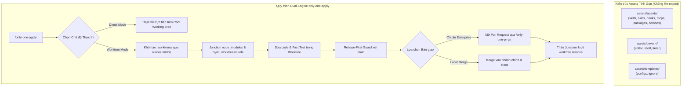

# Concept: Tái Cấu Trúc Toàn Diện Assets (Không Re-export) Và Tích Hợp Dual-Engine Worktree Trong only-one-apply

## 1. Problem & Goal (Vấn đề & Mục tiêu)

### Problem (Điểm nghẽn & Thiếu sót hiện tại)
- **Context & Trigger**: Thư mục `assets/` đang bị phân mảnh thành 11 thư mục phẳng, nhiều thư mục chỉ chứa 1 tệp manifest đơn lẻ; đồng thời quy trình apply thiếu cơ chế cô lập không gian làm việc.
- **Symptom & Defect**: Cấu trúc thư mục rải rác, không gom theo miền nghiệp vụ; việc duy trì các tệp re-export trung gian tạo ra nợ kỹ thuật (technical debt) và dư thừa code; quy trình apply sửa file trực tiếp gây bẩn git status.
- **Root Cause**: Thiếu kiến trúc phân miền nghiệp vụ (Domain-Driven Packaging) triệt để trong `assets/` và thiếu cơ chế Execution Sandboxing cho quy trình apply.
- **Impact / Blast Radius**: Gây khó khăn khi bảo trì thư viện tài nguyên, làm tăng nguy cơ xung đột mã nguồn khi chạy nhiều tác vụ Antigravity song song.

### Goal (Kết quả kỹ thuật mục tiêu)
- **Core Goal**: Tái cấu trúc triệt để thư mục `assets/` về 3 miền nghiệp vụ (`agents/`, `devenv/`, `templates/`), loại bỏ hoàn toàn các tầng re-export trung gian, và tích hợp cơ chế Dual-Engine Git Worktree tự đóng gói trong `only-one-apply`.
- **Acceptance Criteria**:
  - Di chuyển dứt điểm 11 thư mục phẳng về đúng 3 miền: `assets/agents/`, `assets/devenv/`, và `assets/templates/`.
  - Không sử dụng tệp re-export trung gian; cập nhật trực tiếp các đường dẫn import trong `src/` và `test/`.
  - Tự đóng gói trọn vẹn script điều phối (`scripts/worktree-runner.ts`) và template (`templates/worktreeinclude.template`) ngay bên trong `assets/agents/skills/only-one-apply/`.
  - Hỗ trợ chế độ Direct Mode và Worktree Mode (tự sinh `.worktrees/<slug>`, chia sẻ `node_modules` qua NTFS Junction, áp dụng Rebase-First Guard trước khi merge/PR).

## 2. Scope Boundaries (Ranh giới phạm vi)

- **In-Scope**:
  - Tái cấu trúc dứt điểm thư mục `assets/`:
    - `assets/agents/`: `skills/`, `rules/`, `hooks/`, `mcps/`, `packages/`, `combos/`.
    - `assets/devenv/`: `editor/` (từ `vs/`), `shell/` (từ `git/`), `linter/` (từ `eslint-rules/`).
    - `assets/templates/`: `configs/`, `ignore/`.
  - Cập nhật trực tiếp các đường dẫn import trong `src/` và `test/` trỏ thẳng tới cấu trúc mới.
  - Xóa bỏ các thư mục phẳng rác cũ sau khi đã di dời tài nguyên.
  - Bổ sung pattern `.worktrees/` vào mẫu `assets/templates/ignore/git.ignore`.
  - Tự đóng gói module runner và template cấu hình vào `assets/agents/skills/only-one-apply/`.
  - Nâng cấp tài liệu `SKILL.md` của `only-one-apply` với Step 0 phân luồng và Step 5b Rebase Guard.
- **Explicit Out-of-Scope**:
  - Không tạo các tệp facade hay re-export trung gian để giữ tương thích ngược giả.
  - Không phân rã từng file nhỏ trong task thành nhiều worktree con (giữ nguyên hạt nhân 1 Task = 1 Worktree).
  - Không thay đổi logic nghiệp vụ cốt lõi của các tool skills hiện hành.

## 3. Proposed Solution & Core Mechanism (Giải pháp đề xuất & Cơ chế cốt lõi)

- **Core Mechanism**:
  - **Kiến trúc Domain-Driven Assets Triệt để**:
    - Gom nhóm tài nguyên dứt điểm vào 3 thư mục đại diện cho 3 miền: `agents/` (AI Agents), `devenv/` (Môi trường Dev), `templates/` (Mẫu dự án).
    - Cập nhật các câu lệnh import trực tiếp sang đường dẫn chuẩn mới `@assets/agents/...`, `@assets/devenv/...`, `@assets/templates/...`.
  - **Cơ chế Dual-Engine Tự Đóng Gói trong only-one-apply**:
    - Khi kích hoạt, kiểm tra tham số `--worktree` hoặc `--direct` (tự động gợi ý Worktree Mode nếu working tree có tệp uncommitted).
    - Ở chế độ Worktree Mode, `only-one-apply` gọi runner nội bộ để tạo worktree `.worktrees/<slug>`, tạo NTFS Junction cho `node_modules` và đồng bộ file theo `templates/worktreeinclude.template`.
    - Tiến hành sửa đổi mã nguồn và kiểm thử độc lập trong worktree.
    - Áp dụng Rebase-First Guard với nhánh chính; nếu có xung đột, agent phụ trách tự giải quyết ngay trong worktree.
    - Cho phép lựa chọn mở Pull Request qua `/only-one-pr-git` hoặc merge nhanh tại chỗ, sau đó tháo gỡ junction và dọn dẹp worktree an toàn.

- **Cấu trúc Thư mục Assets Mới (Sạch 100%, Không Re-export)**:

```text
assets/
├── agents/                      # MIỀN 1: Hệ sinh thái AI Agent
│   ├── skills/                  # Các gói skill (chứa only-one-apply, only-one-plan...)
│   ├── rules/                   # Các quy tắc agent
│   ├── hooks/                   # Lifecycle hooks
│   ├── mcps/                    # Manifest MCP servers
│   ├── packages/                # Manifest npm packages
│   └── combos/                  # Combo presets
│
├── devenv/                      # MIỀN 2: Môi trường lập trình máy trạm
│   ├── editor/                  # Cấu hình VS Code, Cursor, Antigravity
│   ├── shell/                   # Shell profiles (bash, zsh, git-alias)
│   └── linter/                  # ESLint presets & rules
│
└── templates/                   # MIỀN 3: Mẫu tệp dự án dùng chung
    ├── configs/                 # Template cấu hình dự án
    └── ignore/                  # git.ignore, docker.ignore, npm.ignore
```

- **Conceptual Flow / Domain Model**:



## 4. Critical Risks & Edge Cases (Rủi ro & Xử lý ngoại lệ)

- **Cập nhật thiếu sót đường dẫn import trong `src/` và `test/`**:
  - *Rủi ro*: Sau khi di chuyển thư mục vật lý, một số file vẫn import theo đường dẫn cũ gây lỗi biên dịch TypeScript.
  - *Giải pháp*: Quét toàn bộ codebase bằng regex, cập nhật đồng bộ các câu lệnh import và chạy kiểm thử toàn diện `npm test`.
- **Khóa tệp tin trên hệ điều hành Windows (NTFS File Locking)**:
  - *Rủi ro*: Tiến trình nền giữ khóa junction của `node_modules` khiến lệnh xóa worktree thất bại.
  - *Giải pháp*: Script `worktree-runner.ts` chủ động gọi `unlinkSync` tháo gỡ junction trước khi chạy `git worktree remove`.
- **Xung đột mã nguồn nghiêm trọng khi Rebase**:
  - *Rủi ro*: Nhánh chính có commit xung đột cấu trúc với nhánh task.
  - *Giải pháp*: Không hủy bỏ rebase mù quáng, cô lập trạng thái lỗi trong worktree và kích hoạt `/only-one-conflict` giải quyết.
