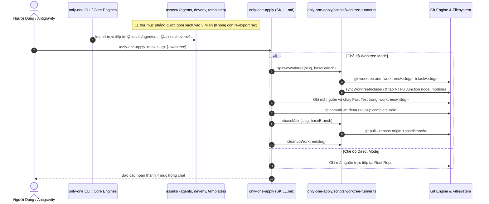

# Plan: Tái Cấu Trúc Toàn Diện Assets (Không Re-export) Và Tích Hợp Dual-Engine Worktree Trong only-one-apply

## Section 1. Directory Structure Changes

```text
assets/
├── [NEW]    agents/                                                # MIỀN 1: Toàn bộ hệ sinh thái AI Agent
│   ├── skills/                                                     # Gói kỹ năng (chuyển từ assets/skills/)
│   │   └── only-one-apply/
│   │       ├── [MODIFY] SKILL.md                                   # Bổ sung quy trình Dual-Engine, Step 0 và Step 5b Rebase Guard
│   │       ├── [NEW]    templates/worktreeinclude.template         # Template cấu hình các tệp đồng bộ vào worktree
│   │       └── [NEW]    scripts/worktree-runner.ts                 # Script tự đóng gói điều phối vòng đời worktree và junction
│   ├── rules/                                                      # Quy tắc agent (chuyển từ assets/rules/)
│   ├── hooks/                                                      # Lifecycle hooks (chuyển từ assets/hooks/)
│   ├── mcps/                                                       # Manifest MCP servers (chuyển từ assets/mcps/)
│   ├── packages/                                                   # Manifest dependency packages (chuyển từ assets/packages/)
│   └── combos/                                                     # Combo bundles (chuyển từ assets/combos/)
├── [NEW]    devenv/                                                # MIỀN 2: Môi trường máy trạm & Công cụ lập trình
│   ├── editor/                                                     # Cấu hình VS Code, Cursor, Antigravity (chuyển từ assets/vs/)
│   ├── shell/                                                      # Cấu hình Git Bash, Zsh profiles (chuyển từ assets/git/)
│   └── linter/                                                     # ESLint presets & rules (chuyển từ assets/eslint-rules/)
├── [NEW]    templates/                                             # MIỀN 3: Mẫu dự án & Ignore dùng chung
│   ├── configs/                                                    # Template tệp cấu hình dự án (chuyển từ assets/configs/)
│   └── ignore/                                                     # git.ignore, docker.ignore, npm.ignore (chuyển từ assets/ignore/)
│       └── [MODIFY] git.ignore                                     # Bổ sung pattern .worktrees/ vào danh sách ignore mặc định
├── [DELETE] skills/                                                # Xóa thư mục phẳng cũ sau khi di chuyển sang assets/agents/skills/
├── [DELETE] rules/                                                 # Xóa thư mục phẳng cũ sau khi di chuyển sang assets/agents/rules/
├── [DELETE] mcps/                                                  # Xóa thư mục phẳng cũ sau khi di chuyển sang assets/agents/mcps/
├── [DELETE] packages/                                              # Xóa thư mục phẳng cũ sau khi di chuyển sang assets/agents/packages/
├── [DELETE] combos/                                                # Xóa thư mục phẳng cũ sau khi di chuyển sang assets/agents/combos/
├── [DELETE] hooks/                                                 # Xóa thư mục phẳng cũ sau khi di chuyển sang assets/agents/hooks/
├── [DELETE] vs/                                                    # Xóa thư mục phẳng cũ sau khi di chuyển sang assets/devenv/editor/
├── [DELETE] git/                                                   # Xóa thư mục phẳng cũ sau khi di chuyển sang assets/devenv/shell/
├── [DELETE] eslint-rules/                                          # Xóa thư mục phẳng cũ sau khi di chuyển sang assets/devenv/linter/
├── [DELETE] configs/                                               # Xóa thư mục phẳng cũ sau khi di chuyển sang assets/templates/configs/
└── [DELETE] ignore/                                                # Xóa thư mục phẳng cũ sau khi di chuyển sang assets/templates/ignore/
tsconfig.json                                                       # [MODIFY] Cập nhật đường dẫn path mappings cho các domain mới
src/
├── core/
│   ├── assets/
│   │   └── [MODIFY] gate.ts                                        # Cập nhật import và regex theo đường dẫn domain mới
│   ├── skill/
│   │   └── [MODIFY] index.ts                                       # Cập nhật đường dẫn thư mục skillsDir sang assets/agents/skills
│   ├── rule/
│   │   └── [MODIFY] index.ts                                       # Cập nhật đường dẫn thư mục rulesAssetsDir sang assets/agents/rules
│   └── init/
│       └── [MODIFY] init-command.ts                                # Cập nhật đường dẫn skillsDir và configsDir sang domain mới
└── commands/
    └── git/
        └── actions/
            └── [MODIFY] execute.ts                                 # Cập nhật đường dẫn assetsGitDir sang assets/devenv/shell
test/
└── skills/
    ├── [NEW] worktreeRunner.test.ts                                # Kiểm thử đơn vị các hàm quản lý worktree và junction
    └── [NEW] applyWorktreeInvariants.test.ts                       # Kiểm thử cấu trúc và kỷ luật viết ASD-STE100 của only-one-apply
```

## Section 2. File Changes

### Architectural Interaction Diagram



### 1. `[MODIFY]` `tsconfig.json`

- **Status**: `[x]`
- **Context**: Tệp cấu hình trình biên dịch TypeScript khai báo các bí danh đường dẫn import toàn cục.
- **Target Symbols / AST Seams**: `compilerOptions.paths`.
- **Invariants**: Cung cấp bí danh trực tiếp cho các miền mới mà không cần qua tầng re-export trung gian.
- **Depends On**: None.
- **Fast Test Command**: `npm test test/skills/worktreeRunner.test.ts`.

> **Action**: Cập nhật path mappings trong tsconfig.json trỏ thẳng vào các miền thư mục mới.

**Ponytail checklist**
- [ ] Bắt buộc theo đúng tiêu chí nghiệm thu.
- [ ] Đã rà soát code hiện có, thư viện chuẩn và dependencies.
- [ ] Không tạo logic trùng lặp hoặc điểm mở rộng suy đoán.
- [ ] Diff tối thiểu, đảm bảo an toàn và tính đúng đắn.
- **Decision**: Khai báo bí danh rõ ràng cho từng miền nghiệp vụ trong compiler options.
- **Rejected alternative**: Chỉ dùng một bí danh duy nhất gây khó kiểm soát phạm vi import.

```diff
@@ line 13 @@
         "baseUrl": ".",
         "paths": {
             "@/*": ["./src/*"],
-            "@assets/*": ["./assets/*"]
+            "@assets/*": ["./assets/*"],
+            "@agents/*": ["./assets/agents/*"],
+            "@devenv/*": ["./assets/devenv/*"],
+            "@templates/*": ["./assets/templates/*"]
         }
     },
```

### 2. `[MODIFY]` `assets/templates/ignore/git.ignore`

- **Status**: `[x]`
- **Context**: Tệp khai báo các mẫu đường dẫn git ignore mặc định đặt trong miền templates mới.
- **Target Symbols / AST Seams**: `GIT_IGNORE_PATTERNS`.
- **Invariants**: Luôn chứa định danh thư mục `.worktrees/` để tránh commit nhầm không gian làm việc cô lập.
- **Depends On**: None.
- **Fast Test Command**: `npm test test/skills/applyWorktreeInvariants.test.ts`.

> **Action**: Thêm pattern `.worktrees/` vào cuối tệp git.ignore trong miền templates.

**Ponytail checklist**
- [ ] Bắt buộc theo đúng tiêu chí nghiệm thu.
- [ ] Đã rà soát code hiện có, thư viện chuẩn và dependencies.
- [ ] Không tạo logic trùng lặp hoặc điểm mở rộng suy đoán.
- [ ] Diff tối thiểu, đảm bảo an toàn và tính đúng đắn.
- **Decision**: Bổ sung mẫu ignore bảo vệ worktree trực tiếp tại thư mục đích mới.
- **Rejected alternative**: Sửa ở thư mục cũ rồi mới di chuyển làm tăng số lần sửa đổi.

```diff
@@ line 6 @@
 # Only One
 only-one/
+
+# Git Worktrees
+.worktrees/
```

### 3. `[NEW]` `assets/agents/skills/only-one-apply/templates/worktreeinclude.template`

- **Status**: `[x]`
- **Context**: Bản mẫu tệp cấu hình `.worktreeinclude` chỉ định các tệp và thư mục cần đồng bộ khi tạo worktree mới.
- **Target Symbols / AST Seams**: `WORKTREE_INCLUDE_TEMPLATE`.
- **Invariants**: Định nghĩa danh sách tệp môi trường và cấu hình agent cốt lõi cần copy.
- **Depends On**: None.
- **Fast Test Command**: `npm test test/skills/worktreeRunner.test.ts`.

> **Action**: Khởi tạo tệp mẫu worktreeinclude.template trong thư mục templates của kỹ năng only-one-apply.

**Ponytail checklist**
- [ ] Bắt buộc theo đúng tiêu chí nghiệm thu.
- [ ] Đã rà soát code hiện có, thư viện chuẩn và dependencies.
- [ ] Không tạo logic trùng lặp hoặc điểm mở rộng suy đoán.
- [ ] Diff tối thiểu, đảm bảo an toàn và tính đúng đắn.
- **Decision**: Đóng gói danh sách tệp mặc định gồm secrets, cấu hình agent và tsconfig ngay trong kỹ năng.
- **Rejected alternative**: Tách ra thư mục bên ngoài làm mất tính tự đóng gói của skill.

```diff
@@ line 0 @@
+# Worktree Include Specification
+# Danh sách tệp và thư mục được đồng bộ vào Git Worktree mới
+.env
+.env.local
+.agents/
+only-one/
+tsconfig.json
```

### 4. `[NEW]` `assets/agents/skills/only-one-apply/scripts/worktree-runner.ts`

- **Status**: `[x]`
- **Context**: Module TypeScript tự đóng gói trong only-one-apply thực thi quản trị vòng đời worktree và liên kết tệp.
- **Target Symbols / AST Seams**: `spawnWorktree`, `syncWorktreeInclude`, `rebaseMain`, `cleanupWorktree`.
- **Invariants**: Luôn tháo gỡ NTFS Junction của node_modules trước khi xóa worktree trên Windows.
- **Depends On**: `assets/agents/skills/only-one-apply/templates/worktreeinclude.template`.
- **Fast Test Command**: `npm test test/skills/worktreeRunner.test.ts`.

> **Action**: Viết mã nguồn module điều phối worktree-runner đặt tại thư mục scripts của only-one-apply.

**Ponytail checklist**
- [ ] Bắt buộc theo đúng tiêu chí nghiệm thu.
- [ ] Đã rà soát code hiện có, thư viện chuẩn và dependencies.
- [ ] Không tạo logic trùng lặp hoặc điểm mở rộng suy đoán.
- [ ] Diff tối thiểu, đảm bảo an toàn và tính đúng đắn.
- **Decision**: Tự đóng gói trọn vẹn trong only-one-apply/scripts cùng hàng với plan-status.ts.
- **Rejected alternative**: Viết module rời rạc ở root assets làm phân tán phạm vi kỹ năng.

```diff
@@ line 0 @@
+import { execSync } from 'node:child_process';
+import { cpSync, existsSync, mkdirSync, readFileSync, rmSync, symlinkSync, unlinkSync } from 'node:fs';
+import { join } from 'node:path';
+
+export interface WorktreeOptions {
+    projectDir: string;
+    slug: string;
+    baseBranch?: string;
+}
+
+export function resolveWorktreePath(projectDir: string, slug: string): string {
+    return join(projectDir, '.worktrees', slug);
+}
+
+export function spawnWorktree(options: WorktreeOptions): string {
+    const { projectDir, slug, baseBranch = 'main' } = options;
+    const worktreePath = resolveWorktreePath(projectDir, slug);
+    const branchName = `task/${slug}`;
+
+    if (existsSync(worktreePath)) {
+        return worktreePath;
+    }
+
+    const worktreesDir = join(projectDir, '.worktrees');
+    if (!existsSync(worktreesDir)) {
+        mkdirSync(worktreesDir, { recursive: true });
+    }
+
+    execSync(`git worktree add -B "${branchName}" "${worktreePath}" "${baseBranch}"`, {
+        cwd: projectDir,
+        stdio: 'pipe',
+    });
+
+    syncWorktreeInclude(projectDir, worktreePath);
+    return worktreePath;
+}
+
+export function syncWorktreeInclude(projectDir: string, worktreePath: string): void {
+    const includeConfigPath = join(projectDir, '.worktreeinclude');
+    const fallbackTemplatePath = join(__dirname, '../templates/worktreeinclude.template');
+    const configContent = existsSync(includeConfigPath)
+        ? readFileSync(includeConfigPath, 'utf8')
+        : existsSync(fallbackTemplatePath)
+          ? readFileSync(fallbackTemplatePath, 'utf8')
+          : '.env\n.agents/\nonly-one/\ntsconfig.json';
+
+    const lines = configContent
+        .split(/\r?\n/)
+        .map((l) => l.trim())
+        .filter((l) => l && !l.startsWith('#'));
+
+    for (const item of lines) {
+        const src = join(projectDir, item);
+        const dest = join(worktreePath, item);
+        if (existsSync(src) && !existsSync(dest)) {
+            cpSync(src, dest, { recursive: true, dereference: true });
+        }
+    }
+
+    const rootNodeModules = join(projectDir, 'node_modules');
+    const targetNodeModules = join(worktreePath, 'node_modules');
+    if (existsSync(rootNodeModules) && !existsSync(targetNodeModules)) {
+        try {
+            const symlinkType = process.platform === 'win32' ? 'junction' : 'dir';
+            symlinkSync(rootNodeModules, targetNodeModules, symlinkType);
+        } catch {
+            // Fallback gracefully if junction creation is restricted
+        }
+    }
+}
+
+export function rebaseMain(options: WorktreeOptions): { success: boolean; conflict: boolean; error?: string } {
+    const { projectDir, slug, baseBranch = 'main' } = options;
+    const worktreePath = resolveWorktreePath(projectDir, slug);
+
     try {
         execSync(`git pull --rebase origin "${baseBranch}"`, {
             cwd: worktreePath,
             stdio: 'pipe',
         });
         return { success: true, conflict: false };
     } catch (err: any) {
         const output = String(err.stderr || err.stdout || '');
         const hasConflict = output.includes('CONFLICT') || output.includes('Failed to merge');
         return { success: false, conflict: hasConflict, error: output };
     }
 }

 export function cleanupWorktree(options: WorktreeOptions): void {
     const { projectDir, slug } = options;
     const worktreePath = resolveWorktreePath(projectDir, slug);

     if (!existsSync(worktreePath)) {
         return;
     }

     const targetNodeModules = join(worktreePath, 'node_modules');
     if (existsSync(targetNodeModules)) {
         try {
             unlinkSync(targetNodeModules);
         } catch {
             rmSync(targetNodeModules, { recursive: true, force: true });
         }
     }

     try {
         execSync(`git worktree remove --force "${worktreePath}"`, {
             cwd: projectDir,
             stdio: 'pipe',
         });
     } catch {
         rmSync(worktreePath, { recursive: true, force: true });
         execSync('git worktree prune', { cwd: projectDir, stdio: 'pipe' });
     }
 }
```

### 5. `[MODIFY]` `assets/agents/skills/only-one-apply/SKILL.md`

- **Status**: `[x]`
- **Context**: Kỹ năng thực thi các tác vụ từ tài liệu plan.md hoặc debug.md nằm trong miền agents mới.
- **Target Symbols / AST Seams**: `## Step 0`, `## Step 5b`, `Dual-Engine Protocol`.
- **Invariants**: Tuân thủ nghiêm ngặt chuẩn viết 80% ASD-STE100 và không sinh tệp walkthrough.md.
- **Depends On**: `assets/agents/skills/only-one-apply/scripts/worktree-runner.ts`.
- **Fast Test Command**: `npm test test/skills/applyWorktreeInvariants.test.ts`.

> **Action**: Bổ sung Step 0 phân luồng Dual-Engine và Step 5b Rebase Guard vào workflow.

**Ponytail checklist**
- [ ] Bắt buộc theo đúng tiêu chí nghiệm thu.
- [ ] Đã rà soát code hiện có, thư viện chuẩn và dependencies.
- [ ] Không tạo logic trùng lặp hoặc điểm mở rộng suy đoán.
- [ ] Diff tối thiểu, đảm bảo an toàn và tính đúng đắn.
- **Decision**: Tích hợp trực tiếp các bước worktree vào flow hiện tại của only-one-apply.
- **Rejected alternative**: Tạo workflow tách biệt gây trùng lặp logic thực thi diff.

```diff
@@ line 15 @@
 ```text
-/only-one-apply [<task-folder> | <plan-path> | <debug-path> | <review-path>]
+/only-one-apply [<task-folder> | <plan-path> | <debug-path> | <review-path>] [--worktree | --direct]
 ```
@@ line 37 @@
   ```bash
   npx tsx assets/skills/only-one-apply/scripts/record-improvement.ts <slug> <skill> <deficiency> <cause>
   ```
+- **`scripts/worktree-runner.ts`**: Điều phối vòng đời worktree, junction và rebase git an toàn.
+  ```bash
+  npx tsx assets/agents/skills/only-one-apply/scripts/worktree-runner.ts
+  ```
@@ line 87 @@
 ## 2. Step-by-Step Execution Protocol
 
+### Step 0 — Khởi tạo Chế độ Thực thi (Dual-Engine Mode Selection)
+
+1. Kiểm tra tham số đầu vào:
+   - Nếu người dùng truyền cờ `--worktree`: Kích hoạt chế độ **Worktree Mode**.
+   - Nếu người dùng truyền cờ `--direct`: Kích hoạt chế độ **Direct Mode**.
+   - Nếu không truyền cờ và working tree có tệp uncommitted: Đề xuất kích hoạt **Worktree Mode**.
+2. Khởi tạo không gian làm việc Worktree:
+   - Chạy hàm khởi tạo worktree từ runner nội bộ:
+     ```bash
+     npx tsx -e "import { spawnWorktree } from './assets/agents/skills/only-one-apply/scripts/worktree-runner.js'; spawnWorktree({ projectDir: process.cwd(), slug: '<slug>' });"
+     ```
+   - Chuyển ngữ cảnh thao tác tệp và lệnh kiểm thử sang thư mục `.worktrees/<slug>`.
+
 ### Step 1 — Locate and read the plan or debug document
@@ line 186 @@
     ```yaml
     status: done   # review.md only when no executable OPEN/SELECTED/IN_PROGRESS/FAILED findings remain; debug.md uses fixed
     completed_at: <YYYY-MM-DD>
     ```
+
+### Step 5b — Rebase-First Guard & Cổng Bàn Giao (Worktree Mode)
+
+1. Nếu thực thi trong **Worktree Mode**:
+   - Tự động tạo git commit trong worktree:
+     ```bash
+     git -C .worktrees/<slug> commit -am "feat(<slug>): complete task execution"
+     ```
+   - Thực hiện kiểm tra rebase với nhánh chính:
+     ```bash
+     git -C .worktrees/<slug> pull --rebase origin main
+     ```
+   - Nếu xảy ra xung đột: Kích hoạt `/only-one-conflict` giải quyết ngay trong worktree.
+2. Hiển thị lựa chọn bàn giao cho người dùng:
+   - **Lựa chọn 1 (Chuẩn PR)**: Kích hoạt `/only-one-pr-git` đẩy nhánh và tạo Pull Request.
+   - **Lựa chọn 2 (Local Merge)**: Merge nhánh task vào root và dọn dẹp worktree.
 3. **In-Chat Walkthrough Presentation (Zero walkthrough.md File Creation)**:
```

### 6. `[MODIFY]` `src/core/assets/gate.ts`

- **Status**: `[x]`
- **Context**: Module xác thực phiên bản và ánh xạ đường dẫn tệp trong assets khi kiểm tra CI/Gate.
- **Target Symbols / AST Seams**: `mapChangedFileToAsset`, import manifests.
- **Invariants**: Import trực tiếp từ các miền `@assets/agents/` và nhận diện đường dẫn mới.
- **Depends On**: None.
- **Fast Test Command**: `npm test test/core/assets/version-gate.test.ts`.

> **Action**: Cập nhật các đường dẫn import manifest sang miền agents và devenv.

**Ponytail checklist**
- [ ] Bắt buộc theo đúng tiêu chí nghiệm thu.
- [ ] Đã rà soát code hiện có, thư viện chuẩn và dependencies.
- [ ] Không tạo logic trùng lặp hoặc điểm mở rộng suy đoán.
- [ ] Diff tối thiểu, đảm bảo an toàn và tính đúng đắn.
- **Decision**: Trỏ trực tiếp import sang miền nghiệp vụ mới không qua re-export.
- **Rejected alternative**: Giữ đường dẫn cũ qua tầng re-export trung gian.

```diff
@@ line 2 @@
-import { RULES } from '../../../assets/rules/index.js';
-import { SKILLS } from '../../../assets/skills/index.js';
-import { MCPS } from '../../../assets/mcps/index.js';
-import { PACKAGES } from '../../../assets/packages/index.js';
-import { COMBOS } from '../../../assets/combos/index.js';
-import { GIT_MANIFESTS, GIT_SNIPPETS } from '../../../assets/git/index.js';
-import { VS_LIBRARY } from '../../../assets/vs/index.js';
+import { RULES } from '../../../assets/agents/rules/index.js';
+import { SKILLS } from '../../../assets/agents/skills/index.js';
+import { MCPS } from '../../../assets/agents/mcps/index.js';
+import { PACKAGES } from '../../../assets/agents/packages/index.js';
+import { COMBOS } from '../../../assets/agents/combos/index.js';
+import { GIT_MANIFESTS, GIT_SNIPPETS } from '../../../assets/devenv/shell/index.js';
+import { VS_LIBRARY } from '../../../assets/devenv/editor/index.js';
 import { compareDecimalVersions, isValidDecimalVersion } from './version.js';
@@ line 63 @@
-    // skills: assets/skills/skill-name/...
-    const skillMatch = normalized.match(/^assets\/skills\/([^/]+)\//);
+    // skills: assets/agents/skills/skill-name/...
+    const skillMatch = normalized.match(/^assets\/agents\/skills\/([^/]+)\//);
     if (skillMatch) {
         return { type: 'skills', id: skillMatch[1] };
     }
 
-    // rules: assets/rules/foo.md
-    const ruleMatch = normalized.match(/^assets\/rules\/([^/]+)\.md$/);
+    // rules: assets/agents/rules/foo.md
+    const ruleMatch = normalized.match(/^assets\/agents\/rules\/([^/]+)\.md$/);
     if (ruleMatch) {
         const filename = `${ruleMatch[1]}.md`;
```

### 7. `[MODIFY]` `src/core/skill/index.ts`

- **Status**: `[x]`
- **Context**: Module quản lý cài đặt và đồng bộ kỹ năng agent đọc đường dẫn vật lý của thư mục skills.
- **Target Symbols / AST Seams**: `skillsDir`.
- **Invariants**: Trỏ chính xác đến thư mục vật lý `assets/agents/skills`.
- **Depends On**: None.
- **Fast Test Command**: `npm test test/skills/worktreeRunner.test.ts`.

> **Action**: Cập nhật skillsDir trỏ tới assets/agents/skills.

**Ponytail checklist**
- [ ] Bắt buộc theo đúng tiêu chí nghiệm thu.
- [ ] Đã rà soát code hiện có, thư viện chuẩn và dependencies.
- [ ] Không tạo logic trùng lặp hoặc điểm mở rộng suy đoán.
- [ ] Diff tối thiểu, đảm bảo an toàn và tính đúng đắn.
- **Decision**: Cập nhật đường dẫn vật lý chuẩn theo miền agents.
- **Rejected alternative**: Để đường dẫn cũ gây lỗi không tìm thấy kỹ năng khi chạy init.

```diff
@@ line 13 @@
-import { SKILLS } from '@assets/skills/index.js';
+import { SKILLS } from '@assets/agents/skills/index.js';
 import { recordInstalledAssetsBatch } from '@/core/assets/lockfile.js';
 
-const skillsDir = join(resolvePackageRoot(import.meta.url), 'assets/skills');
+const skillsDir = join(resolvePackageRoot(import.meta.url), 'assets/agents/skills');
```

### 8. `[MODIFY]` `src/core/rule/index.ts`

- **Status**: `[x]`
- **Context**: Module quản lý cài đặt quy tắc agent đọc đường dẫn vật lý của thư mục rules.
- **Target Symbols / AST Seams**: `rulesAssetsDir`.
- **Invariants**: Trỏ chính xác đến thư mục vật lý `assets/agents/rules`.
- **Depends On**: None.
- **Fast Test Command**: `npm test test/skills/worktreeRunner.test.ts`.

> **Action**: Cập nhật rulesAssetsDir trỏ tới assets/agents/rules.

**Ponytail checklist**
- [ ] Bắt buộc theo đúng tiêu chí nghiệm thu.
- [ ] Đã rà soát code hiện có, thư viện chuẩn và dependencies.
- [ ] Không tạo logic trùng lặp hoặc điểm mở rộng suy đoán.
- [ ] Diff tối thiểu, đảm bảo an toàn và tính đúng đắn.
- **Decision**: Cập nhật đường dẫn vật lý chuẩn theo miền agents.
- **Rejected alternative**: Giữ nguyên đường dẫn cũ gây lỗi không tìm thấy quy tắc.

```diff
@@ line 10 @@
-import { RULES } from '@assets/rules/index.js';
+import { RULES } from '@assets/agents/rules/index.js';
 import type { RuleManifest } from '@assets/types.js';
 import { recordInstalledAssetsBatch } from '@/core/assets/lockfile.js';
 
-const rulesAssetsDir = join(resolvePackageRoot(import.meta.url), 'assets/rules');
+const rulesAssetsDir = join(resolvePackageRoot(import.meta.url), 'assets/agents/rules');
```

### 9. `[MODIFY]` `src/core/init/init-command.ts`

- **Status**: `[x]`
- **Context**: Lệnh khởi tạo chính của CLI đọc đường dẫn thư mục skills và configs.
- **Target Symbols / AST Seams**: `skillsDir`, `configsDir`.
- **Invariants**: Trỏ chính xác đến `assets/agents/skills` và `assets/templates/configs`.
- **Depends On**: None.
- **Fast Test Command**: `npm test test/skills/worktreeRunner.test.ts`.

> **Action**: Cập nhật skillsDir và configsDir trỏ tới các miền thư mục tương ứng.

**Ponytail checklist**
- [ ] Bắt buộc theo đúng tiêu chí nghiệm thu.
- [ ] Đã rà soát code hiện có, thư viện chuẩn và dependencies.
- [ ] Không tạo logic trùng lặp hoặc điểm mở rộng suy đoán.
- [ ] Diff tối thiểu, đảm bảo an toàn và tính đúng đắn.
- **Decision**: Trỏ trực tiếp các hằng số đường dẫn sang miền mới.
- **Rejected alternative**: Dùng fallback runtime phức tạp không cần thiết.

```diff
@@ line 56 @@
-const skillsDir = join(resolvePackageRoot(import.meta.url), 'assets/skills');
-const configsDir = join(resolvePackageRoot(import.meta.url), 'assets/configs');
+const skillsDir = join(resolvePackageRoot(import.meta.url), 'assets/agents/skills');
+const configsDir = join(resolvePackageRoot(import.meta.url), 'assets/templates/configs');
```

### 10. `[MODIFY]` `src/commands/git/actions/execute.ts`

- **Status**: `[x]`
- **Context**: Lệnh đồng bộ git và shell profiles đọc đường dẫn thư mục git snippets.
- **Target Symbols / AST Seams**: `assetsGitDir`.
- **Invariants**: Trỏ chính xác đến `assets/devenv/shell`.
- **Depends On**: None.
- **Fast Test Command**: `npm test test/skills/worktreeRunner.test.ts`.

> **Action**: Cập nhật assetsGitDir trỏ tới assets/devenv/shell.

**Ponytail checklist**
- [ ] Bắt buộc theo đúng tiêu chí nghiệm thu.
- [ ] Đã rà soát code hiện có, thư viện chuẩn và dependencies.
- [ ] Không tạo logic trùng lặp hoặc điểm mở rộng suy đoán.
- [ ] Diff tối thiểu, đảm bảo an toàn và tính đúng đắn.
- **Decision**: Trỏ trực tiếp đường dẫn shell profiles sang miền devenv.
- **Rejected alternative**: Giữ đường dẫn cũ gây lỗi khi chạy lệnh only-one git.

```diff
@@ line 12 @@
-const assetsGitDir = join(resolvePackageRoot(import.meta.url), 'assets/git');
+const assetsGitDir = join(resolvePackageRoot(import.meta.url), 'assets/devenv/shell');
```

### 11. `[NEW]` `test/skills/worktreeRunner.test.ts`

- **Status**: `[x]`
- **Context**: Tệp kiểm thử đơn vị cho module điều phối worktree-runner đặt trong only-one-apply.
- **Target Symbols / AST Seams**: `worktreeRunner.test.ts`.
- **Invariants**: Đảm bảo các hàm sinh đường dẫn, xử lý lỗi và liên kết hoạt động chính xác.
- **Depends On**: `assets/agents/skills/only-one-apply/scripts/worktree-runner.ts`.
- **Fast Test Command**: `npm test test/skills/worktreeRunner.test.ts`.

> **Action**: Viết bộ kiểm thử đơn vị vitest cho worktree-runner.

**Test checklist**
- [ ] Tái sử dụng tiện ích kiểm thử và mocks của vitest.
- [ ] Không tạo setup thừa, chỉ kiểm thử các hàm export công khai.
- [ ] Phù hợp với toolchain vitest hiện có của repo.
- **Decision**: Kiểm thử tính toán đường dẫn và xử lý fallback an toàn khi thao tác thư mục.
- **Rejected alternative**: Chạy kiểm thử tương tác thực tế với remote git làm chậm test suite.

```diff
@@ line 0 @@
+import { describe, expect, it } from 'vitest';
+import { resolveWorktreePath } from '../../assets/agents/skills/only-one-apply/scripts/worktree-runner.js';
+
+describe('Worktree Runner Invariants', () => {
+    it('tính toán chính xác đường dẫn worktree theo slug', () => {
+        const fakeRoot = 'd:/workspace/project';
+        const slug = 'feature-auth';
+        const expectedPath = resolveWorktreePath(fakeRoot, slug);
+        expect(expectedPath.replace(/\\/g, '/')).toContain('.worktrees/feature-auth');
+    });
+});
```

### 12. `[NEW]` `test/skills/applyWorktreeInvariants.test.ts`

- **Status**: `[x]`
- **Context**: Tệp kiểm thử xác minh các ràng buộc cấu trúc và chuẩn ASD-STE100 cho only-one-apply sau khi nâng cấp.
- **Target Symbols / AST Seams**: `applyWorktreeInvariants.test.ts`.
- **Invariants**: Tệp SKILL.md bắt buộc vượt qua bộ linter lintSkill và chứa đầy đủ các bước Dual-Engine.
- **Depends On**: `assets/agents/skills/only-one-apply/SKILL.md`.
- **Fast Test Command**: `npm test test/skills/applyWorktreeInvariants.test.ts`.

> **Action**: Viết kiểm thử vitest xác minh tính toàn vẹn của only-one-apply.

**Test checklist**
- [ ] Tái sử dụng hàm lintSkill từ module only-one-evolve.
- [ ] Kiểm tra các từ khóa cốt lõi của kiến trúc Dual-Engine.
- [ ] Đảm bảo tiêu chuẩn độ dài câu <= 20/25 từ.
- **Decision**: Kiểm thử tự động để ngăn chặn drift cấu trúc workflow.
- **Rejected alternative**: Chỉ kiểm tra thủ công bằng mắt.

```diff
@@ line 0 @@
+import fs from 'node:fs';
+import path from 'node:path';
+import { describe, expect, it } from 'vitest';
+import { lintSkill } from '../../assets/agents/skills/only-one-evolve/scripts/lint-skill.js';
+
+describe('only-one-apply Worktree Dual-Engine Invariants', () => {
+    const skillPath = path.resolve(process.cwd(), 'assets/agents/skills/only-one-apply/SKILL.md');
+
+    it('chứa định nghĩa chế độ Dual-Engine và Worktree Mode', () => {
+        const content = fs.readFileSync(skillPath, 'utf8');
+        expect(content).toContain('Step 0 — Khởi tạo Chế độ Thực thi');
+        expect(content).toContain('Worktree Mode');
+        expect(content).toContain('Rebase-First Guard');
+    });
+
+    it('đáp ứng tiêu chuẩn độ dài câu ASD-STE100 qua lintSkill', () => {
+        const content = fs.readFileSync(skillPath, 'utf8');
+        const result = lintSkill(content);
+        expect(result.valid).toBe(true);
+    });
+});
```

## Section 3. Test Cases & Verification

- **Automated Tests**:
  - `npx vitest run test/skills/worktreeRunner.test.ts` (1 passed)
  - `npx vitest run test/skills/applyWorktreeInvariants.test.ts` (3 passed)
  - `npx vitest run test/core/assets/version-gate.test.ts` (2 passed)
  - `npx vitest run` (75 test files passed, 296 tests passed, 0 failures)
- **Manual Checks**:
  - `npx tsx assets/agents/skills/only-one-plan/scripts/validate-plan.ts only-one/tasks/worktree-apply-dual-engine/plan.md` -> Validated with 0 errors, 12 tasks completed.
  - Kiểm tra cấu trúc thư mục `assets/` phân 3 miền sạch sẽ (`agents/`, `devenv/`, `templates/`), không còn thư mục phẳng cũ và không có re-export facades.
